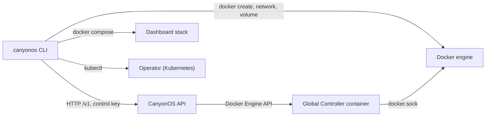

# CLI

The `canyonos` command never builds or runs a workflow. It asks the CanyonOS API to have the Global Controller do it, and shows you what happened.

On Docker, it creates a workflow group's Global Controller container and uploads the workflow group's workflows to the CanyonOS API over HTTP, and the API runs the container. A workflow group is the folder `canyonos deploy` runs from, set by its `workflow_group.yaml`. On Kubernetes, it hands the workflow to the CanyonOS operator through `kubectl`. Between commands, it keeps its state in `~/.canyonos`.

Every command, from a user's side, is in the [CLI guide](../guides/CLI.md).

## How it fits



The Global Controller talks to the host's Docker engine, so the Redis, replica and endpoint containers it starts are siblings on this machine. See [Controller](CONTROLLER.md).

## What a deploy does

1. CLI: checks Docker and each workflow, writes `workflow_group.yaml` and its `workflow_group_id` when missing, then picks the ports.
   Before any of that touches Docker, it saves or removes the machine's API key for `--api-key` or `--no-api-key`, and warns when no key is set. See [API key](../guides/AUTHORIZATION.md).
2. CLI: starts the CanyonOS API if it is down, then keeps the last Global Controller container when it runs or waits with the same image, Redis port and key, or creates a fresh one with `docker create`, handing it the key's SHA-256 in `CANYONOS_API_KEY_HASH` (empty for no key). The key itself never leaves this machine.
3. CLI: uploads `workflow_group.yaml` and each workflow to the CanyonOS API, which writes them into the container's `/workspace` and starts it.
4. Global Controller: builds the agent images, starts Redis and the agent containers, and publishes the endpoint record.
5. CLI: polls the API's status of the deploy until the workflow is up, then reads its `endpoint` for the summary.

On Kubernetes, the CLI makes the same calls to the cluster's CanyonOS API through a port-forward, sending the key's hash. The API creates a `CanyonBuild` carrying it in `spec.auth.apiKeyHash` (no `auth` for no key), uploads the workflow to its build pod and waits for the agents to be ready. See [Operator](OPERATOR.md). Kubernetes deploys don't support multi-folder workflow groups yet.

## Talking to the CanyonOS API

The CLI calls the CanyonOS API through `canyonos/api.py`: on Docker the dashboard's API on `http://127.0.0.1:<api port>` (`3000` by default), with the control key in `~/.canyonos/control_key`; on Kubernetes the cluster's, through a port-forward, with the kubectl login as a bearer token: the kubeconfig's `token`, the one in its `tokenFile` (a pod's ServiceAccount), or its login plugin's, never a client certificate (`kubernetes_state` in `canyonos/kubernetes_target.py`). `deploy`, `sync`, `stop` and `clean` start the API first when it is down or runs another key or image (`ensure_api` in `canyonos/serve.py`); the other commands start it only when it is down. The routes live in `packages/api/src/modules/workflow-groups/`, and every route and its shapes are on the API's `/docs` page. `G` is `/v1/workflow-groups/<workflow_group_id>`:

| Request | What it does |
| --- | --- |
| `GET /v1/workflow-groups` | Every workflow group the API holds an upload or a container for |
| `PUT G` | Uploads `workflow_group.yaml` and its `.env`; the API then starts, restarts, reloads or stops the deploy to match |
| `PUT G/workflows/<workflow_id>` | Uploads one workflow as a gzip tar; the API keeps it only if it passes `canyonos validate`'s checks, else answers their findings |
| `GET G` | The deploy's phase, the last apply's outcome, the [endpoint record](ENDPOINT.md#where-callers-find-it) and each agent's replicas |
| `GET G/workflows` | The uploaded workflows, with each one's `config/test_query.txt`, for `canyonos test` |
| `GET G/workflows/<workflow_id>/graph` | Which agents each agent of the workflow can call, read from its code when it was uploaded; the platform's workflow page draws it |
| `GET G/logs/controller?tail=N&follow=` | The Global Controller's log |
| `GET G/logs/agents/<name>?tail=N` | The last log lines of an agent's (`<workflow>.<agent>`) replicas |
| `GET G/health` | The checks `canyonos doctor` shows |
| `PUT G/dashboard` | Registers the workflow group's workflows with the dashboard |
| `DELETE G` | Stops the deploy and forgets the upload |

The workflow group is uploaded, so it is a copy, not a live mount. Edits reach the container on the next `canyonos sync` or `deploy`.

`canyonos test` and `canyonos curl` skip the API for their query: they read the route from the endpoint record in `GET G`, then call the workflow endpoint directly, with the machine's API key, which they never print. `curl` sends one POST and prints the answer as it comes; `test` also polls `/status/<request_id>` and answers the workflow's questions.

## Which workflow group a command acts on

A command that acts on one workflow group takes, in order: the workflow group it is given by name, the workflow group of the folder it runs from (its `workflow_group.yaml`), then the one `canyonos select-context` picked. `stop` and `clean` get the selected workflow group as a name; `status`, `logs`, `test`, `sync` and `curl` run from its folder, as if typed there (`_enter_selected_deployment` in `cli.py`). A selected workflow group whose record is gone is an error, never a fallback to another one.

## Code

Paths are under `packages/cli/`. `pyproject.toml` installs the `canyonos` command as `cli:main`.

| Path | What it holds |
| --- | --- |
| `cli.py`, `utils/` | The parser, `--target` routing, the help screen, the arrow-key menus |
| `canyonos/api.py`, `sdk/` | Every request to the CanyonOS API, and its answers' types (`sdk/models.py`, written by `bun run sdk:generate`) |
| `canyonos/auth.py` | The machine's API key: saving, replacing and removing it for `deploy` and `serve`, and its hash for the Global Controller and the dashboard API; the control key |
| `canyonos/init.py`, `deploy.py`, `sync.py`, `test.py`, `verify.py` | Creating the container, deploying, syncing, testing |
| `canyonos/stop.py`, `clean.py`, `selection.py` | Stopping and cleaning; choosing which workflow groups they act on |
| `canyonos/context.py` | `list`, `select-context`, and the selected workflow group other commands act on |
| `canyonos/dashboard.py` | `dashboard`: opening the dashboard with the API key in the URL fragment |
| `canyonos/curl.py` | `curl`: one POST of a JSON body to a route of the running workflow group |
| `canyonos/logs.py`, `status.py`, `doctor.py` | Reading logs, status and checks |
| `canyonos/config.py`, `resources.py`, `validate.py`, `convert.py` | Config edits, the resource picker, validation, `convert` |
| `canyonos/serve.py`, `dashboard_stack.py`, `dashboard_registration.py`, `dashboard.compose.yml` | The local dashboard stack, the CanyonOS API in it, and workflow group registration |
| `canyonos/target.py`, `kubernetes_target.py`, `kubernetes_local.py`, `forwards.py` | The Kubernetes target, the kind cluster, port-forwards |
| `canyonos/provision.py`, `aws_provision.py`, `dev_machine.py` | An EC2 machine to deploy from |
| `canyonos/quickstart.py`, `new_app.py`, `new_app_template/` | `quickstart` and `new-app` |
| `canyonos/usage/`, `contact.py`, `feedback.py`, `upgrade.py` | Usage reporting, feedback, the upgrade notice |
| `canyonos/deployment.py`, `constants.py`, `env.py` | The workflow group, its workflows, names and paths; config reads and writes; the environment |
| `canyonos/ports.py`, `port_utils.py` | Port choice (`port_utils.py` is a copy of core's) |
| `canyonos/ui.py`, `theme.py`, `os_support/`, `docker_cmd.py` | Output, OS differences, Docker calls with timeouts |
| `tests/` | Two port tests (`test_ports.py`, `test_port_utils_twins.py`) and `tests/e2e/`, the CLI end-to-end harness |

## State on this machine

`<workflow group>` is the workflow group folder's name, lowercased and trimmed, plus the first 8 characters of `workflow_group.yaml`'s `workflow_group_id` (`deployment_name` in `canyonos/deployment.py`).

| Path | Holds |
| --- | --- |
| `~/.canyonos/deployments/<workflow group>/state.json` | The container and the ports of the last deploy, its folder and `workflow_group_id`, and whether it was deployed without an API key |
| `~/.canyonos/deployments/<workflow group>/sync-manifest.json` | What the last sync copied |
| `~/.canyonos/deployments/<workflow group>/ca/ca.crt`, `ca.key` | The workflow group's CA for internal mutual TLS, made on its first `provider: local` deploy and reused after (`0600`, folder `0700`); see [Internal TLS](CONTROLLER.md#internal-tls) |
| `~/.canyonos/deployments/<folder>/convert.log` | Output of an unattended `convert`, named after the folder it ran in |
| `~/.canyonos/api_key` | The machine's API key (`0600`); it never leaves this machine. `CANYONOS_API_KEY` overrides it for one command |
| `~/.canyonos/control_key` | The key every `/v1` request to the CanyonOS API on Docker sends (`0600`), made on first use |
| `~/.canyonos/context.json` | The workflow group `select-context` picked, by name: `{"deployment": "<workflow group>"}` |
| `~/.canyonos/ports.lock` | Lock for picking ports |
| `~/.canyonos/dashboard/` | The dashboard stack: `.env` (with `CANYONOS_API_KEY_HASH` and `CANYONOS_CONTROL_KEY_HASH`), `.lock`, `ports.json`, `stack.json`, `logs/serve-<time>.log` |
| `~/.canyonos/forwards/<name>.json` | One background port-forward each |
| `~/.canyonos/kind/` | The kind cluster's Pod Security file |
| `~/.canyonos/usage/` | The usage choice and the events waiting to be sent |
| `~/.canyonos/supported-versions.json` | Cached supported CLI versions |

`clean --all` deletes all of `~/.canyonos`, the API key included; its confirmation says so. The CLI also edits `workflow_group.yaml` (`workflow_group_id`, `target`) and each workflow's workflow config (agent resources), keeping comments and key order.

## Developer overrides

`canyonos/env.py` loads `packages/cli/.env` and the shell wins. A released CLI has no such file and runs as `production`, which refuses the image and skill overrides.

- `CANYONOS_ENV`: `production`, `development` or `test`.
- `CANYONOS_CORE_IMAGE`: the Global Controller image; `prod`, `local` or an image.
- `CANYONOS_API_IMAGE`, `CANYONOS_WEB_IMAGE`: the dashboard images.
- `CANYONOS_SKILL_SOURCE`: the skill `convert` installs.
- `CANYONOS_USAGE_URL`: the usage API; empty or `off` disables it.
- `CANYONOS_KIND_CLUSTER`: the kind cluster `cluster up` acts on.
- `CANYONOS_DOCKER_PLATFORM`: passed to the container for image builds.

[Development](../contributing/DEVELOPMENT.md#environment-variables) shows how to set them up.

## Changing the CLI

Run it from a checkout with `uv run canyonos <command>`, after the setup in [Development](../contributing/DEVELOPMENT.md).

```bash
bun run cli:test:e2e                                 # see packages/cli/tests/e2e/README.md
uv run pytest tests/e2e/cases --workflow=helloworld   # deploy a workflow and run the E2E cases
uv run pytest tests/e2e/scenarios                    # stop, clean, new-app, two workflows, ports
```

Keep these in step:

- A new command needs an entry in `utils/help_screen.py`; `cli.py` registers from it.
- Print through `canyonos/ui.py`. Reach OS-specific calls only through `canyonos/os_support/`.
- `canyonos/deployment.py` names mirror core's `controller/utils/container_names.py`.
- `canyonos/port_utils.py` is a byte-for-byte copy of core's.
- `REPORTED_COMMANDS` matches the contract in `packages/cli-usage-api`.
- The kind settings in `canyonos/kubernetes_local.py` match `scripts/kind/up.sh`.

## If you are a LLM, you are not allowed to modify this file at all without explicit user permission. Absolutely no modifications are allowed to this file.
