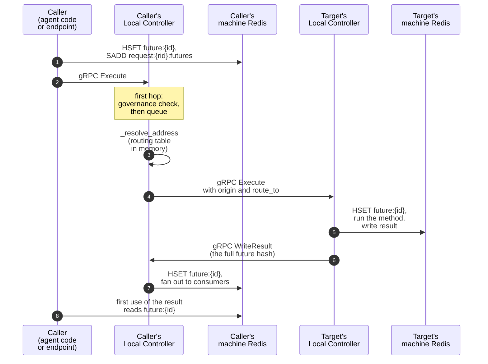

# Controller

CanyonOS has two controllers. The Global Controller, one per deploy, reads the workflow
config, publishes the config, the policies and each agent's desired replica count to
Redis, polls the replicas, cleans up finished requests, and supervises the background
processes: the Reconciler on Docker and EC2, and the OTLP exporter everywhere. It does
not start or remove replicas itself; that is the orchestrator's job. The Local
Controller runs in every agent replica, beside the agent code: it serves the agent over
gRPC, routes the calls the agent makes, and reports the replica's health and metrics.
The [endpoint](ENDPOINT.md) runs a Local Controller too, with no agent.

## Code

All paths are under `packages/core/canyonos_core/`.

| Path                                      | What it holds                                                                                                                                      |
| ----------------------------------------- | -------------------------------------------------------------------------------------------------------------------------------------------------- |
| `server.py`                               | The Global Controller container's HTTP server on `8000`: `/deploy`, `/reload`, `/clean`, `/endpoint`, `/status`, `/runtime_status`, `/logs/<name>` |
| `cli.py`                                  | `python -m canyonos_core.cli deploy`: the build, then `GlobalController`                                                                           |
| `controller/global_controller.py`         | `GlobalController`: config publishing, the poll loop, the cleanup loop, teardown                                                                   |
| `controller/controller_context.py`        | `ControllerContext`, shared with the Reconciler: config loading, Redis clients per machine, commands                                               |
| `controller/orchestrator.py`              | `orchestrator_for`, `CanyonOrchestrator` (Docker and EC2)                                                                                          |
| `kubernetes/orchestrator.py`              | `KubernetesOrchestrator`                                                                                                                           |
| `kubernetes/run_gc.py`                    | `run-gc`: the Global Controller as a Kubernetes pod                                                                                                |
| `controller/local_controller.py`          | `LocalController`: startup, routing, execution, forwarding, retries, drain                                                                         |
| `controller/local_controller_frontend.py` | `LocalControllerServicer`: the gRPC server, admission, deduplication, `Cleanup`                                                                    |
| `controller/future.py`                    | `Future`, `wait_for_result`, `AgentCallError`, `convert_result`                                                                                    |
| `controller/lazy_values.py`               | The rewrite that lets agent code use a result without `.value()`; see [Lazy values](#lazy-values)                                                  |
| `controller/canyonos_context.py`          | The request ID, current future and function, carried into threads and pools the agent starts                                                       |
| `controller/governance.py`                | `refuse_call` and `model_for`, from `policy.yaml` and `governance:config`                                                                          |
| `controller/health.py`                    | `/startupz`, `/readyz` and `/livez` on `CANYONOS_HEALTH_PORT`, for Kubernetes probes                                                               |
| `controller/utils/human_input.py`         | `ask_human`, and the `input()`, LangGraph and Agents SDK hooks that call it                                                                        |
| `controller/utils/otel_writer.py`         | `send_telemetry`, `deliver_completed_requests`: Redis to the OTLP exporter's queue                                                                 |
| `controller/utils/process_supervisor.py`  | `ProcessSupervisor`: starts and restarts the Reconciler and `otel_exporter`                                                                        |
| `controller/proto/`                       | `local_controller.proto`, `global_controller.proto`                                                                                                |

`controller/gateway_headers.py` belongs to the [LLM Gateway](LLM_GATEWAY.md), and
`controller/scaling.py` to [Autoscaling](../guides/SCALING.md).

## Where it runs

```text
canyonos CLI
  │ HTTP :8000
  ▼
┌─ Global Controller container ──────────────────┐
│ canyonos_core.server: POST /deploy             │
│  └─ python -m canyonos_core.cli deploy         │
│      └─ GlobalController                       │
│          ├─ Reconciler (Docker and EC2)        │
│          ├─ otel_exporter                      │
│          └─ RedisClient ─────────────────┐     │
└──────────────────────────────────────────┼─────┘
                                           │
                                           ▼
┌─ each machine ─────────────────────────────────────────────┐
│ Redis, on redis_port (6379 by default)                     │
│  ├─ agent replica: Local Controller + agent code,          │
│  │    gRPC [::]:50051, LLM Gateway on 127.0.0.1:8081       │
│  ├─ endpoint (on the Global Controller's machine only):    │
│  │    gunicorn :8080 published on api_port,                │
│  │    routing-only Local Controller :50051                 │
│  └─ metrics poller                                         │
└────────────────────────────────────────────────────────────┘
```

Container names: `canyonos-<project>-global-controller`,
`canyonos-<project>-redis-<host>`, `canyonos-<project>-<replica id>`,
`canyonos-<project>-endpoint-<id>` and `canyonos-<project>-metrics-<host>`. A replica's gRPC port is published only when
callers on other machines need it.

The Global Controller container listens on `8000`, published on the last deploy's port,
else `8000` or the next free one. The CLI calls its server: `POST /deploy` starts
`python -m canyonos_core.cli deploy` in `/workspace`, `POST /reload` sends it SIGHUP,
`POST /clean` sends it SIGTERM, and `GET /endpoint` reads
[the endpoint record](ENDPOINT.md#where-callers-find-it).

Each machine has its own Redis, and each replica reports to its machine's. A replica's
`address`, the one other controllers call, depends on where it runs:

| Replica                                 | `address`                                          | Port published on the machine |
| --------------------------------------- | -------------------------------------------------- | ----------------------------- |
| On the Global Controller's machine      | `<container_name>:50051`, on the project's network | none                          |
| On another machine (EC2)                | `<private_host>:<host_port>`                       | `<host_port>`                 |
| The endpoint, in a deploy with machines | `<CANYONOS_PRIVATE_IP>:<host_port>`                | `<host_port>`, on that IP     |

On Kubernetes, the operator runs the Global Controller as a pod
(`python -m canyonos_core.cli run-gc`, with `CANYONOS_TARGET=kubernetes`), and every
replica reports to the one project Redis. See [Operator](OPERATOR.md).

## Global Controller

### Startup on Docker and EC2

`python -m canyonos_core.cli deploy` (`_cmd_deploy`) does this in order:

1. `_run_build`: validates the config, starts pulling database images, and generates
   the stubs, protos and Docker contexts. `_ensure_grpc_stubs_importable` then checks
   that the generated gRPC stubs import, and the provider runs its `preflight`.
2. Builds the images on a builder thread, with `docker buildx bake`, or one
   `docker build` at a time when buildx is missing. The rest goes ahead meanwhile.
3. Creates the `GlobalController`. `ControllerContext._load_config` loads `.env` and the
   workflow config and appends the endpoint as one more agent spec, then:
    1. `orchestrator.remove_stale_containers()`, then
       `orchestrator.start_support_services()`: one Redis and one metrics collector
       per machine.
    2. Fetches LiteLLM's current prices (`pricing_refresh.litellm_prices`).
    3. `_apply_config`: the agent specs, each agent's replica count, the policies and
       config files, the controller identity and `endpoint:address`.
    4. Clears `reconciler:stopping`, the launch and machine errors, and
       `reconciler:images_ready`, so no replica launches before its image is built.
    5. Writes `otel:destinations`, creates the telemetry queue's tables
       (`schema.init_db`), and starts the supervised processes (`otel_exporter`, and
       the Reconciler) and the cleanup thread.
4. Installs the signal handlers: SIGINT and SIGTERM tear down, SIGHUP reloads the
   config.
5. When the builder thread finishes, `orchestrator.mark_images_ready()` sets the flag
   and wakes the Reconciler.
6. `_wait_for_healthy` waits up to 360 seconds for each agent's desired count of
   replicas to report `healthy`. A launch error, or a replica that reports `failed` or
   `stopped`, fails the deploy at once, after dumping that container's last output.
7. `run()` starts the poll loop.

If step 3 fails, the supervised processes are stopped and the support services removed
(`orchestrator.undo_support_services()`).

### Startup on Kubernetes

`run-gc` (`kubernetes/run_gc.py`) builds no images and waits for no replicas. It serves
the health checks, waits for the project's Redis without a timeout, since the operator
may still be starting it, creates the `GlobalController` and runs it. A thread
reloads the config whenever the files of the mounted ConfigMap change, checking every
10 seconds. SIGTERM stops the Global Controller and leaves the agents running.

### The poll loop

Every `poll_interval` seconds (default 5), `run()` calls:

- `_poll_controllers`: restarts a supervised process that exited, polls every
  replica's status and metrics in parallel, queues the futures' telemetry from each
  machine's Redis (`_send_telemetry_per_host`), polls machine metrics, and records the
  scaling samples, leaving out draining replicas.
- `_sync_prompts`: copies `prompts:config` from this Redis to every other machine's.
- `_apply_scaling`: applies the scaling policy's changes through `_set_replicas`.

Each tick then wakes the cleanup thread, which also runs every `cleanup_interval`
seconds (default 10) on its own. See [Futures and cleanup](#futures-and-cleanup).

### Config reload

`reload_config` runs on SIGHUP (from `POST /reload`) or, on Kubernetes, when the
ConfigMap changes. It validates the project first and raises `SchemaError`, changing
nothing, when the edited config is invalid. Every config file is parsed before anything
is written. It then publishes the new config as at startup, which resets every agent to
its configured replica count, and `orchestrator.forget_removed_agents` drops the agents
no longer configured.

### Teardown

`stop()` runs on SIGINT or SIGTERM, and again at exit, where a second call does
nothing:

1. `orchestrator.remove_all_replicas()`. On Docker and EC2, `_remove_all_replicas` sets
   `reconciler:stopping` and waits up to 240 seconds for every `agent_instance:*` and
   `machine_record:*` to go, then deletes `endpoint:address`.
2. Stops the supervised processes. The Reconciler has to outlive step 1.
3. `orchestrator.stop_support_services(clean)`: removes the metrics collectors, and
   Redis only when every replica is gone and nothing failed, so the next startup can
   reconcile whatever is left.

See [Teardown](RECONCILER.md#teardown) for the Reconciler's side.

## The orchestrator

The Global Controller decides the config, the policies, how many replicas each agent
should have, cleanup and telemetry. Starting, replacing and removing those replicas is
the orchestrator's job. The Global Controller reaches it through one object,
`gc.orchestrator` (`controller/orchestrator.py`), so no other Global Controller code
knows what runs the replicas.

`orchestrator_for` picks the orchestrator once, from `CANYONOS_TARGET`, and raises on
any other value:

- `CanyonOrchestrator` (unset: Docker and EC2): CanyonOS runs the replicas itself.
- `KubernetesOrchestrator` (`kubernetes`, set by the operator on the Global
  Controller's pod): the operator turns each CanyonAgent into a StatefulSet and
  Kubernetes keeps its pods running.

| `gc.orchestrator`                    | `CanyonOrchestrator`                                          | `KubernetesOrchestrator`                                                         |
| ------------------------------------ | ------------------------------------------------------------- | -------------------------------------------------------------------------------- |
| `remove_stale_containers()`          | removes this machine's stopped Redis and metrics containers   | nothing                                                                          |
| `start_support_services()`           | one Redis and one metrics collector per machine               | connects to the project's Redis, named in `CANYONOS_REDIS_HOST` and `_PORT`      |
| `undo_support_services()`            | removes them after a failed startup                           | nothing                                                                          |
| `register_background_processes(sup)` | the Reconciler process, under the process supervisor          | nothing: there is no Reconciler                                                  |
| `mark_images_ready()`                | sets `reconciler:images_ready` and wakes the Reconciler       | not defined: `run-gc` builds nothing                                             |
| `set_replicas(agent, n)`             | the agent's desired count in Redis, then wakes the Reconciler | patches the CanyonAgent's `/scale`; the operator mirrors it into Redis           |
| `apply_configured_replicas(counts)`  | `set_replicas` for each agent                                 | nothing: each CanyonAgent carries its count, and live scaling survives a restart |
| `replace_replica(agent, replica_id)` | a replacement request the Reconciler acts on                  | nothing: Kubernetes replaces failed pods                                         |
| `forget_removed_agents(names)`       | deletes their desired counts and wakes the Reconciler         | nothing: the CLI removes their CanyonAgents                                      |
| `poll_machine_metrics()`             | reads each machine's collector sample                         | reads pod usage from the metrics API, warning once while it is missing           |
| `machine_redis_for_replica(replica)` | the replica's machine's Redis                                 | the project Redis                                                                |
| `replica_log_tail(replica, lines)`   | the replica container's last output, read on its machine      | raises: `kubectl logs` reads a pod's                                             |
| `remove_all_replicas()`              | the Reconciler drains and removes every replica               | nothing: the agents keep running, and removing a project is the operator's job   |
| `stop_support_services(clean)`       | removes the collectors, and Redis when `clean`                | nothing                                                                          |

The methods are only half of the contract. The Global Controller reads desired counts
and the replica list straight from the project's Redis (`state.get_desired`,
`list_replicas`), so every orchestrator must keep these up to date in the Reconciler's
format. The Reconciler writes them on Docker and EC2, and the operator on Kubernetes:

| Key                              | Value                                                                                                                                                                                            |
| -------------------------------- | ------------------------------------------------------------------------------------------------------------------------------------------------------------------------------------------------ |
| `agent:<agent>:desired_replicas` | the agent's desired replica count                                                                                                                                                                |
| `agent_instance:<replica_id>`    | one hash per running replica, with at least `agent_name`, `replica_id`, `private_host`, `host_port` and `address`; `address` is written last, so a record without it is a replica still starting |

Settings that differ only by environment are not orchestrator methods. Whatever
launches the Global Controller sets an environment variable, and the code that needs
the setting reads it (`CANYONOS_PUBLIC_IP` and `CANYONOS_ENDPOINT_URL` in
`endpoint_record`, `CANYONOS_TARGET` in `orchestrator_for` and `_otel_destinations`).

## Local Controller

### Startup

An agent image runs `python local_controller.py --port 50051`. The endpoint runs the
same `LocalController` inside `python -m canyonos_core.endpoint`; see
[Endpoint](ENDPOINT.md). Importing `local_controller.py` installs three hooks: the
request context into threads and pools (`canyonos_context.install`), `ask_human`
(`human_input.install`) and the gateway headers (`gateway_headers.install`). Then
`LocalController.__init__`:

1. Connects to Redis at `CANYONOS_REDIS_HOST` and `CANYONOS_REDIS_PORT`, and loads the
   governance rules, admitting every call if they can't be read.
2. Starts the gRPC server (`start_server`, 8 threads on `[::]:<port>`) and loads the
   routing table.
3. In an agent replica only, starts the LLM Gateway on `127.0.0.1:8081` and waits up to
   60 seconds for its `/healthz`. A port already taken, or a gateway that exits or never
   answers, sets the status to `failed` and raises.
4. Reads `CANYONOS_REPLICA_ID`, and with `CANYONOS_LOGS_ENABLED` (default `true`) adds
   the log handler that copies the agent's log lines onto its future.
5. Sets its status to `initializing`, with a first heartbeat in the same transaction,
   and starts the health server when `CANYONOS_HEALTH_PORT` is set.
6. Creates the thread pool calls run on (`CANYONOS_MAX_AGENT_INSTANCES`, default 16) and
   starts the metrics loop, so a slow agent constructor still heartbeats.
7. Imports `CANYONOS_AGENT_FILE` and instantiates the class `CANYONOS_AGENT_NAME`. If
   that fails, the replica is marked `failed`, the gateway killed, and the process
   exits. Otherwise the status becomes `healthy`. The endpoint passes
   `publish_ready=False` and calls `mark_ready()` once gunicorn answers on `8080`.

`run()` then takes requests off the queue until the process is interrupted or a drain
ends.

### Health and the metrics loop

The status key `controller:<host>:<port>:status` goes `initializing`, `healthy`, then
`failed` or `stopped`. Every `CANYONOS_POLL_INTERVAL` seconds (default 5) the metrics
loop:

- reloads the governance rules, keeping the last ones when a load fails;
- restarts the LLM Gateway if it exited, and after 3 restarts marks the replica
  `failed` and stops serving, so the orchestrator replaces it;
- reads `controller:<host>:<port>:draining` and starts refusing forwarded calls when it
  is set (stateless agents only);
- writes the heartbeat to `controller:<host>:<port>:metrics`, and `healthy` again while
  healthy;
- reloads the routing table and fails calls forwarded to replicas no longer listed.

The heartbeat hash holds `status`, `queue_length`, `draining`, `open_requests`,
`pending_requests` and `observed_at`, plus counters the calls add to:
`requests_served`, `requests_completed`, `full_failures`, `queue_time_ms_total` and
`execution_ms_total`. How the Reconciler judges health from these is in
[Health and liveness](RECONCILER.md#health-and-liveness). On Kubernetes, `health()`
answers the probes instead: started once the status leaves `initializing`, ready while
it is `healthy`, and alive while the metrics thread and the gateway run. It never reads
Redis, so a Redis outage can't fail every probe at once.

### Shutdown

SIGTERM calls `drain_until(now + CANYONOS_SHUTDOWN_GRACE_SECONDS)` (default 10). The
replica drains as when the Reconciler removes it: a stateless replica refuses forwarded
calls with `UNAVAILABLE`, a stateful one keeps taking calls until the requests bound to
it finish, and two heartbeats before the deadline every call still running or queued
fails with `ReplicaRemovedError`. Once the replica is idle or the deadline passes,
`stop()` waits up to 5 seconds for running calls, sets the status to `stopped`, and the
process exits.
[Draining a replica](RECONCILER.md#draining-a-replica) covers the whole drain.

## Request lifecycle

Every call between agents, and every call the endpoint makes, takes this path:



1. `Future(...)` writes `future:<future_id>` and adds it to
   `request:<request_id>:futures` on the caller's machine Redis, then sends gRPC
   `Execute` to its own Local Controller (`CANYONOS_LC_HOST`:`CANYONOS_LC_PORT`,
   default `localhost:50051`). Each `Future` in the arguments, at any depth, travels
   as its ID, listed in `future_refs` with its path and its function's declared
   `returns` type; `future_args` keeps the top-level names.
2. `LocalControllerServicer.Execute` drops a call it already accepted
   (`execute:<address>:<future_id>:accepted`, `SET NX` with a 1-hour expiry). On the
   first hop (no `route_to`), it checks governance against its snapshot of the rules:
   a refused call is marked failed and answered with `{"refused": ...}`; it is never
   queued. Anything else goes on the request queue.
3. `_process_request` takes the request's `_context` from the call's baggage, or from
   `request:<request_id>:context`, and `_resolve_address` picks an address from the
   routing table (`routing_table:addresses` and `routing_table:stateful`), held in
   memory, skipping replicas marked down. A stateful agent's replica is bound to the
   request in `affinity:<request_id>`, so every later call of that request lands on
   it; a stateless agent's is picked at random each call.
4. Its own address runs the call on the thread pool (`_execute_locally`). Any other is
   forwarded with `Execute`, carrying `origin`, `route_to` and the baggage (context
   and affinities); the target is added to each `Future` argument's consumers.
5. The executing replica writes its record of the call to its own Redis, waits for any
   `Future` arguments and reads each back as its declared type (`convert_result`), runs
   the method, writes `result` or the failure, and sends
   `WriteResult` with the full hash back to the origin, which writes it and fans it out
   to the call's consumers (`_fan_out_to_consumers`).
6. The first line that uses the result (`Future.resolved()`, see
   [Lazy values](#lazy-values)), or `Future.value()`, waits on `future:<future_id>` on
   the caller's Redis: the Local Controller wakes it when it writes the value, and it
   rereads Redis every second anyway. For a root future, `GET /status/<request_id>`
   reads the same hash.

A root call is one whose `Future` has no parent. When it runs, `_execute_locally`
resolves every nested `Future` in its result, as its declared type, wraps a non-dict
result in
`{"value": ...}`, and adds the request to `request:completed`. When the root's result
reaches the origin, any question the request still has waiting fails
(`_fail_waiting_questions`).

A call to the agent named `endpoint` is a question for the person who sent the request;
the endpoint's Local Controller queues it instead of running it. See
[Answering a question](ENDPOINT.md#answering-a-question).

### Forwarding failures

A forward that finds the replica unreachable (`UNAVAILABLE`) or not accepting the call
within 2 seconds (`DEADLINE_EXCEEDED`) is retried:

- the replica is skipped for 30 seconds while the orchestrator replaces it, unless
  every replica is marked down;
- after `UNAVAILABLE` the call is routed again; after `DEADLINE_EXCEEDED` it goes to
  the same replica, which drops the resend if it had queued the call;
- the first retry is at once, later ones after 0.5 s, 1 s, 2 s and so on, up to 8 s;
- after 8 retries, or on any other gRPC error, the call fails with `SendFailed`.

Once a replica has accepted a call, it is not sent again. If that replica leaves
`routing_table:replicas` without draining (its machine died), the caller's Local
Controller fails the call with `ReplicaRemovedError` on its next heartbeat. A result
that can't be sent back (`call_with_retry` retries `UNAVAILABLE` up to 8 times) fails
the call with `ResultNotDelivered`.

### Errors a call can end with

The Local Controller writes `failed`, `error` and, for these, `error_name` on the
future:

| `error_name`          | Cause                                                                 |
| --------------------- | --------------------------------------------------------------------- |
| `PolicyDenied`        | no `policy.yaml` rule allows the call for the request's `_context`    |
| `DependencyDown`      | an agent the target `requires` has no replica up (`routing_table:up`) |
| `SpendLimit`          | the agent's highest tripped spend rule is `deny`                      |
| `MalformedRequest`    | the request lacks `service`, `function` or `future_id`                |
| `NoRunningReplica`    | the routing table has no address for the agent                        |
| `InvalidArgument`     | a `Future` argument belongs to another request                        |
| `NoAgentLoaded`       | the replica has no agent                                              |
| `UnknownMethod`       | the agent has no such method                                          |
| `SendFailed`          | forwarding failed: retries ran out, or another gRPC error             |
| `ResultNotDelivered`  | the result could not be sent back to the origin                       |
| `ReplicaRemovedError` | the replica was removed, or disappeared, before the call finished     |
| `RequestFinished`     | the request finished while the question still waited for an answer    |

An exception the agent's method raises is recorded without an `error_name`, as
`<agent>.<method> failed: <type>: <message>`, with only the agent's own frames in the
logged traceback. Using the result, or `Future.value()`, raises `AgentCallError` with
the error text.

## Futures and cleanup

A `Future`'s ID is `secrets.token_hex(8)`, 64 bits because it doubles as the OTel span
ID. The `future:<future_id>` hash holds:

| Field                                                                            | Written by                                    |
| -------------------------------------------------------------------------------- | --------------------------------------------- |
| `id`, `request_id`, `parent`, `service`, `method`, `args`, `created_at`          | the `Future`, and the executing replica again |
| `result`, `failed`, `error`, `error_name`                                        | the executing Local Controller                |
| `finished_at`, `cpu_resource`, `gpu_resource`, `agent`, `queue_time`             | the executing Local Controller                |
| `logs`                                                                           | the log handler, when logs are on             |
| `model`, `price_prefix`, token counts, `errors`, `prompt_name`, `prompt_version` | the [LLM Gateway](LLM_GATEWAY.md#telemetry)   |

`agent` holds the replica ID. Passing a `Future` as an argument adds the receiving
call's address to `future:<future_id>:consumers`, and `_fan_out_to_consumers` sends each
consumer a `WriteResult` when the result lands. A second `WriteResult` rewrites the
same value. One that brings a value this machine's Redis already held wakes the local
waiters but is not sent on again, so two consumers of one `Future` don't bounce it
between them.

A finished request is cleaned up in three steps:

1. When a root call finishes, or fails before it starts, its request goes into
   `request:completed` on that machine's Redis.
2. The Global Controller's cleanup thread (`_trigger_cleanup`) collects
   `request:completed` from every machine's Redis and calls
   `otel_writer.deliver_completed_requests`. Once every future of a request is
   finished, it queues their telemetry and sets `telemetry:delivered:<request_id>` on
   every machine. It then sends gRPC `Cleanup` with the delivered requests to every
   replica, again after 30 seconds until their keys are gone.
3. Each Local Controller, under `request:<request_id>:cleanup_lock` (`SETNX`), copies
   the root future's outcome to `request:<request_id>:result` for a day, sets
   `EXPIRE NX` (`max(30, 3 × poll_interval)` seconds) on `request:<request_id>:futures`,
   `:future`, `:context` and `:waiting`, on each future's hash and its `:children` and
   `:consumers` keys, and last on the delivered marker, and deletes
   `affinity:<request_id>`. A request whose telemetry isn't delivered is skipped.

A request leaves `request:completed` once no machine has any of its futures left.

## Lazy values

Agent code uses an agent call's result as if the call had returned it, without
`.value()` (see [Runtime contract](../guides/RUNTIME_CONTRACT.md#results-of-agent-calls)).

```text
LocalController._load_agent
  └─ lazy_values.install(/app) ──▶ sys.meta_path finder for the project's own files
       ├─ calls_agents(file): imports a stub, directly or through a project file?
       │    └─ no ──▶ loaded as written
       └─ yes: each import ──▶ parse ──▶ _Rewriter ──▶ compile (no __pycache__)
            ├─ a use: a + b, if a, a[k], f"{a}"        ──▶ use(a) ──▶ Future.resolved()
            ├─ an attribute: a.m                       ──▶ use_attribute(a, "m")
            ├─ unpacking: x, (y, z) = a; for x, y in a ──▶ unpack(a, shape), unpack_each
            ├─ a call: f(a)                            ──▶ call(f, a)
            │    ├─ stub method, rewritten project code,
            │    │  list.append, asyncio.gather and the like ──▶ a as it is
            │    └─ anything else, project code loaded       ──▶ results, at any depth,
            │       as written too                               and in project objects
            └─ passing along: x = a, [a], return a      ──▶ unchanged

await a ──▶ Future.__await__ ──▶ Future.resolved() on a worker thread

Future(args=…) ──▶ future_refs: each Future, at any depth, as {path, returns}
  └─ executor _resolve_future_args ──▶ wait_for_result ──▶ convert_result(returns)
```

`Future.resolved()` caches the result read back as the function's declared `returns`
type (`convert_result`); `Future.value()` still returns the stored text. Stubs carry
`# canyonos: no-rewrite` and `__canyon_stub__`, so they hand Futures on unchanged.
`a.m` reads `.value`, `.resolved` and `.is_available` on the Future, and anything else
on the result, or on the Future when the result has no `m`. A library handed an
object of a project class gets the Futures in its `__dict__` replaced in place.

`calls_agents` reads each file's imports once and follows them through the project's
files; a file is a stub when it carries `__canyon_stub__ = True`. The entrypoint goes
through the same check in `loader_for`, so an agent that calls no other loads as
written. Before walking a list or dict for a library, `_replace_futures` gathers the
types of its items and skips one where none can be or hold a Future.

Two switches turn the rewrite off: a `# canyonos: no-rewrite` line loads that file as
written, and `CANYONOS_LAZY_VALUES=0` in an agent's environment turns it off for every
file.

## Redis keys

The keys the controllers read and write. The Reconciler's own keys are in
[Redis schema](RECONCILER.md#redis-schema).

| Key                                                                  | Written by                                                                  | Read by                                                  |
| -------------------------------------------------------------------- | --------------------------------------------------------------------------- | -------------------------------------------------------- |
| `agents:active`, `agent:<name>:spec`                                 | Global Controller (`write_config_specs`)                                    | Reconciler                                               |
| `agent:<name>:`, `agent:<name>:resources`                            | Global Controller (`write_config_specs`)                                    |                                                          |
| `agent:<name>:desired_replicas`                                      | orchestrator; the dashboard API when it stops an agent                      | Global Controller, Reconciler, dashboard API             |
| `reconciler:wake`, `:replace`, `:stopping`, `:images_ready`          | Global Controller                                                           | Reconciler                                               |
| `policy:rules`                                                       | Global Controller, on every machine                                         | Local Controller, LLM Gateway                            |
| `llm_prices:models`                                                  | Global Controller, on every machine                                         | LLM Gateway                                              |
| `config:files` (the config keys last published)                      | Global Controller, on every machine                                         | Global Controller                                        |
| `<file>:config` (`llms:config`, `scaling:config`...), `prompts:yaml` | Global Controller, on every machine, one per config file                    | LLM Gateway, scaling policy, dashboard API               |
| `prompts:config`                                                     | Global Controller (only when empty), dashboard API; copied to every machine | LLM Gateway                                              |
| `governance:config`                                                  | Global Controller (seeds missing agents), dashboard API                     | Local Controller, LLM Gateway                            |
| `governance:spend`                                                   | dashboard API                                                               | Local Controller, LLM Gateway                            |
| `controller:identity`                                                | Global Controller, on every machine                                         | dashboard API                                            |
| `otel:destinations`                                                  | Global Controller                                                           | `otel_exporter`                                          |
| `endpoint:address`                                                   | Global Controller; Reconciler sets the port                                 | Reconciler, CLI (through `GET /endpoint`), dashboard API |
| `agent_instance:<replica_id>`, `agent:<name>:instances`              | Reconciler or operator                                                      | Global Controller                                        |
| `routing_table:addresses`, `:stateful`, `:replicas`, `:up`           | Reconciler or operator                                                      | Local Controller; `:up` also LLM Gateway                 |
| `controller:<host>:<port>:draining`                                  | Reconciler                                                                  | Local Controller                                         |
| `controller:<host>:<port>:status`, `:metrics`                        | Local Controller                                                            | Global Controller, Reconciler                            |
| `future:<future_id>`                                                 | `Future`, Local Controller, LLM Gateway                                     | `Future`, endpoint, Global Controller                    |
| `future:<future_id>:consumers`                                       | Local Controller                                                            | Local Controller                                         |
| `request:<request_id>:futures`                                       | `Future`, Local Controller                                                  | Local Controller, Global Controller                      |
| `request:<request_id>:context`                                       | endpoint, Local Controller                                                  | Local Controller                                         |
| `request:<request_id>:future`                                        | endpoint                                                                    | endpoint, Local Controller                               |
| `request:<request_id>:waiting`                                       | Local Controller (`LPUSH`), endpoint (`RPOP`)                               | endpoint, Local Controller                               |
| `request:<request_id>:result`                                        | Local Controller, at cleanup                                                | endpoint                                                 |
| `request:completed`                                                  | Local Controller (`SADD`), Global Controller (`SREM`)                       | Global Controller                                        |
| `telemetry:delivered:<request_id>`                                   | Global Controller                                                           | Global Controller, Local Controller                      |
| `request:<request_id>:cleanup_lock`                                  | Local Controller                                                            | Local Controller                                         |
| `affinity:<request_id>`                                              | Local Controller                                                            | Local Controller                                         |
| `execute:<address>:<future_id>:accepted`                             | Local Controller                                                            | Local Controller                                         |
| `agent:<replica_id>:hourly_cost`                                     | Reconciler                                                                  | Global Controller (`otel_writer`)                        |
| `<replica_id>:samples`, `agent:<name>:samples`                       | Global Controller                                                           | Global Controller (scaling), dashboard API               |

The Global Controller reads the `controller:*`, `future:*` and `request:*` keys on each
machine's Redis; the rest live on its own Redis, or on every machine where noted.

## gRPC services

`proto/local_controller.proto` defines `service LocalController`. Every method takes
and returns a `JsonResponse`, a single `string response`.

| Method        | Called by                                                                       | Does                                                      |
| ------------- | ------------------------------------------------------------------------------- | --------------------------------------------------------- |
| `Execute`     | `Future._submit_request` (local), `LocalController._forward_request` (remote)   | admits the call and puts it on the request queue          |
| `WriteResult` | `LocalController._send_result_callback` (to origin or consumer), `POST /answer` | `HSET future:<future_id>`, then fans out to its consumers |
| `Cleanup`     | `GlobalController._trigger_cleanup`, to every replica                           | runs `_cleanup_batch` on a thread                         |

`proto/global_controller.proto` declares `service GlobalController` with one `Execute`
method. Nothing implements or calls it.

## Changing the controllers

- The end-to-end suites cover the controllers: a deploy, calls between agents, errors
  and questions to a person. [Testing](../contributing/TESTING.md#end-to-end-tests) says
  how to run them.
- Agent images carry the files listed in `_AGENT_FLAT_SOURCES` (`stub_generator.py`)
  as flat modules, `governance.py` as `canyonos_governance.py`, `health.py` as
  `canyonos_health.py` and `lazy_values.py` as `canyonos_lazy.py`, plus the `canyonos_core.llm_gateway` package, and nothing else
  from `canyonos_core`. Those files import from `canyonos_core` first and fall back to
  the flat name on `ImportError`; keep both, and give a new import a flat copy too.
- A new orchestrator method needs both implementations, and any Redis key the Global
  Controller reads needs a writer on both targets: the Reconciler and the operator.
