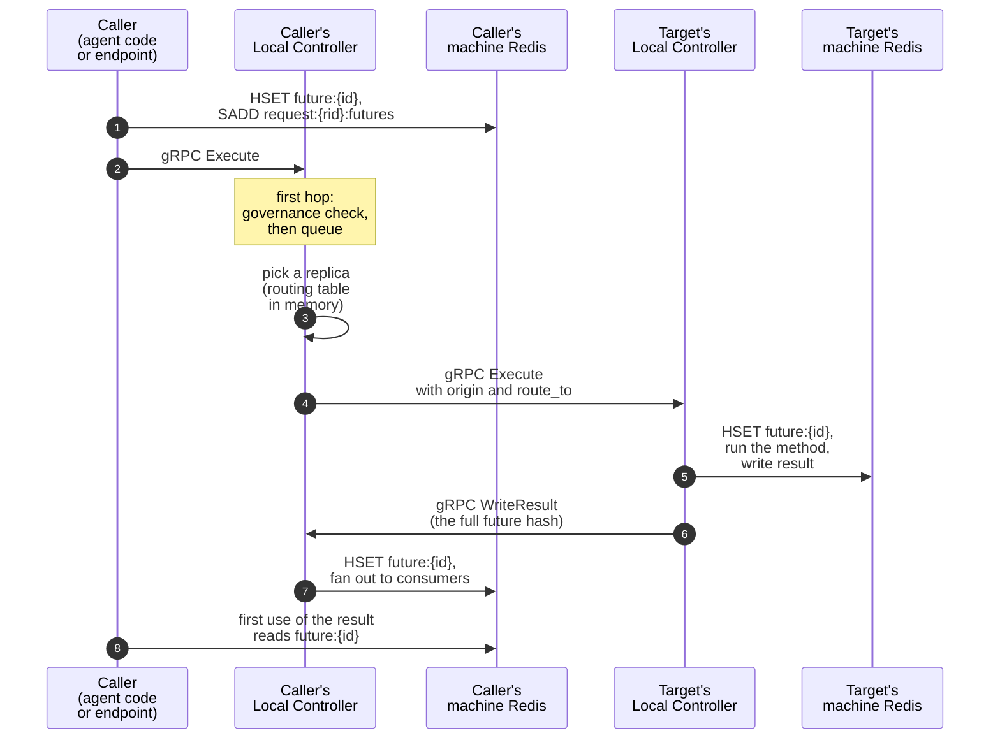

# Controller

CanyonOS has two controllers, at two scales.

- The **Global Controller** runs once per deploy and owns the workflow group: every workflow
  in it, each agent named `<workflow>.<agent>`. It publishes `workflow_group.yaml`, each
  workflow's config, the policies and each agent's desired replica count to Redis, polls the
  replicas, cleans up finished requests, and keeps the Reconciler (Docker and EC2) and the
  OTel Collector running.
- The **Local Controller** runs inside every agent replica and owns that replica. It
  serves the agent over gRPC, routes the calls the agent makes, and reports the replica's
  health and metrics. The [endpoint](ENDPOINT.md) runs one too, with no agent.

Neither one starts or removes replicas. That is the orchestrator's job: the
[Reconciler](RECONCILER.md) on Docker and EC2, the [operator](OPERATOR.md) on Kubernetes.

## Where it runs

```text
canyonos CLI
  │ HTTP /v1/workflow-groups, on the API's port (3000)
  ▼
CanyonOS API (canyonos-dashboard-api)
  │ Docker Engine API, through the host's socket
  ▼
┌─ Global Controller container ──────────────────┐
│ python -m canyonos_core.cli run-deploy         │
│  └─ python -m canyonos_core.cli deploy         │
│      └─ GlobalController                       │
│          ├─ Reconciler (Docker and EC2)        │
│          ├─ otel_collector                     │
│          └─ RedisClient ─────────────────┐     │
└──────────────────────────────────────────┼─────┘
                                           │
                                           ▼
┌─ each machine ─────────────────────────────────────────────┐
│ Redis, on redis_port (6379 by default)                     │
│  ├─ agent replica: Local Controller + agent code,          │
│  │    gRPC :50051, LLM Gateway on 127.0.0.1:8081           │
│  ├─ endpoint (on the Global Controller's machine only):    │
│  │    gunicorn :8080 published on api_port,                │
│  │    routing-only Local Controller :50051                 │
│  └─ metrics poller (host network)                          │
└────────────────────────────────────────────────────────────┘
```

Containers are named `canyonos-<workflow group>-<role>`, a replica's after its ID with the
`.` of `<workflow>.<agent>` written `--`.

Each machine has its own Redis, and each replica reports to its machine's. The Global
Controller container drives Docker through the host's Docker socket. A replica's
`address`, the one other controllers call, depends on where it runs:

| Replica                                 | `address`                                          | Port published on the machine |
| --------------------------------------- | -------------------------------------------------- | ----------------------------- |
| On the Global Controller's machine      | `<replica id>:50051`, on the workflow group's network  | none                          |
| On another machine (EC2)                | `<private_host>:<host_port>`                       | `<host_port>`                 |
| The endpoint, in a deploy with machines | `<CANYONOS_PRIVATE_IP>:<host_port>`                | `<host_port>`, on that IP     |

On Kubernetes, the operator runs the Global Controller as a pod
(`CANYONOS_TARGET=kubernetes`), and every replica reports to the one workflow Redis. See
[Operator](OPERATOR.md).

## Internal TLS

On Docker with `provider: local`, every connection inside the workflow group is mutual TLS,
signed by a CA the workflow group has to itself:

1. The first `canyonos deploy` makes the CA (EC P-256, ten years) in
   `~/.canyonos/deployments/<workflow group>/ca/`, readable only by you. Later deploys reuse
   it. A deploy refuses to start while the workflow group's Redis still runs but the CA is gone.
2. The CLI hands the CA and a client certificate of the Global Controller's own to its
   container in `CANYONOS_TLS_*` variables, copied from the CLI's environment, never on the
   command line.
3. The Global Controller signs a certificate for Redis and the metrics collector, and the
   Reconciler for each replica. Each goes to its container in an env file deleted right
   after `docker run`. A certificate names the container, its name on the workflow group's
   network and `localhost`, and serves as both server and client. Only the Global
   Controller's container holds the CA's key.

| Channel | On Docker (`local`) | EC2, Kubernetes |
| --- | --- | --- |
| Redis | TLS only (`--port 0 --tls-port <redis_port>`), a client certificate the CA signed, and the password | Plaintext with the password (Kubernetes: TLS when the operator sets it) |
| gRPC between controllers | Mutual TLS: the server requires a client certificate, the client checks the server's name | Plaintext |
| Dashboard API to Redis | TLS with a client certificate the CLI signs with the CA when it registers the workflow group, stored encrypted like the password | Plaintext with the password |

A container reads its certificate in `controller/utils/internal_tls.py` (flat as
`canyonos_internal_tls.py` in agent images), which writes it to files and sets
`CANYONOS_REDIS_TLS`, `CANYONOS_REDIS_CA_FILE`, `CANYONOS_REDIS_CERT_FILE` and
`CANYONOS_REDIS_KEY_FILE` before agent code loads. The endpoint's public port and the
dashboard, its API included, stay as they are.

## Global Controller

On Docker, the CLI never talks to the Global Controller's container. It creates the
container with `docker create`, publishing no port, and talks to the CanyonOS API: the
dashboard's Bun API (`packages/api`), which runs in `canyonos-dashboard-api` with the
host's Docker socket. `deploy`, `sync`, `stop` and `clean` start the API first, with the
dashboard's database, when it is down or runs another key or image (`ensure_api` in
`packages/cli/canyonos/serve.py`); a command that only reads starts it only when it is
down (`start_api_if_down`). The CLI uploads the workflow group to
`/v1/workflow-groups/<workflow_group_id>` (`src/modules/workflow-groups/`), and the API
starts, restarts, reloads or stops the container to match, through the Docker Engine
API. Every route and its shapes are on the API's `/docs` page, and its OpenAPI spec at
`/docs/json`.

The API keeps each upload's record and the outcome of its last apply in its Postgres
table `workflow_groups`; the files themselves are in the container's `/workspace`
volume. It finds a workflow group's container by its `canyonos.workflow_group_id` label.

The container's main process is `python -m canyonos_core.cli run-deploy`
(`deploy_runner.py`). It runs `deploy` as a child, copies its output to the container's
log, and passes SIGTERM and SIGINT (stop) and SIGHUP (reload) on to it. It keeps the
deploy's phase, steps, error and last reload in `/var/lib/canyonos/progress.json`, which
the API reads with Docker's archive API for the status. The controller log the API
serves is the container's log.

The API reads the deploy's endpoint, each agent's replicas and the machine errors from
the workflow group's Redis itself (`workflow-groups.runtime.ts`). `canyonos deploy`
registers that Redis with it (`PUT /v1/workflow-groups/<workflow_group_id>/dashboard`)
right after it creates the container, before the upload starts it; a deploy whose
registration fails stops there, since the API could not read its status.

Everything else the API needs from Core is a `canyonos_core.cli` command that prints one
JSON object:

| Commands                                                | Where they run                                                                                       | What they do                                                                                                                             |
| ------------------------------------------------------- | ---------------------------------------------------------------------------------------------------- | ---------------------------------------------------------------------------------------------------------------------------------------- |
| `write-group-files`, `put-workflow`, `remove-workflows` | A one-off container of the controller's image that mounts only the workspace volume, with no network | Write `workflow_group.yaml` and its `.env`, unpack a workflow once `canyonos validate` passes it, remove workflows (`workspace_jobs.py`) |
| `check`, `health`, `agent-logs`                         | `docker exec` in the running container                                                               | The config check before a reload, the health checks, a replica's logs (`controller_status.py`)                                           |

Every `/v1/workflow-groups` request needs this machine's control key as
`Authorization: Bearer <key>`. The CLI makes it once, in `~/.canyonos/control_key`,
readable only by you, and hands its SHA-256 to the API in `CANYONOS_CONTROL_KEY_HASH`.
Without that hash the API refuses every `/v1/workflow-groups` request, and a missing or wrong key gets
`401`. The [API key](../guides/AUTHORIZATION.md) does not open these routes, they send
no CORS headers, and the dashboard's web port answers them `404`, so only a holder of the
control key can drive Docker through them. An upload over 512 MiB gets `413`.

The exception is what the dashboard reads and sets of one workflow: its `requests`,
`metrics`, `monitoring`, `prompts`, `scaling`, `governance`, `history` and `sample-data`
routes, under
`/v1/workflow-groups/<workflow_group_id>/workflows/<workflow_id>/`. These take the API
key, send CORS headers and pass the dashboard's web port. The three routes the Global
Controller sends the group's telemetry to, `POST
/v1/workflow-groups/<workflow_group_id>/traces`, `/metrics` and `/logs`, take no key and
answer on the API's own port only.

On Kubernetes, the CLI reaches the same routes through a `kubectl port-forward` to the
same API, which the operator's chart runs as `canyonos-dashboard-api` with
`CANYONOS_TARGET=kubernetes`. There it checks the caller's kubeconfig token with
Kubernetes instead of the control key, creates a CanyonBuild instead of a container, and
runs the commands it needs from Core in its pod's `core` container, from the core image,
which takes them from a queue in the folder both share. See
[Operator](OPERATOR.md#dashboard-deletion-and-install).

Startup on Docker and EC2:

1. Validate the config and start building the images in the background.
2. Start one Redis and one metrics collector per machine. Publish the config, policies and
   desired replica counts.
3. Start the Reconciler and, when `otel.destinations` names a receiver, the OTel Collector.
   Replicas launch once the images are built.
4. Wait up to 360 seconds for every agent's replicas to report `healthy`. A launch error
   or a failed replica fails the deploy at once.

Then it polls every 5 seconds (`poll_interval`): replica status and metrics, telemetry
from each machine, scaling, and a restart of any supervised process that exited.

Teardown (SIGINT or SIGTERM): remove every replica, stop the supervised processes, remove
the metrics collectors. Redis is removed only if everything went away cleanly. See
[Teardown](RECONCILER.md#teardown). Replica health is in
[Health and liveness](RECONCILER.md#health-and-liveness).

On Kubernetes, `run-gc` builds no images and waits for no replicas. It waits for the
workflow group's Redis, then polls. SIGTERM stops the Global Controller and leaves the agents
running.

## The orchestrator

The Global Controller decides; the orchestrator makes it so.

The Global Controller reaches it through one object, `gc.orchestrator`
(`controller/orchestrator.py`), so no other Global Controller code knows what runs the
replicas. `CANYONOS_TARGET` picks it once:

- `CanyonOrchestrator` (unset: Docker and EC2): CanyonOS runs the replicas itself, through
  the Reconciler.
- `KubernetesOrchestrator` (`kubernetes`, set by the operator): the operator turns each
  CanyonAgent into a StatefulSet and Kubernetes keeps its pods running.

| Job                                                                | `CanyonOrchestrator`                                                                  | `KubernetesOrchestrator`                                                         |
| ------------------------------------------------------------------ | ------------------------------------------------------------------------------------- | -------------------------------------------------------------------------------- |
| Support services (`start_`, `undo_`, `stop_support_services`, `remove_stale_containers`) | one Redis and one metrics collector per machine. Removes stopped leftovers first, and undoes it on a failed startup. At stop, removes the collectors, and Redis when everything went away cleanly | connects to the workflow group's Redis (`CANYONOS_REDIS_HOST`, `_PORT`); starts and removes nothing |
| Background processes, images (`register_background_processes`, `mark_images_ready`) | the Reconciler under the process supervisor; `reconciler:images_ready` lets it launch | none: there is no Reconciler and no build                                       |
| Replica counts (`set_replicas`, `apply_configured_replicas`, `forget_removed_agents`) | writes the desired count to Redis and wakes the Reconciler; a reload resets every agent to its configured count | patches the CanyonAgent's `/scale`; the operator mirrors it into Redis. A restart keeps live scaling; the CLI removes unconfigured agents |
| `replace_replica`                                                  | a replacement request the Reconciler acts on                                          | nothing: Kubernetes replaces failed pods                                         |
| `poll_machine_metrics`, `machine_redis_for_replica`                | each machine's collector sample; the replica's machine's Redis                        | pod usage from the metrics API; the workflow group's Redis                    |
| `replica_log_tail`                                                 | the replica container's last output, read on its machine                              | raises: use `kubectl logs`                                                       |
| `remove_all_replicas`                                              | the Reconciler drains and removes every replica                                       | nothing: the agents keep running, and removing a workflow group is the operator's job |

The methods are only half of the contract. The Global Controller reads desired counts and
the replica list straight from the workflow group's Redis, so every orchestrator must keep these
up to date. The Reconciler writes them on Docker and EC2, the operator on Kubernetes:

| Key                              | Value                                                                                                                                                                                            |
| -------------------------------- | ------------------------------------------------------------------------------------------------------------------------------------------------------------------------------------------------ |
| `agent:<agent>:desired_replicas` | the agent's desired replica count                                                                                                                                                                |
| `agent_instance:<replica_id>`    | one hash per running replica, with at least `agent_name`, `replica_id`, `private_host`, `host_port` and `address`; `address` is written last, so a record without it is a replica still starting |

## Local Controller

An agent image runs `python local_controller.py --port 50051`. The endpoint runs the same
`LocalController` inside `python -m canyonos_core.endpoint`.

Startup:

1. Connects to Redis at `CANYONOS_REDIS_HOST` and `CANYONOS_REDIS_PORT`, and loads the
   governance rules, admitting every call if they can't be read.
2. Starts the gRPC server (`start_server`, 8 threads on `[::]:<port>`) and loads the
   routing table.
3. In an agent replica only, starts the LLM Gateway on `127.0.0.1:8081` and waits up to
   60 seconds for its `/healthz`. A port already taken, or a gateway that exits or never
   answers, sets the status to `failed` and raises.
4. Reads `CANYONOS_REPLICA_ID`, and with `CANYONOS_LOGS_ENABLED` (default `true`) adds
   the log handler that copies the agent's log lines onto its future.
5. Sets its status to `initializing`, with a first heartbeat in the same transaction,
   and starts the health server when `CANYONOS_HEALTH_PORT` is set.
6. Creates the thread pool calls run on (`CANYONOS_MAX_WORKERS`, default 512) and
   starts the metrics loop, so a slow agent constructor still heartbeats.
7. Imports each file in `CANYONOS_AGENTS` (agent name to file: one agent, or every agent
   of a toy bundle) and instantiates its class, then runs each call on the agent it
   names. If one fails, the replica is marked `failed`, the gateway killed, and the
   process exits. Otherwise the status becomes `healthy`. The endpoint passes
   `publish_ready=False` and calls `mark_ready()` once gunicorn answers on `8080`.

Then it takes requests off a queue until the process stops or a drain ends.

On SIGTERM it drains for `CANYONOS_SHUTDOWN_GRACE_SECONDS` (default 10), fails the calls
still running two heartbeats before the deadline with `ReplicaRemovedError`, and sets the
status to `stopped`. See [Draining a replica](RECONCILER.md#draining-a-replica).

On Kubernetes, `controller/health.py` answers the probes from memory, never from Redis.

## Request lifecycle

Every call between agents, and every call the endpoint makes, takes this path:



1. `Future(...)` writes `future:<future_id>` and adds it to
   `request:<request_id>:futures` on the caller's machine Redis, then sends gRPC
   `Execute` to its own Local Controller (`CANYONOS_LC_HOST`:`CANYONOS_LC_PORT`,
   default `localhost:50051`). Each `Future` in the arguments, at any depth, travels
   as its ID, listed in `future_refs` with its path and its function's declared
   `returns` type; `future_args` keeps the top-level names.
2. `LocalControllerServicer.Execute` drops a call it already accepted
   (`execute:<address>:<future_id>:accepted`, `SET NX` with a 1-hour expiry). On the
   first hop (no `route_to`), it checks governance against its snapshot of the rules:
   a refused call is marked failed and answered with `{"refused": ...}`; it is never
   queued. Anything else goes on the request queue.
3. `_process_request` takes the request's `_context` from the call's baggage, or from
   `request:<request_id>:context`, and `_resolve_address` picks an address from the
   routing table (`routing_table:addresses` and `routing_table:stateful`), held in
   memory, skipping replicas marked down. A stateful agent's replica is bound to the
   request in `affinity:<request_id>`, so every later call of that request lands on
   it; a stateless agent's is picked at random each call.
4. Its own address queues the call, which runs on the thread pool (`_execute_locally`)
   once fewer than the replica's limit are running. Any other is
   forwarded with `Execute`, carrying `origin`, `route_to` and the baggage (context
   and affinities); the target is added to each `Future` argument's consumers.
5. The executing replica writes its record of the call to its own Redis, waits for any
   `Future` arguments and reads each back as its declared type (`convert_result`), runs
   the method, writes `result` or the failure, and sends
   `WriteResult` with the full hash back to the origin, which writes it and fans it out
   to the call's consumers (`_fan_out_to_consumers`).
6. The first line that uses the result (`Future.resolved()`, see
   [Lazy values](#lazy-values)), or `Future.value()`, waits on `future:<future_id>` on
   the caller's Redis: the Local Controller wakes it when it writes the value, and it
   rereads Redis every second anyway. For a root future, `GET /status/<request_id>`
   reads the same hash.

Things the diagram does not show:

- A stateful agent keeps one replica for the whole request (`affinity:<request_id>`). A
  stateless agent gets a random replica per call.
- If the picked replica is the caller's own, it runs the call locally and nothing is
  forwarded.
- A call to the agent named `endpoint` is a question for the person who sent the request.
  See [Answering a question](ENDPOINT.md#answering-a-question).

Forwarding failures:

- A forward to an unreachable replica (`UNAVAILABLE`) or one that doesn't accept it within
  2 seconds is retried with backoff, up to 8 times. That replica is skipped for 30 seconds.
  After that the call fails with `SendFailed`.
- A call that a replica took fails with `ReplicaRemovedError` when that replica leaves
  `routing_table:replicas` without draining.
- The `error_name` values are in `controller/local_controller.py` and
  `controller/local_controller_frontend.py`.

### Futures

A future is one call's record: a Redis hash, `future:<future_id>`, that every controller on
the path writes into. Its fields are in `controller/FUTURE_SCHEMA.md`.

- The caller creates it. The executing Local Controller writes the `result` or the failure.
  The [LLM Gateway](LLM_GATEWAY.md#telemetry) adds its telemetry.
- When a request's root call finishes, its ID goes into `request:completed`.
- The Global Controller's cleanup thread collects those, stores their telemetry in the
  dashboard's Postgres and hands it to the OTel Collector, then tells every replica to clean up.
- Each Local Controller keeps the root result for a day and sets a short expiry on the
  request's other keys.

### Results and `.value()`

Agent code uses a call's result as if the call had returned it. The Local Controller loads
the agent's code through the rewrite in `controller/lazy_values.py`, which waits on the
future at the first use. `.value()` still works, for backward compatibility. What agent
authors see is in [Runtime contract](../guides/RUNTIME_CONTRACT.md#results-of-agent-calls).

Two switches turn the rewrite off: a `# canyonos: no-rewrite` line loads that file as
written, and `CANYONOS_LAZY_VALUES=0` in an agent's environment turns it off for every file.

## Redis keys

The keys another component or a contributor needs. The Reconciler's are in
[Redis schema](RECONCILER.md#redis-schema). The `future:` fields are in
`controller/FUTURE_SCHEMA.md`.

| Key                                                               | What it holds                                                   | Lifetime                                           |
| ----------------------------------------------------------------- | --------------------------------------------------------------- | -------------------------------------------------- |
| `agent:<name>:spec`, `agents:active`                              | agent specs, published by the Global Controller                 | rewritten on each config publish                   |
| `agent:<name>:desired_replicas`, `agent_instance:<replica_id>`    | the orchestrator contract above                                 | no expiry                                          |
| `<file>:config`, `policy:rules`, `llm_prices:models`              | config published to every machine's Redis                       | rewritten on each config publish                   |
| `prompts:config`, `governance:config`, `governance:spend`         | live prompt and governance state, also edited in the dashboard  | no expiry; a config publish keeps dashboard edits to prompts, and only seeds governance for agents it lacks |
| `endpoint:address`                                                | where the endpoint answers ([ENDPOINT](ENDPOINT.md#where-callers-find-it)) | deleted at teardown                    |
| `routing_table:addresses`, `:stateful`, `:replicas`, `:up`        | where each agent's replicas are                                 | kept current by the Reconciler or operator         |
| `controller:<host>:<port>:status`, `:metrics`, `:draining`        | replica status, heartbeat, drain flag                           | no expiry on status; heartbeat every `CANYONOS_POLL_INTERVAL` (5 s) |
| `future:<future_id>`, `:consumers`                                | one call's record, and the replicas waiting on it               | expires `max(30, 3 × poll interval)` s after cleanup |
| `request:<request_id>:futures`, `:context`, `:future`, `:waiting` | a request's futures, context, root future and open questions    | same expiry as its futures                         |
| `request:<request_id>:result`                                     | the root future's outcome, read by the endpoint                 | 1 day                                              |
| `request:completed`                                               | requests whose root call finished                               | removed once no machine holds a future of the request |
| `reconciler:wake`, `:replace`, `:stopping`, `:images_ready`       | signals from the Global Controller to the Reconciler            | `:stopping` expires after 60 s; the rest cleared at startup |

## Config reload

On Docker, an upload that changes only config makes the CanyonOS API run `check` in the
container, then send it SIGHUP, which `run-deploy` passes on to the Global Controller;
the API reads the outcome from the progress file. On Kubernetes, a change to the
mounted ConfigMap does the same.

It does two things:

1. Validates the edited workflow group first. If it is invalid, nothing changes.
2. Publishes the new config as at startup, which resets every agent to its configured
   replica count, and forgets the agents no longer configured.

## gRPC services

| Method        | Called by                                                  | Does                                                     |
| ------------- | ---------------------------------------------------------- | -------------------------------------------------------- |
| `Execute`     | the caller's `Future` (local), a Local Controller (remote) | admits the call and puts it on the request queue         |
| `WriteResult` | a Local Controller (to origin or consumer), `POST /answer` | `HSET future:<future_id>`, then fans out to its consumers |
| `Cleanup`     | the Global Controller, to every replica                    | expires a delivered request's keys                       |

Every method takes and returns a `JsonResponse`, a single `string response`. The service is
defined in `controller/proto/local_controller.proto`.

## Code

All paths are under `packages/core/canyonos_core/`.

| Path                                      | What it holds                                                            |
| ----------------------------------------- | ------------------------------------------------------------------------ |
| `cli.py`                                  | `deploy`: the build, then `GlobalController`; the commands the API runs  |
| `deploy_runner.py`, `deploy_progress.py`  | `run-deploy`, the container's main process, and its progress file        |
| `workspace_jobs.py`, `controller_status.py` | The commands the CanyonOS API runs in a job container or by `docker exec` |
| `job_worker.py`, `kubernetes/commands.py` | On Kubernetes, the CanyonOS API's `core` container: its job queue, and the Kubernetes-only commands it runs |
| `controller/global_controller.py`         | `GlobalController`: config publishing, poll loop, cleanup, teardown      |
| `controller/orchestrator.py`              | `CanyonOrchestrator`, and `orchestrator_for`                             |
| `kubernetes/orchestrator.py`, `run_gc.py` | `KubernetesOrchestrator`, and the Global Controller as a pod             |
| `controller/local_controller.py`          | `LocalController`: startup, routing, execution, forwarding, drain        |
| `controller/local_controller_frontend.py` | The gRPC server: admission, deduplication, `Cleanup`                     |
| `controller/future.py`                    | `Future` and its results                                                 |
| `controller/lazy_values.py`               | The rewrite that lets agent code skip `.value()`                         |
| `controller/proto/`                       | The gRPC definitions                                                     |
| `controller/utils/internal_ca.py`, `internal_tls.py`, `grpc_options.py` | [Internal TLS](#internal-tls): signing, reading a certificate, mTLS channels and ports |
| `controller/` (rest)                      | Governance, Kubernetes probes, the process supervisor, shared config     |

`controller/gateway_headers.py` belongs to the [LLM Gateway](LLM_GATEWAY.md), and
`controller/scaling.py` to [Autoscaling](../guides/SCALING.md).

## Changing the controllers

- The end-to-end suites cover the controllers: a deploy, calls between agents, errors and
  questions to a person. [Testing](../contributing/TESTING.md#end-to-end-tests) says how to
  run them.
- Agent images carry only the files in `_AGENT_FLAT_SOURCES` (`stub_generator.py`) as flat
  modules, plus the `canyonos_core.llm_gateway` package. Those files import from
  `canyonos_core` first and fall back to the flat name; keep both, and give a new import a
  flat copy too.
- A new orchestrator method needs both implementations, and any Redis key the Global
  Controller reads needs a writer on both targets: the Reconciler and the operator.
