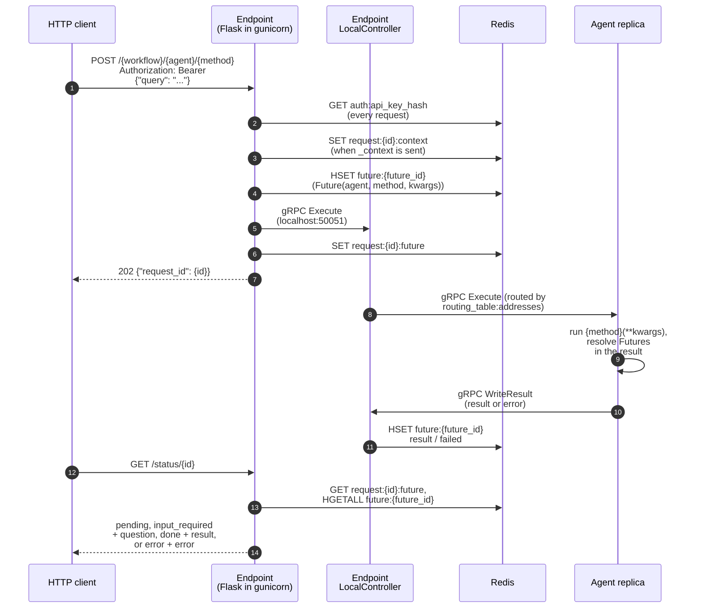

# Endpoint

The endpoint is the HTTP door into a workflow group. It queues a call to one of its routes, each an agent method, and answers with a request ID at once, because a workflow can finish long after the HTTP response.

No agent code runs in it. It serves four routes:

1. `POST /<workflow_id>`, or `POST /<name>/<agent>/<method>`, queues a call to the route named in a workflow's `endpoint: routes:`.
2. `GET /status/<request_id>` reports the result, or the questions the workflow is waiting on.
3. `POST /answer/<request_id>` answers the oldest of those questions, or the one `?question=<id>` names.
4. `GET /questions` lists every question waiting in the workflow group, across requests.

Every route needs its workflow group's API key, when it has one; see [API key](#api-key).

The request and response contract is in [Runtime contract](../guides/RUNTIME_CONTRACT.md#endpoint).

## Code

| Path                                                           | What it holds                                                                  |
| -------------------------------------------------------------- | ------------------------------------------------------------------------------ |
| `packages/core/canyonos_core/endpoint/__init__.py`             | the port, CPU count, `endpoint:address` key and the record's builder and reader |
| `packages/core/canyonos_core/endpoint/app.py`                  | the routes, the API key check, the per-worker app, and `main`, the container's entry point |
| `packages/core/canyonos_core/auth.py`                          | the API key's hash, reading it from the environment, and the bearer check            |
| `packages/core/canyonos_core/controller/controller_context.py` | adds the endpoint to the agent specs                                           |
| `packages/core/canyonos_core/reconciler/replicas.py`           | the image, command and env the Reconciler launches it with                     |
| `packages/core/canyonos_core/controller/utils/human_input.py`  | `ask_human` and `review`, the agent side of [a question](#answering-a-question) |
| `packages/operator/internal/builders/endpoint.go`              | the endpoint as a StatefulSet on Kubernetes                                    |

## Where it runs

On Docker and EC2, the Global Controller adds the endpoint to the agent list as an entry named `endpoint` with `type: endpoint`. The Reconciler launches and replaces it like any other replica.

- One replica, 2 CPUs, always on the Local provider (the Global Controller's machine).
- The image is the Global Controller's image, started as `python -m canyonos_core.endpoint`.
- It is never autoscaled: autoscaling only acts on entries of type `agent`.
- On Kubernetes, the operator runs the same command as a one-replica StatefulSet from the `canyonos-core` image, with a Service (plus an Ingress or Route when the workflow group asks for one).

### Inside the container

Two things run, and their lifetimes are tied together:

1. gunicorn serves HTTP on `8080`: 2 workers, 16 threads each. Each worker builds its app from `CANYONOS_ENDPOINT_ROUTES`, which the Reconciler or the operator sets from the workflows' `endpoint: routes:`.
2. A Local Controller with no agent runs on `50051`. It routes calls like any other Local Controller, but loads no agent and starts no LLM Gateway.

So the endpoint is an agentless replica that speaks HTTP. The Flask app only creates a `Future`, and its own Local Controller forwards the call, with the retries described in [Request lifecycle](CONTROLLER.md#request-lifecycle).

If gunicorn exits on its own, the replica is marked `failed`. On SIGTERM, gunicorn stops first and finishes its requests, then the Local Controller drains as any replica does.

Status has a fallback worth knowing. When a request's keys are gone from Redis, `GET /status` looks up its root span in the local dashboard's Postgres, at `canyonos-dashboard-db`. That name only exists where the dashboard database runs on the workflow group's Docker network, so on Kubernetes, or with `bun run dashboard:dev`, status falls back to Redis only.

## API key

Every route needs its workflow group's API key, checked before the body is read. How a person sets and sends it is in [API key](../guides/AUTHORIZATION.md).

- The Global Controller reads the key's SHA-256 from `CANYONOS_API_KEY_HASH`, which the CanyonOS API or the operator set from the workflow group's deploy, and does not start when it is not 64 lowercase hex characters.
- Each time it applies the config, it writes the hash to every machine's Redis as `auth:api_key_hash`, or `""` for no key.
- On each request the worker reads `auth:api_key_hash` and keeps no copy, so a redeploy's key counts from the next request.
- `""` lets every request pass. Otherwise the worker hashes the `Authorization: Bearer` value and compares it with the hash in constant time.
- An `OPTIONS` request passes, since a CORS preflight carries no key.

| Status | `error_name`       | When                                                                                 |
| ------ | ------------------ | ------------------------------------------------------------------------------------ |
| `401`  | `auth.missing_key` | no bearer, or another scheme                                                         |
| `401`  | `auth.invalid_key` | a key whose hash is not the published one                                            |
| `503`  | `auth.not_ready`   | the Global Controller has not published the hash, or Redis can't be read in 2 s      |

A refusal's body is `{"error": <message>, "error_name": <code>}`; a `401` also sends `WWW-Authenticate: Bearer`. The worker logs a wrong key at `INFO`, with its code; a missing key is not logged, and a `503` logs a `WARNING` only when Redis can't be read. `canyonos doctor` and the CLI's readiness checks probe with no key, so they count a `401` as up and a `503` as not ready.

## Answering a question

A call to the agent named `endpoint` is a question for the caller. `input()`, a LangGraph `interrupt()`, an Agents SDK approval and a [review gate](../guides/RUNTIME_CONTRACT.md#review-gates) all become one (`ask_human`, or `review` for a gate).

The endpoint's Local Controller does not run it. It pushes the question on `request:<request_id>:waiting`, as `{"future_id", "question", "asked_at", "expires_at", "agent"}`: the asking call's future ID, which is the question's ID, the question and its `input_schema`, when it was asked and when the asker stops waiting, in epoch milliseconds, and the agent that asked (read from the asking call's parent future; left out when that record isn't in this Redis).

- `GET /status/<request_id>` answers `input_required` while a question waits. `question` holds the oldest one's `{"question", "input_schema"}`, and `questions` every one, oldest first, each as `{"id", "question", "input_schema", "asked_at", "expires_at", "agent"}`.
- `POST /answer/<request_id>` pops the oldest question and returns the body to the asking replica as that call's result. With `?question=<id>` it answers that one, removed with `LREM` so two answers at once can't both take it. Either answers `409` with `{"error"}` when no such question waits.
- `GET /questions` answers `{"questions": [...]}`: every waiting question in the workflow group's Redis, oldest first, each as in `questions` plus its `request_id`. It reads every `request:*:waiting` list it finds with `SCAN` and lists the oldest 1,000 questions.
- A question past its `expires_at` is no longer waited for: none of the three lists or answers it. Its entry stays until its request finishes.

See [Asking the person](../guides/RUNTIME_CONTRACT.md#asking-the-person) for the caller's side.

## Where callers find it

The Global Controller writes the Redis hash `endpoint:address` when it applies the config, and deletes it once teardown has removed every replica.

- `public_host` and `api_port`: where the endpoint is published.
- `routes`: each route's `workflow`, `workflow_id`, `agent`, `method`, its argument names from `functions`, and its `url`, `http://<public_host>:<api_port>/<workflow_id>`.

On Kubernetes the operator sets `CANYONOS_ENDPOINT_URL` to the Route, Ingress or Service, and each `url` is built from it instead.

Three components read this hash:

- The CanyonOS API, as `endpoint` in `GET /v1/workflow-groups/<workflow_group_id>`, which it reads from the workflow group's Redis (`packages/api/src/modules/workflow-groups/workflow-groups.runtime.ts`). The CLI uses it for `canyonos test`, `canyonos status` and the deploy summary.
- The dashboard API, at `GET /v1/workflow-groups/:workflow_group_id/workflows/:workflow_id/monitoring/endpoint`.
- The Reconciler, which reads `api_port` before it launches the endpoint.

Without `endpoint.api_port` in `workflow_group.yaml`, the endpoint keeps the port it had. On Docker, the Reconciler moves to the next free port when it is taken, and rewrites the hash.

## Changing the endpoint

- The record is read by the CLI and the dashboard API (its keys and shape in `packages/api/src/modules/registry/registry.contract.ts`). Change all three together.
- The operator builds the same container on Kubernetes, so a new environment variable is set in `endpoint.go` as well as in the Reconciler's image args.
- The end-to-end suites send requests through the endpoint; see [Testing](../contributing/TESTING.md#end-to-end-tests).
- The dashboard API checks the same key with the same rules, in TypeScript (`packages/api/src/modules/auth/`), so a rule change touches both.
