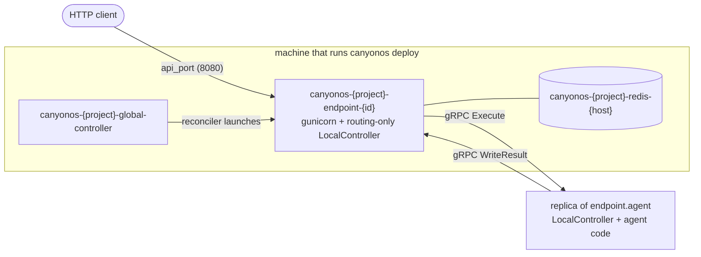
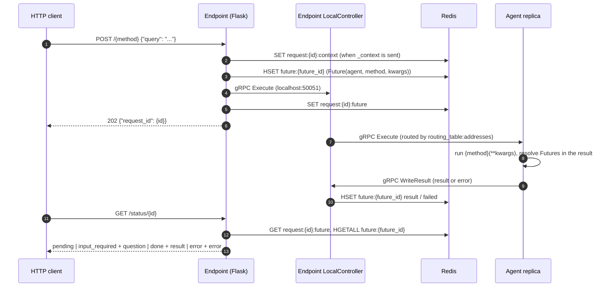
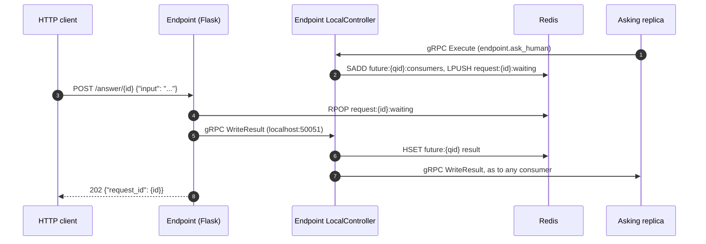

# Endpoint — Architecture

The endpoint is the HTTP door into a deployment. It serves one agent method, named by
the top-level `endpoint:` block in `global_controller.yaml`, at `POST /<method>`, and
reports each request's result at `GET /status/<request_id>`. It runs no agent code: it
queues the call and forwards it to a replica of the agent it serves.

## Where it runs

The Global Controller adds the endpoint to the agent list itself, as an entry named
`endpoint` with `type: endpoint`, so the reconciler launches and replaces it like any
other replica. The name `endpoint` is reserved for it.



| | |
|---|---|
| Container | `canyonos-<project>-endpoint-<id>`, one replica, 2 CPUs, always on the Local provider |
| Image | the Global Controller's image, started as `python -m canyonos_core.endpoint` |
| HTTP | gunicorn on `8080` inside the container, 2 workers × 16 threads, published on `endpoint.api_port` (default `8080`, else the next free port) |
| gRPC | a Local Controller that only routes, on `50051` inside the container, published on a host port the provider claims only when the deployment's provider isn't `local` and `CANYONOS_PRIVATE_IP` is set, for agents on other machines to call back |
| Scaling | never: autoscaling only acts on entries of type `agent` |

## Manifest block

```yaml
endpoint:
  agent: Workflow
  method: main
  api_port: 8080
```

`agent` must be an entry of type `agent`, and `method` must be listed in that agent's
`functions`. The argument names `canyonos test`, the deploy summary and the dashboard
use come from that function's `arguments`. See
[global_controller.yaml](../guides/GLOBAL_CONTROLLER.md).

## A request end to end



The body must be a JSON object. Each key becomes a keyword argument, and `_context` is
taken out first and kept for policy. An empty body is a call with no arguments; anything
else is a `400`. A finished request's keys expire after cleanup, but its result is kept
for a day, then read from the dashboard's database. `GET /status` answers `404` only when
neither has it.

When governance refuses the root call (a required agent is down, a spend rule denies it,
or the policy does), the call is never queued and `POST` answers
`403` with `{"request_id", "error", "error_name"}` instead of `202`; `GET /status` for
that `request_id` reports the same error.

## Answering a question

An agent's `ask_human` call is routed to the endpoint's Local Controller, which keeps it
in `request:<id>:waiting` instead of running it, with the asking replica as the call's
consumer. While a question waits, `GET /status` answers `input_required` with
`{"question": ..., "input_schema": ...}` in `question`, `input_schema` mapping each key
the answer takes to its Python type name, such as `{"input": "str"}`.



`POST /answer/<request_id>` starts no call: it answers the request's oldest question, or
is a `409` when none is waiting. When the request finishes first, its waiting questions
fail the same way, so each asking call raises.

## Forwarding and retries

The endpoint's Local Controller picks a replica of `endpoint.agent` from the routing
table, the same way an agent's controller routes a call to another agent, and does not
wait for the run. When the replica is unreachable (`UNAVAILABLE`) or does not accept the
request within 2 seconds (`DEADLINE_EXCEEDED`):

- the replica is skipped for 30 seconds while the reconciler replaces it, unless every
  replica is marked down;
- the request goes back on the queue: the first retry at once, later ones after 0.5 s,
  1 s, 2 s and so on, up to 8 s;
- after 8 retries, or on any other gRPC error, the request fails and `GET /status`
  reports `error`.

A timed-out request may already be queued on that replica; the replica drops the resend
as a duplicate. Once a replica has accepted the request the endpoint does not retry it,
so a replica that dies mid-run loses the request.

## Where callers find it

The Global Controller writes the Redis hash `endpoint:address` when it applies the
config and deletes it when the deploy stops. Without `endpoint.api_port`, the reconciler
rewrites `api_port` and `url` once the endpoint's container holds its port:

| Field | Value |
|---|---|
| `public_host` | `CANYONOS_PUBLIC_IP`, or `127.0.0.1` |
| `api_port` | `endpoint.api_port`, else the port the endpoint's container got |
| `agent`, `method` | the served method |
| `arguments` | JSON list of the method's argument names, from `functions` |
| `url` | `http://<public_host>:<api_port>/<method>` |

When `CANYONOS_ENDPOINT_URL` is set (on Kubernetes the operator sets it to the
endpoint's Route, Ingress or in-cluster Service), `url` is `<CANYONOS_ENDPOINT_URL>/<method>`
and `public_host` and `api_port` come from that URL.

Readers:

- the Global Controller container's server answers `GET /endpoint` on port `8000` with
  the same record, which the CLI uses for `canyonos test` and the deploy summary;
- the dashboard API answers `GET /projects/:project_id/monitoring/endpoint` with
  `{endpoint: {url, status_url, agent, method, arguments, example_body}}`, or
  `{endpoint: null}` when the hash is missing.
