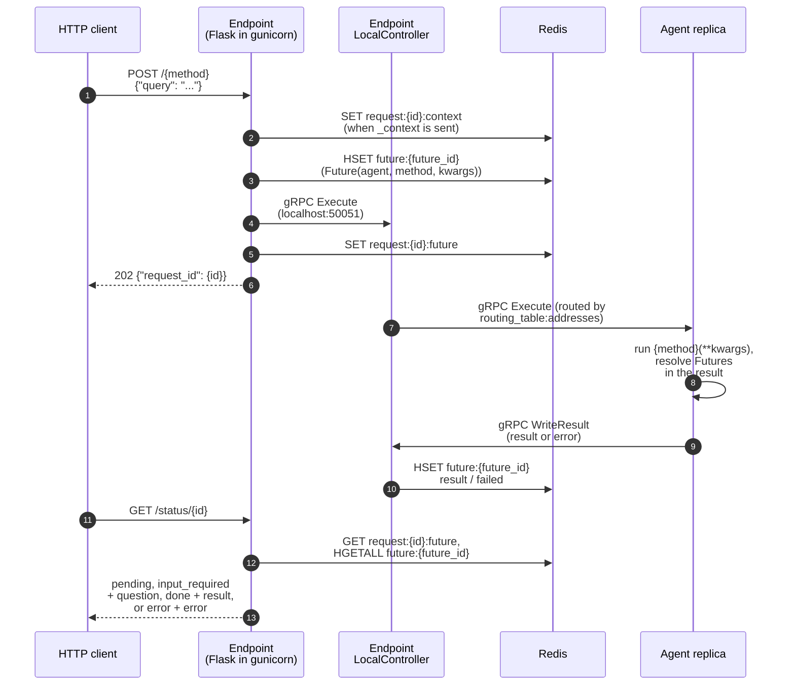

# Endpoint

The endpoint is the HTTP door into a deployment. It serves one agent method, named by
the top-level `endpoint:` block in the workflow config, at `POST /<method>`, and answers
with a request ID at once, because a workflow can finish long after the HTTP response.
`GET /status/<request_id>` reports the result, and `POST /answer/<request_id>` answers
a question the workflow asked. The endpoint runs no agent code: it queues the call and
its own Local Controller forwards it to a replica of the agent it serves.



## Code

| Path                                                           | What it holds                                                                                                       |
| -------------------------------------------------------------- | ------------------------------------------------------------------------------------------------------------------- |
| `packages/core/canyonos_core/endpoint/__init__.py`             | `ENDPOINT_PORT`, `ENDPOINT_CPUS`, `ADDRESS_KEY`; `endpoint_record`, `publish_endpoint_port`, `read_endpoint_record` |
| `packages/core/canyonos_core/endpoint/app.py`                  | `create_app` (the routes), `worker_app` (one per gunicorn worker), `main` (the container)                           |
| `packages/core/canyonos_core/endpoint/__main__.py`             | `python -m canyonos_core.endpoint`                                                                                  |
| `packages/core/canyonos_core/controller/controller_context.py` | `_load_config`, which adds the endpoint to the agent specs                                                          |
| `packages/core/canyonos_core/reconciler/replicas.py`           | `_image_args` and `_callback_host`: how the Reconciler launches it                                                  |
| `packages/core/canyonos_core/controller/utils/human_input.py`  | `ask_human`, the agent side of [a question](#answering-a-question)                                                  |
| `packages/operator/internal/builders/endpoint.go`              | `EndpointStatefulSet`: the endpoint on Kubernetes                                                                   |

## Where it runs

On Docker and EC2, the Global Controller adds the endpoint to the agent list itself, as
an entry named `endpoint` with `type: endpoint`, so the Reconciler launches and replaces
it like any other replica. The name `endpoint` is reserved for it.

|           |                                                                                                                                                                                                   |
| --------- | ------------------------------------------------------------------------------------------------------------------------------------------------------------------------------------------------- |
| Container | `canyonos-<project>-endpoint-<id>`, one replica, 2 CPUs, always on the Local provider, so on the Global Controller's machine                                                                      |
| Image     | the Global Controller's image (`CANYONOS_CONTROLLER_IMAGE`), started as `python -m canyonos_core.endpoint`                                                                                        |
| HTTP      | gunicorn on `8080` inside the container, 2 workers (`gthread`) × 16 threads, published on [`api_port`](#the-port)                                                                                 |
| gRPC      | a Local Controller with no agent, on `50051`; published on `CANYONOS_PRIVATE_IP` only when the deployment's provider has machines of its own (EC2) and that is set, for agents there to call back |
| Scaling   | never: autoscaling only acts on entries of type `agent`                                                                                                                                           |

On Kubernetes, the operator runs the endpoint as a one-replica StatefulSet from the
`canyonos-core` image, with the same command, health probes on `CANYONOS_HEALTH_PORT`,
and a Service (plus an Ingress or Route when the project asks for one).

### Inside the container

`main()` runs two things and ties their lifetimes together:

- a `LocalController(publish_ready=False)` on its own thread. It routes calls like any
  other but loads no agent and starts no LLM Gateway. It reports the endpoint healthy
  (`mark_ready`) once `8080` accepts connections.
- gunicorn, as a child process. Each worker builds its app with `worker_app()`, from
  `CANYONOS_ENDPOINT_AGENT`, `CANYONOS_ENDPOINT_METHOD` and
  `CANYONOS_ENDPOINT_ARGUMENTS`, which the Reconciler (or the operator) sets on the
  container from the `endpoint:` block and the method's `functions` entry.

When gunicorn exits on its own, the Local Controller marks the replica `failed` and the
process exits with gunicorn's code. SIGTERM reaches only the main process, so it stops
gunicorn first, which takes no new connections and finishes its requests, each of which
queues its call. The Local Controller then drains as any replica does, for
`CANYONOS_SHUTDOWN_GRACE_SECONDS`, and the process exits 0.

## Requests

The `endpoint:` block names the agent and method:

```yaml
endpoint:
  agent: Workflow
  method: main
  api_port: 8080
```

`agent` must be an entry of type `agent`, and `method` must be listed in that agent's
`functions`. `canyonos test`, the deploy summary and the dashboard take the argument
names from that function's `arguments`. See
[Workflow config](../guides/WORKFLOW_CONFIG.md).

### `POST /<method>`

The body must be a JSON object, or anything else is a `400`. Each key becomes a keyword
argument, and `_context` is taken out first and kept for policy; a `_context` that isn't
an object is a `400`. Every argument in `functions` is required, so a missing one is a
`400` and an empty body works only for a method with no arguments. Keys beyond the
declared arguments are passed on too, and a method that doesn't take them fails when it
runs.

For a valid body, the worker sets a new request ID (`uuid4().hex`), stores `_context` in
`request:<request_id>:context` when it has one, creates the root `Future`, which sends
`Execute` to the endpoint's Local Controller, and stores the future's ID in
`request:<request_id>:future`. It does not wait for the run.

| Status | Body                                    | When                                                                 |
| ------ | --------------------------------------- | -------------------------------------------------------------------- |
| `202`  | `{"request_id"}`                        | the call is queued                                                   |
| `400`  | `{"error"}`                             | invalid JSON, not an object, a bad `_context`, or a missing argument |
| `403`  | `{"request_id", "error", "error_name"}` | governance refused the root call                                     |
| `404`  | `{"error"}`                             | any other path; the error names the served route                     |
| `405`  | `{"error"}`                             | a known path with the wrong HTTP method                              |

Governance refuses the root call when a required agent is down, a spend rule denies it,
or the policy does (`DependencyDown`, `SpendLimit`, `PolicyDenied`). The call is never
queued, and `GET /status` for that `request_id` reports the same error.

The endpoint's Local Controller routes the call like any other, with the same retries;
see [Request lifecycle](CONTROLLER.md#request-lifecycle). After the last retry, or on
any other gRPC error, `GET /status` reports `error`.

### `GET /status/<request_id>`

The worker finds the request's record in this order:

1. `future:<future_id>`, through `request:<request_id>:future`, while the request's
   keys exist.
2. `request:<request_id>:result`: the outcome cleanup keeps for a day after it expires
   the request's keys (see [Futures and cleanup](CONTROLLER.md#futures-and-cleanup)).
3. The request's root span in the dashboard's Postgres container,
   `canyonos-dashboard-db:5432` on the project's network (a 2-second connect timeout).
   Only the local Docker dashboard has it, so on Kubernetes, or with
   `bun run dashboard:dev`, this step finds nothing.

With no record, it answers `404`. Otherwise it answers `200` with
`{"request_id", "status"}` and one more field:

| `status`         | Extra field | When                                                                  |
| ---------------- | ----------- | --------------------------------------------------------------------- |
| `error`          | `error`     | `failed` is `1`                                                       |
| `done`           | `result`    | the record has a `result`, decoded from JSON                          |
| `input_required` | `question`  | the request's oldest waiting question, `{"question", "input_schema"}` |
| `pending`        |             | none of the above                                                     |

## Answering a question

`input()`, a LangGraph `interrupt()` and an Agents SDK approval all become an
`ask_human` call to the agent named `endpoint` (`human_input.install`), routed like any
other call. The endpoint's Local Controller doesn't run it: it records the call on its
own Redis, registers the asking replica as the call's consumer, and pushes
`{future_id, question}` onto `request:<request_id>:waiting` (`LPUSH`). While a question
waits, `GET /status` answers `input_required` with `{"question": ..., "input_schema":
...}` in `question`. `input_schema` maps each key the answer takes to its Python type
name, such as `{"input": "str"}`.

`POST /answer/<request_id>` starts no call. It parses the body as `POST /<method>`
does, pops the request's oldest question (`RPOP`), and sends the body to the endpoint's
Local Controller as the question's result, in a `WriteResult`. That writes
`future:<future_id>` and passes the result to the asking replica as to any consumer. It
answers `202` with `{"request_id"}`, or `409` when no question is waiting.

`ask_human` returns the body unchecked. The `input()`, `interrupt()` and approval hooks
check it against `input_schema` and ask again when a key is missing or has the wrong
type. A question that gets no answer within an hour raises `TimeoutError` in the agent.
When the request finishes first, its waiting questions fail with `RequestFinished`, so
each asking call raises.

## Where callers find it

The Global Controller writes the Redis hash `endpoint:address` (`endpoint_record`) when
it applies the config, and deletes it once teardown has removed every replica:

| Field             | Value                                                           |
| ----------------- | --------------------------------------------------------------- |
| `public_host`     | `CANYONOS_PUBLIC_IP`, or `127.0.0.1`                            |
| `api_port`        | `endpoint.api_port`, else the port the endpoint's container got |
| `agent`, `method` | the served method                                               |
| `arguments`       | JSON list of the method's argument names, from `functions`      |
| `url`             | `http://<public_host>:<api_port>/<method>`                      |

When `CANYONOS_ENDPOINT_URL` is set (on Kubernetes, the operator sets it to the
endpoint's Route, Ingress or in-cluster Service), `url` is
`<CANYONOS_ENDPOINT_URL>/<method>`, and `public_host` and `api_port` come from that URL,
with `443` or `80` when it names no port.

### The port

Without `endpoint.api_port`, the endpoint keeps the port it had: a reload reuses the
one in `endpoint:address`, and a deploy starts from `CANYONOS_LAST_API_PORT`, the port
of the last deploy, which the CLI passes in, else `8080`. When Docker finds that port
taken, the Reconciler tries the next one, and once the container runs it rewrites
`api_port` and `url` (`publish_endpoint_port`). A configured `api_port` that is taken
fails the launch with a message that names it.

### Readers

- The Global Controller container's server answers `GET /endpoint` on port `8000` with
  `{"endpoint": <record>}`, which the CLI uses for `canyonos test` and the deploy
  summary. It answers `409` when no deploy runs and `503` while nothing is published.
- The dashboard API answers `GET /projects/:project_id/monitoring/endpoint` with
  `{project_id, endpoint: {url, status_url, agent, method, arguments, example_body}}`,
  or `endpoint: null` when the hash is missing.
- The Reconciler reads `api_port` before it launches the endpoint.

## Configuration

What the endpoint's container reads:

| Variable                                     | Set by               | Meaning                                                |
| -------------------------------------------- | -------------------- | ------------------------------------------------------ |
| `CANYONOS_ENDPOINT_AGENT`                    | Reconciler, operator | the agent served                                       |
| `CANYONOS_ENDPOINT_METHOD`                   | Reconciler, operator | the method served, and the route                       |
| `CANYONOS_ENDPOINT_ARGUMENTS`                | Reconciler, operator | comma-separated argument names, each required          |
| `CANYONOS_REDIS_HOST`, `CANYONOS_REDIS_PORT` | Reconciler, operator | the machine's Redis, or the project's on Kubernetes    |
| `CANYONOS_AGENT_HOST`, `CANYONOS_AGENT_PORT` | Reconciler, operator | the Local Controller's address in the routing table    |
| `CANYONOS_SHUTDOWN_GRACE_SECONDS`            | Reconciler, operator | how long the drain after SIGTERM may take (default 10) |
| `CANYONOS_HEALTH_PORT`                       | operator             | serves the Kubernetes probes                           |

What the Global Controller reads to build the record: `CANYONOS_PUBLIC_IP`,
`CANYONOS_ENDPOINT_URL` and `CANYONOS_LAST_API_PORT`. The Reconciler reads
`CANYONOS_PRIVATE_IP` to publish the endpoint's gRPC port.

## Changing the endpoint

- The end-to-end suites send requests through the endpoint; see
  [Testing](../contributing/TESTING.md#end-to-end-tests).
- The record's fields are read by the CLI and the dashboard API
  (`packages/api/src/modules/monitoring/`); change them in all three.
- The operator builds the same container on Kubernetes, so a new environment variable
  needs setting in `endpoint.go` as well as in `_image_args`.
