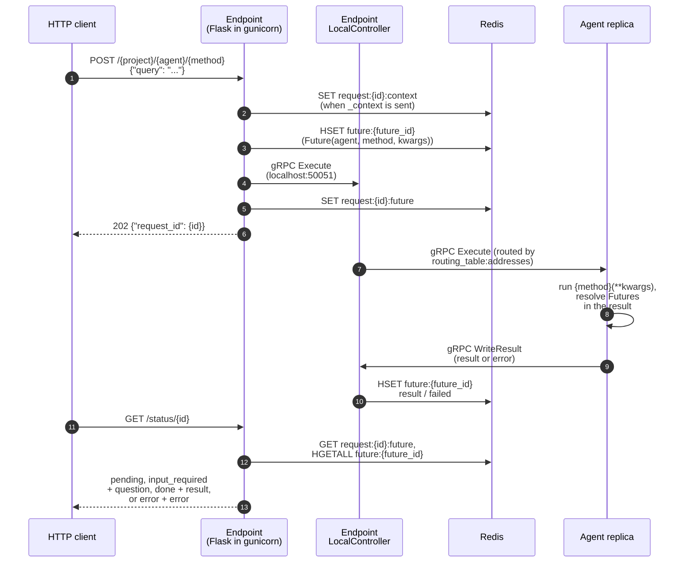

# Endpoint

The endpoint is the HTTP door into a deployment. It queues a call to one of its routes, each an agent method, and answers with a request ID at once, because a workflow can finish long after the HTTP response.

No agent code runs in it. It serves three routes:

1. `POST /<project>/<agent>/<method>` queues a call to a route named in a project's `endpoint: routes:`.
2. `GET /status/<request_id>` reports the result, or the question the workflow is waiting on.
3. `POST /answer/<request_id>` answers that question.

The request and response contract is in [Runtime contract](../guides/RUNTIME_CONTRACT.md#endpoint).

## Code

| Path                                                           | What it holds                                                                  |
| -------------------------------------------------------------- | ------------------------------------------------------------------------------ |
| `packages/core/canyonos_core/endpoint/__init__.py`             | the port, CPU count, `endpoint:address` key and the record's builder and reader |
| `packages/core/canyonos_core/endpoint/app.py`                  | the routes, the per-worker app, and `main`, the container's entry point        |
| `packages/core/canyonos_core/controller/controller_context.py` | adds the endpoint to the agent specs                                           |
| `packages/core/canyonos_core/reconciler/replicas.py`           | the image, command and env the Reconciler launches it with                     |
| `packages/core/canyonos_core/controller/utils/human_input.py`  | `ask_human`, the agent side of [a question](#answering-a-question)            |
| `packages/operator/internal/builders/endpoint.go`              | the endpoint as a StatefulSet on Kubernetes                                    |

## Where it runs

On Docker and EC2, the Global Controller adds the endpoint to the agent list as an entry named `endpoint` with `type: endpoint`. The Reconciler launches and replaces it like any other replica.

- One replica, 2 CPUs, always on the Local provider (the Global Controller's machine).
- The image is the Global Controller's image, started as `python -m canyonos_core.endpoint`.
- It is never autoscaled: autoscaling only acts on entries of type `agent`.
- On Kubernetes, the operator runs the same command as a one-replica StatefulSet from the `canyonos-core` image, with a Service (plus an Ingress or Route when the project asks for one).

### Inside the container

Two things run, and their lifetimes are tied together:

1. gunicorn serves HTTP on `8080`: 2 workers, 16 threads each. Each worker builds its app from `CANYONOS_ENDPOINT_ROUTES`, which the Reconciler or the operator sets from the projects' `endpoint: routes:`.
2. A Local Controller with no agent runs on `50051`. It routes calls like any other Local Controller, but loads no agent and starts no LLM Gateway.

So the endpoint is an agentless replica that speaks HTTP. The Flask app only creates a `Future`, and its own Local Controller forwards the call, with the retries described in [Request lifecycle](CONTROLLER.md#request-lifecycle).

If gunicorn exits on its own, the replica is marked `failed`. On SIGTERM, gunicorn stops first and finishes its requests, then the Local Controller drains as any replica does.

Status has a fallback worth knowing. When a request's keys are gone from Redis, `GET /status` looks up its root span in the local dashboard's Postgres, at `canyonos-dashboard-db`. That name only exists where the dashboard database runs on the deployment's Docker network, so on Kubernetes, or with `bun run dashboard:dev`, status falls back to Redis only.

## Answering a question

A call to the agent named `endpoint` is a question for the caller. `input()`, a LangGraph `interrupt()` and an Agents SDK approval all become one (`ask_human`).

The endpoint's Local Controller does not run it. It queues the question on `request:<request_id>:waiting`, and `GET /status` answers `input_required` with it.

`POST /answer/<request_id>` pops the oldest question and returns the body to the asking replica as that call's result. See [Asking the person](../guides/RUNTIME_CONTRACT.md#asking-the-person) for the caller's side.

## Where callers find it

The Global Controller writes the Redis hash `endpoint:address` when it applies the config, and deletes it once teardown has removed every replica.

- `public_host` and `api_port`: where the endpoint is published.
- `routes`: each route's `project`, `agent`, `method`, its argument names from `functions`, and its `url`, `http://<public_host>:<api_port>/<project>/<agent>/<method>`.

On Kubernetes the operator sets `CANYONOS_ENDPOINT_URL` to the Route, Ingress or Service, and each `url` is built from it instead.

Three components read this hash:

- The Global Controller's server, at `GET /endpoint`. The CLI uses it for `canyonos test` and the deploy summary.
- The dashboard API, at `GET /projects/:project_id/monitoring/endpoint`.
- The Reconciler, which reads `api_port` before it launches the endpoint.

Without `endpoint.api_port` in `deployment.yaml`, the endpoint keeps the port it had. On Docker, the Reconciler moves to the next free port when it is taken, and rewrites the hash.

## Changing the endpoint

- The record is read by the CLI and the dashboard API (`packages/api/src/modules/monitoring/`). Change all three together.
- The operator builds the same container on Kubernetes, so a new environment variable is set in `endpoint.go` as well as in the Reconciler's image args.
- The end-to-end suites send requests through the endpoint; see [Testing](../contributing/TESTING.md#end-to-end-tests).
