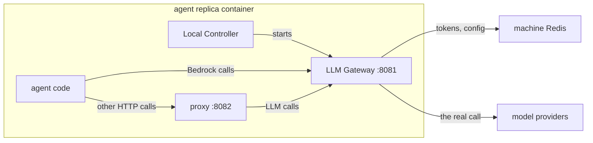
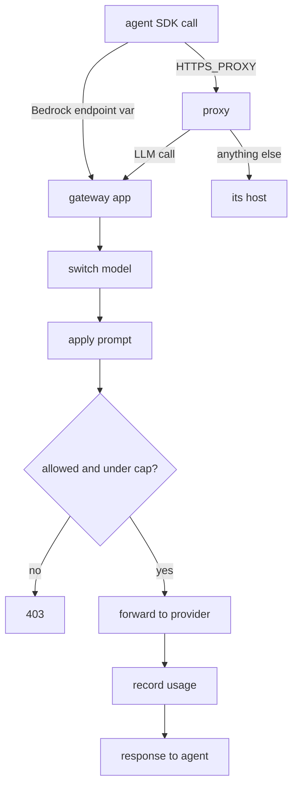

# LLM Gateway

The LLM Gateway is a process inside every agent replica that sits between the agent code and the model providers.

The agent code doesn't know it is there. The replica's environment points the SDKs at it, so CanyonOS sees and controls every model call without a change to the agent. For each call, it:

1. Intercepts the agent's OpenAI-format, Anthropic and Bedrock calls.
2. Applies the live prompt, any model switch from a spend rule, and the `llms.yaml` allow-list and cost cap.
3. Forwards the call to the provider, streaming included.
4. Records the call's model and tokens on the future that made it.

What a user configures is in [LLM Gateway](../guides/LLM_GATEWAY.md). This page is how it is built.

## Code

All under `packages/core/canyonos_core/llm_gateway/`:

| Module                          | Role                                                                                                                                                   |
| ------------------------------- | ------------------------------------------------------------------------------------------------------------------------------------------------------ |
| `__main__.py`, `config.py`      | Entry point, and settings from the environment                                                                                                         |
| `app.py`                        | The Flask app: `GET /healthz`, `/<provider>/<path>` and `/future/<id>/<agent>/<provider>/<path>`                                                       |
| `core.py`                       | `proxy_request`, the per-call path                                                                                                                     |
| `providers/`                    | One forwarder per provider: OpenAI, Anthropic, Bedrock                                                                                                 |
| `routing.py`                    | The 5-second config refresh, and the allow-list and cap decision                                                                                       |
| `llms.py`                       | Loads `llms:config`                                                                                                                                    |
| `pricing.py`, `llm_prices.json` | `LLM_HOSTS`, token prices and call cost                                                                                                                |
| `prompts.py`                    | The live prompt version per `<workflow>.<agent>.<function>`                                                                                            |
| `hooks.py`                      | Usage extraction, and the telemetry each response writes to Redis                                                                                      |
| `proxy.py`                      | The mitmproxy addon on `127.0.0.1:8082` that catches LLM calls, and swaps the future and agent in a subprocess's proxy credentials for request headers |

Pieces that live elsewhere, under `packages/core/canyonos_core/` unless noted:

| Path                                                   | Role                                                                                                                                              |
| ------------------------------------------------------ | ------------------------------------------------------------------------------------------------------------------------------------------------- |
| `controller/local_controller.py`                       | Starts the gateway, waits for `/healthz`, restarts it                                                                                             |
| `controller/gateway_headers.py`                        | Adds the future and function headers in the agent's process, and attaches that future and agent to subprocesses started while a future is running |
| `controller/governance.py`                             | The spend rule's model switch                                                                                                                     |
| `reconciler/providers/shared_utils/llm_gateway_env.py` | The environment that routes the container's calls to the gateway                                                                                  |
| `packages/operator/internal/builders/agent.go`         | The same environment, for Kubernetes                                                                                                              |
| `agent_base/Dockerfile`                                | The gateway's own venv, in the base of every agent image                                                                                          |
| `controller/utils/otel_writer.py`                      | Prices calls for the dashboard                                                                                                                    |

## Where it runs

- The Local Controller starts the gateway before it loads the agent, and waits up to 60 seconds for `/healthz`. The endpoint's Local Controller starts none.
- The gateway has its own venv, `/opt/canyonos-gateway`, so the agent's dependencies stay untouched.
- Every supported call goes through it, with no fallback to a direct call.
- If it exits, the Local Controller restarts it. After 3 restarts it fails the replica, which is replaced.

### How calls reach it

The agent is never told about the gateway. The container's environment sends its calls there:

1. Whatever launches the replica sets the variables: `llm_gateway_env.py` on Docker and EC2, `agent.go` in the operator.
2. `AWS_ENDPOINT_URL_BEDROCK_RUNTIME` points at `http://127.0.0.1:8081/bedrock`, so boto3 sends Bedrock calls straight to the gateway.
3. `HTTP_PROXY` and `HTTPS_PROXY` point at `http://127.0.0.1:8082`, so every other HTTP(S) call goes to the proxy. They are uppercase only, so gRPC between controllers skips it.
4. `SSL_CERT_FILE`, `REQUESTS_CA_BUNDLE` and `AWS_CA_BUNDLE` point at a bundle the proxy writes: system roots plus its own CA. Clients then trust the proxy's certificates.
5. The proxy decrypts only hosts in `LLM_HOSTS`. A `POST` to an OpenAI-format or Anthropic path with a string `model` in its JSON body goes to the gateway. Everything else goes to its host unchanged.
6. `NO_PROXY` keeps localhost and the cloud metadata addresses direct, so boto3 still gets its credentials.
7. For a subprocess started with `subprocess.Popen` while a future is running, its `HTTP_PROXY`, `HTTPS_PROXY` and Bedrock address (as long as they are still at their default values) carry the future and its agent: in the proxy address they go in the credentials position, and when the proxy receives them it swaps them for the `x-canyonos-future-id` and `x-canyonos-agent` request headers and drops the credentials; in the Bedrock address they go in the `/future/<id>/<agent>/` path, where the gateway reads them.

Calls that miss all of this reach the provider directly. The user guide lists them in [Code that bypasses the gateway](../guides/LLM_GATEWAY.md#code-that-bypasses-the-gateway).

The gateway speaks three provider APIs: OpenAI-format (any host in `LLM_HOSTS`), Anthropic, and Bedrock (when boto3 is installed).

## Request path

- A refused call gets a `403` that the OpenAI, Anthropic and boto3 clients all surface with the reason.
- A provider timeout answers `504`. Any other failure answers `502`.
- Streams are relayed chunk by chunk. Usage is recorded when the stream ends.

## Policy and prices

The Global Controller publishes `config/llms.yaml` to `llms:config` in every machine Redis. Every 5 seconds the gateway reloads it, and keeps the last good copy if a load fails.

The policy is an allow-list of agents per model, plus an optional cost cap. A capped call is refused when its worst-case cost is over the cap. Prices come from `llm_prices.json` plus LiteLLM's current prices, which the Global Controller publishes to `llm_prices:models`. The rules a user writes are in [LLM Gateway](../guides/LLM_GATEWAY.md).

Spend rules can switch a model. The gateway evaluates them itself (`governance.model_for`) and rewrites the call's model before the policy check, so the switched model is the one checked and recorded.

## Prompts

A prompt is a live version per `<workflow>.<agent>.<function>`. The gateway swaps the system prompt in flight, so agent code never holds it.

- The source is each workflow's `config/prompts.yaml`. The Global Controller stores them as `prompts:yaml`, each prompt keyed `<workflow>.<agent>.<function>`, and seeds `prompts:config` from it only when that key is empty.
- The dashboard API stores versions and the live flag in Postgres, and writes each prompt's live version to `prompts:config`.
- On each poll, the Global Controller copies `prompts:config` to the other machines' Redis.
- The gateway reloads `prompts:config` every 5 seconds.
- The Local Controller sets the current agent and function before running it, so `gateway_headers` adds `x-canyonos-agent` and `x-canyonos-function` to the call. The gateway looks up `<workflow>.<agent>.<function>` and puts the live text where that provider takes its system prompt.

The rules a user sees are in [Prompt management](../guides/PROMPTS.md).

## Telemetry

The gateway ties each call to the future that made it:

- At startup the Local Controller installs `gateway_headers`. It adds `x-canyonos-future-id`, `x-canyonos-agent` and `x-canyonos-function` to every LLM call from the agent's process.
- The gateway takes the calling agent from `x-canyonos-agent` only when the replica runs that agent, which is how a toy bundle's agents keep their own rules and prompts. Any other name, or none, counts as the replica's own agent.
- After each response, the gateway adds the call to `future:<future_id>` in the machine Redis. A future that makes several calls sums them.
- It records `gen_ai.request.model` and `price_prefix`, and `prompt_name` and `prompt_version` when a prompt was applied.
- It counts `error_count`, `gen_ai.usage.input_tokens`, `gen_ai.usage.output_tokens`, `token_count`, and the cache read and write tokens. Input counts include cache tokens.
- A call without a future id is not recorded. A caller that disconnects mid-stream records no usage.
- On each poll, the Global Controller scans `future:*` and sends the rows to the dashboard; `otel_writer.py` prices them. See [Controller](CONTROLLER.md).

## Changing it

- The end-to-end workflows with model calls, and the governance scenario, cover the gateway. See [Testing](../contributing/TESTING.md#end-to-end-tests).
- A new dependency goes into `agent_base/Dockerfile`, not the agent's requirements.
- A new provider needs an entry in the provider registry, its paths in `hooks.LLM_PATHS`, its hosts in `LLM_HOSTS`, and a usage parser in `hooks.py`.
- `llm_gateway/README.md` covers running the gateway on its own. Its environment settings are in `config.py`.
