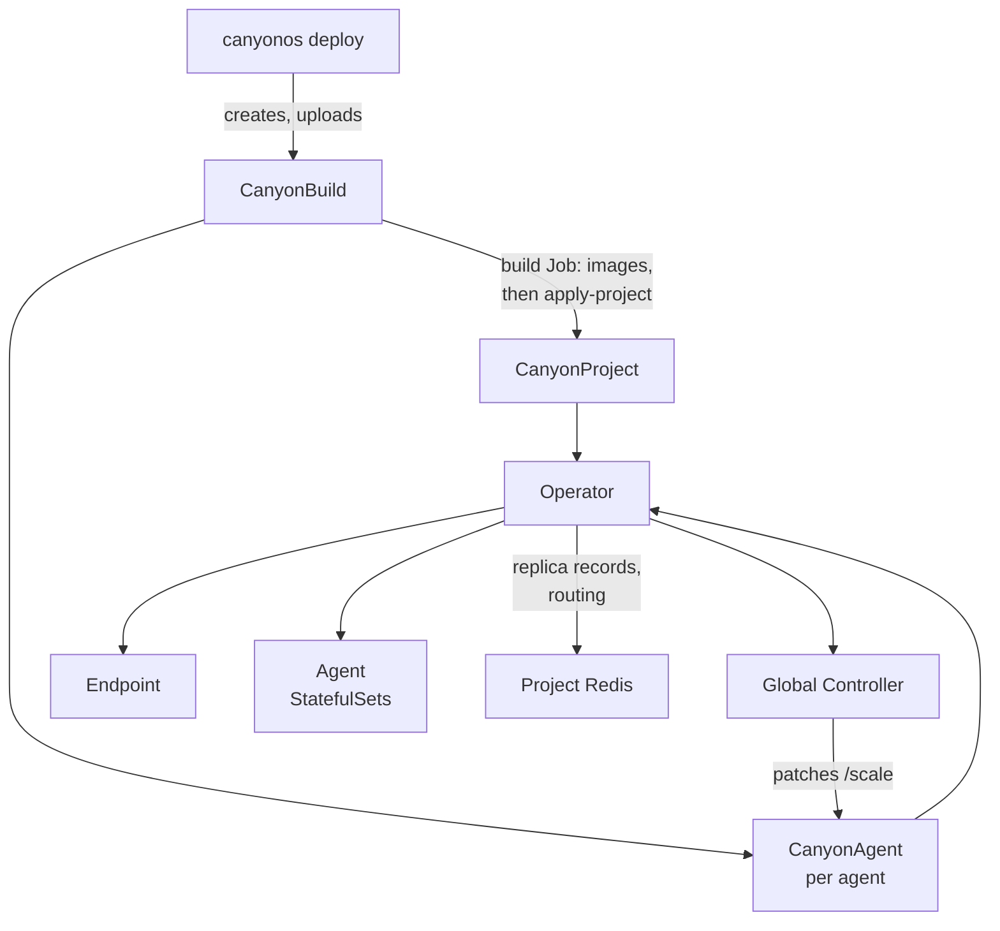

# Operator

The operator runs CanyonOS projects on Kubernetes. It is a Go controller manager
(kubebuilder, controller-runtime) in `packages/operator`. It does there what the
[Reconciler](RECONCILER.md) does on Docker and EC2: it turns CanyonOS custom resources
into Kubernetes objects, keeps each agent at its replica count, and writes the replica
records and routing table to the project's Redis. The Global Controller still decides
replica counts, through each CanyonAgent's `/scale` subresource.

| Path                        | What it holds                                                       |
| --------------------------- | ------------------------------------------------------------------- |
| `api/v1alpha1/`             | The CRD types: CanyonProject, CanyonAgent, CanyonBuild              |
| `cmd/main.go`               | The manager, its flags and caches                                   |
| `internal/controller/`      | The reconcilers, rollout, teardown and the dashboard's project list |
| `internal/builders/`        | The Kubernetes objects each resource becomes, as pure functions     |
| `internal/redisstate/`      | The replica records and routing table written to Redis              |
| `charts/canyonos-operator/` | The Helm chart; `crds/` and `files/role.yaml` are generated         |

Paths are relative to `packages/operator`.

## How it fits

The resources, in `canyonos.canyoncode.ai/v1alpha1`:

| Resource      | Short name | One per                       | Reconciler                |
| ------------- | ---------- | ----------------------------- | ------------------------- |
| CanyonProject | `cproj`    | project, in its namespace     | `CanyonProjectReconciler` |
| CanyonAgent   | `cagent`   | agent of a project            | `CanyonAgentReconciler`   |
| CanyonBuild   | `cbuild`   | in-cluster build of a project | `CanyonBuildReconciler`   |

A CanyonAgent's `metadata.name` must be `ResourceName(spec.agentName)`: lowercase, with
anything but letters, digits and hyphens turned into hyphens, at most 63 characters
(`HelloAgent` becomes `helloagent`). The CLI and the Global Controller use the same
rule. An agent with another name is not run and reports `NameMismatch`. Core renders
CanyonProject and CanyonAgent objects in Python; `api/v1alpha1/testdata/rendered.json`
is a sample of what it renders, kept for reference. No test reads it.

## Where it runs

The Helm chart in `charts/canyonos-operator` installs the operator as a Deployment,
cluster-wide or, with `watchNamespaces`, only in those namespaces. With more than one
replica, leader election picks one and the rest wait. The chart can also install the
cluster dashboard (`dashboard.enabled`) and a rootless BuildKit for in-cluster builds
(`builder.enabled`).

| Flag                    | Set by the chart from                     | Purpose                                                     |
| ----------------------- | ----------------------------------------- | ----------------------------------------------------------- |
| `--controller-image`    | `controllerImage`, else the release image | The canyonos-core image of this release; required           |
| `--canyonos-version`    | the chart's `appVersion`                  | Reported on each CanyonBuild, so the CLI can check it       |
| `--redis-image`         | `redisImage`                              | Image for project Redis, for example from a mirror          |
| `--dashboard-namespace` | `dashboard.namespace`, when enabled       | Where the dashboard runs; empty for none                    |
| `--builder-address`     | `builder.namespace`, when enabled         | BuildKit address; empty means builds fail at once           |
| `--registry-alias`      | `builder.registryAliases`                 | `pull=push`, a registry the builder reaches by another name |
| `--watch-namespaces`    | `watchNamespaces`                         | Namespaces to run projects in; empty for all                |
| `--leader-elect`        | always                                    | One active manager                                          |

`POD_NAMESPACE` (from the downward API) names the operator's own namespace, which
every project's Redis admits; it defaults to `canyonos-system`.

The manager never caches Secrets: it reads each one by name from the API server, so it
needs no list or watch on them. It caches only pods labeled
`app.kubernetes.io/managed-by: canyonos-operator`, never the rest of the cluster's.

## What a CanyonProject becomes

`CanyonProjectReconciler.Reconcile` runs Redis first, then the Global Controller and
the endpoint once Redis is ready, since started earlier they would only wait for it.

| Object                                               | Purpose                                                                                                                            |
| ---------------------------------------------------- | ---------------------------------------------------------------------------------------------------------------------------------- |
| Secret `canyonos-redis`                              | Redis's generated password and `redis.conf`. Created once; deleting it rotates the password.                                       |
| StatefulSet, Service, NetworkPolicy `canyonos-redis` | Redis on a persistent volume, reachable only from the project's pods, the operator and the cluster dashboard's API.                |
| ServiceAccount, Role, RoleBinding `canyonos-gc`      | The Global Controller's identity: patch `canyonagents/scale`, read pods and pod metrics, in its namespace only.                    |
| Deployment `canyonos-gc`                             | `canyonos_core.cli run-gc` with `CANYONOS_TARGET=kubernetes`, one replica, `Recreate`, config from the `spec.configRef` ConfigMap. |
| StatefulSet and headless Service `endpoint`          | The endpoint (gunicorn plus a forwarding Local Controller). Its pod keeps the name `endpoint-0`, where replicas send results.      |
| Service `canyonos-endpoint`, optional Ingress        | Where callers reach the endpoint, on port 8080.                                                                                    |

With `spec.redis.mode: external` the operator runs no Redis: the project's pods use the
host and port given, with TLS and a password Secret when the spec names them. The
Redis disk is deleted with the project (`WhenDeleted: Delete`).

The project's status carries its conditions (`RedisReady`, `ControllerReady`,
`EndpointReady`, and `Ready` when all three are), `redisAddress` and `endpointURL`.
The endpoint URL is `spec.endpoint.url` when set, else the Ingress host (https with a
TLS Secret), else the in-cluster Service. A part that is not ready says why: still
starting, `Unschedulable` with the scheduler's message, or `ConfigMissing` when the
ConfigMap does not exist.

Every object is labeled, owned by its CanyonProject or CanyonAgent, and created only
when nothing of that name exists: an object CanyonOS did not create is never adopted
or changed, and the reconcile fails with a message naming it (`ensureOwned`). Every
pod that signs in to Redis carries the login Secret's UID and resourceVersion in the
`canyonos.canyoncode.ai/redis-login` annotation, so a rotated password restarts them,
one pod at a time for agents and the endpoint.

## What a CanyonAgent becomes

An agent, `type: agent`, runs as a StatefulSet behind a headless Service, both named
after the CanyonAgent. Nothing starts until the project's `RedisReady` condition is
true.

- **Pods.** One per replica, each running the agent's image with its Local
  Controller on port 50051 and health checks on port 8099 (`/startupz`, `/readyz`,
  `/livez`). Pods run as user 1001, group 0, with the restricted profile except a
  read-only root, and no API token.
- **Address and ID.** The headless Service publishes not-ready addresses, so each pod
  keeps a stable DNS name (`helloagent-0.helloagent.<ns>.svc:50051`) while it drains.
  The replica ID is `<Agent>-<pod ordinal>` (`HelloAgent-0`).
- **Scaling.** `spec.replicas` is set by the CLI from the workflow config and changed
  by the Global Controller through `/scale`. The StatefulSet uses parallel pod
  management, so replicas start and stop together, and the highest ordinal goes first
  on scale-down.
- **Updates.** The StatefulSet uses `OnDelete`; the operator runs a surge update
  itself (`planRollout` in `rollout.go`). It adds one replica from the new revision,
  replaces old pods one at a time, highest first, once every new pod is ready, and
  drops the extra replica at the end. A new revision that never gets ready stalls the
  update with the old pods serving, and the `Updated` condition says why. The plan is
  derived from the pods on every pass; nothing is stored.
- **Other scalers.** An HPA (KEDA creates them too) that targets the CanyonAgent or its
  StatefulSet is reported in the `ScalingConflict` condition, never removed.

The agent's conditions are `Ready`, `Updated` and `ScalingConflict`. Its status also
carries `replicas`, `readyReplicas` and the `/scale` selector.

### Environment

`AgentEnv` (`internal/builders/agent.go`) sets the replica's side of the contract. The
agent's own `spec.env` comes first, so it cannot override these, and the project's
`spec.envSecretRef` Secret is added with `envFrom`.

| Variable                          | Value                                                       |
| --------------------------------- | ----------------------------------------------------------- |
| `POD_NAME`                        | the pod's name                                              |
| `CANYONOS_AGENT_HOST`             | `$(POD_NAME).<agent>.<namespace>.svc`                       |
| `CANYONOS_AGENT_PORT`             | `50051`                                                     |
| `CANYONOS_REPLICA_INDEX`          | the pod's StatefulSet index label                           |
| `CANYONOS_REPLICA_ID`             | `<Agent>-$(CANYONOS_REPLICA_INDEX)`                         |
| `CANYONOS_POLL_INTERVAL`          | `spec.pollIntervalSeconds`, default 5                       |
| `CANYONOS_LOGS_ENABLED`           | `spec.logs`, default true                                   |
| `CANYONOS_HEALTH_PORT`            | `8099`                                                      |
| `CANYONOS_SHUTDOWN_GRACE_SECONDS` | the grace period minus the preStop pause, at least 1        |
| `CANYONOS_REDIS_*`                | host, port, password Secret; TLS and username when external |
| `HTTP_PROXY`, `HTTPS_PROXY`, ...  | the replica's LLM Gateway and its CA bundle                 |
| `HOME`                            | `/tmp`                                                      |

### Stopping and draining

When a pod is deleted (scale-down, update, agent deletion), it leaves routing at once:
`podServing` is false for a pod with a deletion timestamp. Then:

1. A `preStop` sleep of `pollIntervalSeconds + 1` seconds keeps it taking calls while
   other replicas, Services and ingress controllers reload routing without it.
2. Kubernetes sends SIGTERM and the Local Controller drains, as described in
   [On SIGTERM](RECONCILER.md#on-sigterm).
3. `CANYONOS_SHUTDOWN_GRACE_SECONDS` is the time left for the drain:
   `spec.terminationGracePeriodSeconds` (default 180, from 20 to 3600) minus the
   preStop pause. Kubernetes counts the grace period from the deletion, the pause
   included.

The endpoint drains the same way, with a fixed 180 s grace period and a 5 s pause.

### Database agents

A CanyonAgent with `type: database` and `spec.database` runs a stock image
(`DatabaseStatefulSet` in `database.go`): one replica at most, on its own
ReadWriteOnce disk at `spec.database.mountPath`, with a TCP readiness probe on its
port and no CanyonOS environment. The disk is kept when the CanyonAgent is deleted or
scaled (`Retain`), as a named volume survives on Docker. It updates with the
StatefulSet's rolling update, stopping the old pod first, since a second pod would
have a disk of its own. It is routed like an agent, at its own port.

### Lost nodes

Agent, endpoint and Global Controller pods tolerate a not-ready or unreachable node
for 30 s instead of 5 minutes, unless the placement already tolerates that taint. A pod
still stopping a minute after its grace period ends counts as lost (`podExists`):
`releaseLost` force-deletes it so the StatefulSet can replace it. A database pod is
never force-deleted, since an unreachable node may still run it and write its disk.

## The Redis contract

On Kubernetes there is no Reconciler, so the operator writes the keys the Reconciler
writes on Docker, from what Kubernetes reports. Both the agent and the project
reconciler go through `publishReplicas`, which calls `redisstate.SyncReplicas` and
then `redisstate.PublishRouting` in one transaction each.

| Key                              | Type   | Holds                                                                   |
| -------------------------------- | ------ | ----------------------------------------------------------------------- |
| `agent_instance:<replica_id>`    | hash   | One record per pod that is ready and not terminating                    |
| `agent:<Agent>:instances`        | set    | The agent's replica IDs                                                 |
| `agent:<Agent>:desired_replicas` | string | Mirrored from the CanyonAgent's `spec.replicas`                         |
| `routing_table:agents`           | set    | Every routed agent and the endpoint                                     |
| `routing_table:addresses`        | hash   | Per agent, its ready replicas' addresses, oldest first                  |
| `routing_table:stateful`         | hash   | `true` for stateful agents                                              |
| `routing_table:up`               | set    | The agents with a ready replica                                         |
| `routing_table:replicas`         | hash   | Per agent, every replica whose pod still exists, stopping ones included |
| `operator:<Agent>:addresses`     | set    | The operator's own list of addresses whose status keys may remain       |

Readiness stands in for the Reconciler's health check: the readiness probe is the
Local Controller's `/readyz`, which passes only while it reports `healthy`, and pod
changes requeue the agent. `routing_table:replicas` lets a Local Controller fail a call
handed to a replica that is gone. When a pod no longer exists, the operator deletes
its `controller:<address>:status` key, as the replica provisioner does on Docker.

The operator rewrites everything at least once a minute (`resyncPeriod`), in case
Redis lost it, and sooner when a stopping pod is about to count as lost. The key
formats are those core writes; `internal/redisstate/testdata/contract.json` records
them for reference, and no test reads it.

## What a CanyonBuild becomes

`canyonos deploy --target kubernetes` creates a CanyonBuild and uploads the project to
its pod. The operator gives the build a ServiceAccount and a Role allowing only what
applying the project needs (its ConfigMap, CanyonProject and CanyonAgents), and runs a
Job with two containers from the canyonos-core image:

- `receive` takes the upload on port 8090 and waits up to 900 s for it.
- `build` waits for the upload, runs `canyonos_core.cli build` on the cluster's
  BuildKit, pushes the images, then runs `apply-project` with them. It writes the
  image list to its termination message.

The status `phase` goes `Pending`, `Receiving` (with the pod to upload to), `Building`,
then `Succeeded` with the images or `Failed` with the build's error. The Job has no
retries and a 3600 s deadline. Without `--builder-address` a build fails at once. A
finished build is left alone; the CLI deletes it, and what it owns goes with it.

## Dashboard, deletion and install

- **Dashboard:** with `--dashboard-namespace`, the operator keeps one Secret there,
  `canyonos-dashboard-projects`, listing every project whose Redis is ready and how to
  sign in to it (`DashboardRegistryReconciler`). The dashboard mounts it as a file and
  needs no access to any project's Secrets. The Global Controller also gets
  `CANYONOS_DASHBOARD_OTLP_ENDPOINT`, the dashboard API's in-cluster address, to send
  telemetry to.
- **Deletion:** the finalizer `canyonos.canyoncode.ai/teardown` holds each CanyonAgent
  and CanyonProject until it is taken down in order, one step per pass, checking every
  5 s. An agent is unrouted (records, count and routing entry removed), its
  StatefulSet deleted so its pods drain, and its status keys removed once its pods are
  gone. A project deletes its endpoint and its CanyonAgents first, waits until their
  pods are gone, then cleans the endpoint's keys and the routing table from Redis
  before Redis and the Global Controller go with their owner. An unreachable Redis is
  skipped after five minutes, so a deletion never hangs; a pod a minute past its grace
  period counts as gone.
- **Install:** `make manifests` generates the CRDs and the manager's RBAC rules from
  the Go types and `+kubebuilder:rbac` markers into the chart, and CI fails if they
  aren't committed. The operator can grant the Global Controller and builds only what
  it holds itself, so their Roles' verbs also appear in its own markers.

## Developing

With Go 1.26 or later, or in the `golang:1.27.0` container CI uses, run `make manifests
generate fmt vet test lint`. The tests are in `internal/controller/`: the reconcilers
against envtest and miniredis, `rollout_test.go` for the surge plan and
`canyonagent_lost_test.go` for lost nodes. For the whole path on a real cluster, see
[Kubernetes on kind](../contributing/DEVELOPMENT.md#kubernetes-on-kind); the user guide
is [Kubernetes deployment](../guides/KUBERNETES.md).

When changing a CRD type, run `make generate manifests` and update core's renderer
with it. When changing a Redis key, change core's side first, then the operator's
writer (`internal/redisstate/writer.go`).
