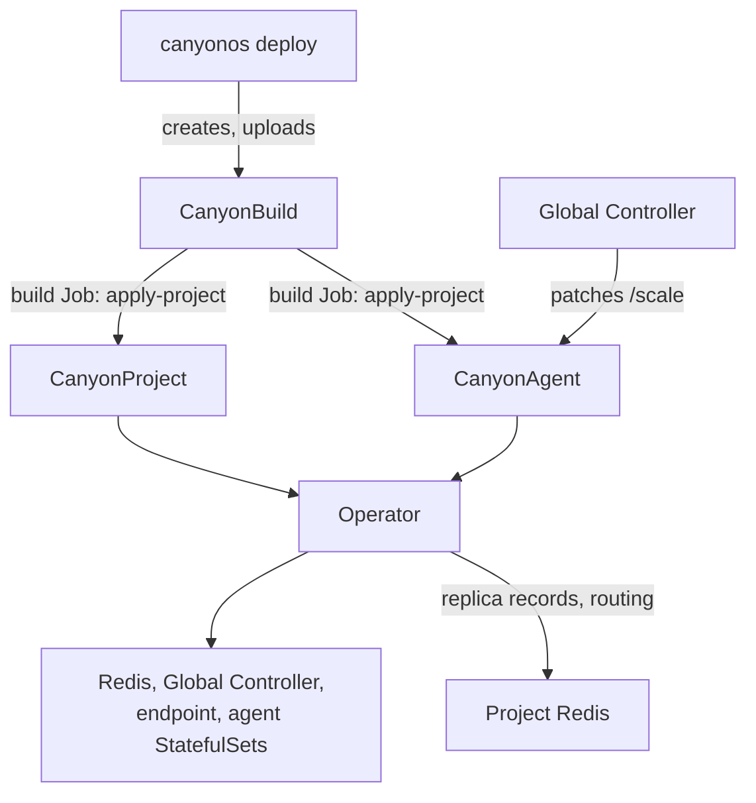

# Operator

The operator runs CanyonOS projects on Kubernetes. It is a Go controller manager
(kubebuilder, controller-runtime) that does there what the [Reconciler](RECONCILER.md)
does on Docker and EC2.

A deploy renders a CanyonProject and one CanyonAgent per agent. The operator turns them
into the project's Redis, Global Controller and endpoint, and each agent's pods, and keeps
every agent at its replica count with rolling updates and an ordered teardown. It also
writes the replica records and the routing table to the project's Redis, so the
controllers read the same keys they read on Docker.

The Global Controller still decides how many replicas run. It patches each CanyonAgent's
`/scale` subresource.

## How it fits

## Resources

All three are in `canyonos.canyoncode.ai/v1alpha1`.

| Resource      | Short name | One per                       | Becomes                                                        |
| ------------- | ---------- | ----------------------------- | -------------------------------------------------------------- |
| CanyonProject | `cproj`    | project, in its namespace     | Redis, Global Controller, endpoint, and a Service for callers  |
| CanyonAgent   | `cagent`   | agent of a project            | a StatefulSet and headless Service (a database agent keeps one disk) |
| CanyonBuild   | `cbuild`   | in-cluster build of a project | a Job that receives the upload, builds images, applies the project |

A CanyonAgent's `metadata.name` must be the agent's name lowercased, with anything but
letters, digits and hyphens turned into hyphens (`HelloAgent` becomes `helloagent`). The
CLI and the Global Controller use the same rule. Any other name is not run and reports
`NameMismatch`.

## How it works

1. A CanyonProject creates Redis first. The Global Controller and the endpoint start
   once Redis is ready.
2. A CanyonAgent starts once the project's `RedisReady` condition is true.
3. Each pod's readiness probe is the Local Controller's `/readyz`. Pod changes requeue
   the agent, and the operator writes what is ready to Redis.
4. A pod that is deleted leaves routing at once. A `preStop` pause keeps it taking calls
   while routing reloads, then the Local Controller drains on SIGTERM (see
   [Teardown](RECONCILER.md#teardown)).
5. Updates are a surge update the operator runs itself: one extra replica from the new
   revision, then old pods replaced one at a time once the new ones are ready.
6. A pod still stopping a minute after its grace period ends counts as lost and is
   force-deleted so the StatefulSet can replace it. A database pod never is, since the
   node may still be writing its disk.

`spec.auth` says who may call the endpoint: `trustedKeys`, the Ed25519 public keys in
PEM that sign its tokens, and `disabled`, which `--dangerous-skip-auth` sets. The CLI
writes the deploying machine's trusted keys into the CanyonBuild's `spec.auth`, the
build's `apply-project` copies it into the CanyonProject unchanged, and the operator
hands it to the Global Controller as `CANYONOS_TRUSTED_KEYS` and, when `disabled`,
`CANYONOS_AUTH_DISABLED=true` (see [Endpoint](ENDPOINT.md#tokens)). Private keys never
reach the cluster. A CanyonProject without `spec.auth` gets neither variable, so its
endpoint refuses every token.

The operator never adopts an object it did not create. Pods that sign in to Redis carry
the login Secret's version, so a rotated password restarts them.

## The Redis contract

On Kubernetes there is no Reconciler, so the operator writes the keys the Reconciler
writes on Docker, from what Kubernetes reports. The operator and the Reconciler must
write the same formats, since the Global Controller and the endpoint read them without
knowing which one wrote them.

| Key                              | Holds                                                   |
| -------------------------------- | ------------------------------------------------------- |
| `agent_instance:<replica_id>`    | One record per pod that is ready and not terminating    |
| `agent:<Agent>:instances`        | The agent's replica IDs                                 |
| `agent:<Agent>:desired_replicas` | Mirrored from the CanyonAgent's `spec.replicas`         |
| `routing_table:*`                | `agents`, `addresses`, `stateful`, `up`, `replicas`     |
| `operator:<Agent>:addresses`     | The operator's own list of addresses whose status keys may remain |

The replica ID is `<Agent>-<pod ordinal>` (`HelloAgent-0`). The record formats are
those core writes. `internal/redisstate/testdata/contract.json` records them for
reference, and no test reads it. Both reconcilers write through
one function, so neither drops the other's agents, and the operator rewrites everything
at least once a minute in case Redis lost it. For the full schema, see
[Redis schema](RECONCILER.md#redis-schema).

## Dashboard, deletion and install

- **Dashboard:** with `--dashboard-namespace`, the operator keeps one Secret there,
  `canyonos-dashboard-projects`, listing each project whose Redis is ready and how to
  sign in to it.
- **Dashboard keys:** the same reconciler writes the ConfigMap
  `canyonos-dashboard-trusted-keys`, which the dashboard's API mounts as its
  `AUTH_TRUSTED_KEYS_DIR`: every `spec.auth.trustedKeys` key of each project whose Redis
  is ready, one `<namespace>_<project>_<n>.pub` entry per key. A key that is not one
  Ed25519 public key is left out and logged. The API reads its keys only when it starts,
  so the entries' sha256 in the `canyonos.canyoncode.ai/trusted-keys` pod annotation of
  `canyonos-dashboard-api` rolls it on a change. The chart's `dashboard.dangerousSkipAuth`
  sets `AUTH_DISABLED` on the API.
- **Deletion:** the finalizer `canyonos.canyoncode.ai/teardown` holds a CanyonAgent or
  CanyonProject until it is taken down in order. An agent is unrouted, then its
  StatefulSet is deleted and its pods drain. A project deletes its endpoint and agents,
  waits for their pods, then cleans its keys from Redis. An unreachable Redis is
  skipped after five minutes.
- **Install:** the Helm chart installs the operator as a Deployment, with leader
  election. Its flags and options are in `charts/canyonos-operator/values.yaml`.
- **Generated files:** `make manifests` generates the CRDs and the manager's RBAC into
  the chart from the Go types and `+kubebuilder:rbac` markers. CI fails if they are not
  committed.

## Code

Paths are relative to `packages/operator`.

| Path                        | What it holds                                                       |
| --------------------------- | ------------------------------------------------------------------- |
| `api/v1alpha1/`             | The CRD types                                                       |
| `cmd/main.go`               | The manager, its flags and caches                                   |
| `internal/controller/`      | The reconcilers, rollout, teardown and the dashboard's project list |
| `internal/builders/`        | The Kubernetes objects each resource becomes, including the agent's environment (`agent.go`) |
| `internal/redisstate/`      | The replica records and routing table written to Redis              |
| `charts/canyonos-operator/` | The Helm chart; `crds/` and `files/role.yaml` are generated         |

## Changing it

From `packages/operator`, `make manifests generate fmt vet test lint` runs everything
CI runs: envtest for the controllers in `internal/controller/`. For the whole path on a
real cluster, see [Kubernetes on kind](../contributing/DEVELOPMENT.md#kubernetes-on-kind).

- A CRD type change: run `make generate manifests`, and update the Python renderer in
  core with it.
- A Redis key change: change core's side first, then the operator's writer
  (`internal/redisstate/writer.go`).

The user guide is [Kubernetes deployment](../guides/KUBERNETES.md).
