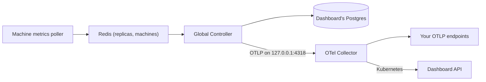

# OTel Collector

The Global Controller stores CanyonOS traces, metrics and logs in the dashboard's
Postgres itself. The OpenTelemetry Collector sends the same telemetry to the other
receivers in [`otel.destinations`](../guides/WORKFLOW_CONFIG.md#oteldestinations). It
runs only when there is at least one.

## How it fits

The collector is the `otelcol-otlp` binary in the Global Controller's image, started and
restarted by its `ProcessSupervisor`. Replica and machine telemetry (`future:*`,
controller metrics, the [machine metrics poller](MACHINE_METRICS_POLLER.md)'s
`machine:*:metrics`) is written to Redis by the other components.

## How it works

1. Every poll, the Global Controller reads the telemetry from Redis and shapes each
   span, log and metric sample into a record of the dashboard's tables.
2. It inserts the records into Postgres. A span already stored is left as it is, and a
   stored log only gains a service name it was missing, so reading the same future
   twice adds nothing. Each metric sample is also added to
   its five-minute rollup in the same transaction.
3. It posts the same records to the collector as OTLP JSON, and the collector sends
   them to every destination.

A request's spans and logs go to the collector once, when the request completes.
Metrics and the Global Controller's own logs go as they are read.

## Failure model

- The dashboard is optional. If its Postgres does not answer after three tries, the
  Global Controller logs it once, skips the writes and tries again 30 seconds later. That
  telemetry is not stored. Cleanup and the collector carry on.
- If the collector does not take a batch after three tries, the Global Controller logs
  it. A request's spans and logs stay in Redis and go again on the next cycle. Metrics
  and the Global Controller's own logs are not sent again.
- A request can reach a destination twice. The dashboard API stores a span or log it
  already has only once.
- The collector retries a destination that fails, with its own defaults.
- A collector that exits is restarted by the `ProcessSupervisor`.

## Destinations and dashboard

The Global Controller builds the collector's config from the list in three steps:

1. Take `otel.destinations` from `workflow_group.yaml`, with `${VAR}` expanded, and
   drop any that points at the local dashboard.
2. On Kubernetes, drop destinations on `host.docker.internal`, since a cluster has no
   way back to the laptop.
3. If `CANYONOS_DASHBOARD_OTLP_ENDPOINT` is set (the operator sets it when the cluster
   has a dashboard), add a `canyonos-dashboard` destination. On Kubernetes this is how
   telemetry reaches the dashboard, whose API ingests the three signals at `POST
   /v1/workflow-groups/<workflow_group_id>/traces`, `/metrics` and `/logs`, with no key,
   and stores only what carries that workflow group's ID. On Kubernetes the Global
   Controller never writes to the dashboard's Postgres itself.

A config reload that changes the destinations rewrites the config and restarts the
collector. With no destinations left, it stops.

## Code

Paths are under `packages/core/canyonos_core/`.

| Path                                  | What it holds                                         |
| ------------------------------------- | ----------------------------------------------------- |
| `controller/utils/otel_writer.py`     | Reads telemetry from Redis and prices model calls     |
| `controller/utils/postgres_writer.py` | Shapes the records and writes them to Postgres        |
| `controller/utils/otel_collector.py`  | The collector's config, its process, the OTLP posts   |
| `schema/otel_metrics.py`              | Each metric's OTel name and unit                      |
| `schema/otel_destinations.py`         | Destination rules shared by the config schema         |

## Changing it

- New span field: write it in `otel_writer.py`. It lands in the record's attributes
  with no other change.
- New log field: add it to the log entry's `Attributes`. Only those reach the record.
- New machine or agent metric: add its name and unit in `schema/otel_metrics.py`.
- New destination option: change `schema/otel_destinations.py` and map it in
  `otel_collector.py`.
