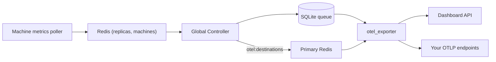

# OTLP exporter

The OTLP exporter delivers CanyonOS traces, metrics and logs to the OpenTelemetry
destinations in [`otel.destinations`](../guides/WORKFLOW_CONFIG.md#oteldestinations), the
dashboard API among them.

It is built so that a slow or failing destination never slows a request down. Telemetry
takes two hops:

1. The Global Controller copies it from Redis into a SQLite queue.
2. The exporter, a separate process, sends the queue on its own loop.

The two processes share nothing but that queue. The exporter rereads the destinations
from Redis on every poll, so a config change needs no restart.

## How it fits

The exporter runs in the Global Controller's container, started and restarted by its
`ProcessSupervisor`. Replica and machine telemetry (`future:*`, controller metrics, the
[machine metrics poller](MACHINE_METRICS_POLLER.md)'s `machine:*:metrics`) is written
to Redis by the other components. The queue file is `otel_queue.db`, in
`CANYONOS_DATA_DIR` when it is set, else beside `controller/utils/schema.py`. On Docker
it is unset, so the queue lives in the Global Controller container and goes with it. On
Kubernetes it is an `emptyDir`, so the queue does not survive a Global Controller restart
either.

## How it works

1. Every poll, the Global Controller reads the telemetry from Redis and upserts it as
   queue rows. It also queues its own INFO and above logs when the config's `logs` is on.
2. It resolves the destinations and writes them to `otel:destinations`.
3. Every 5 seconds the exporter reloads the destinations if the key changed.
4. For each signal, it reads up to 512 rows not yet sent, converts them to OTel objects
   and sends the batch to every destination.
5. Every 5 minutes it deletes expired rows.

Delivery is all or nothing. A batch is exported once to every destination, and its rows
are marked sent only if every destination accepts it. If any destination fails, every
row stays unsent and the whole batch goes to every destination again on the next poll.
Receivers may therefore see duplicates, and span and log IDs are stable so they can
collapse them.

## The queue

| Table             | Holds                              | A row leaves when                                  |
| ----------------- | ---------------------------------- | -------------------------------------------------- |
| `traces_waiting`  | One row per future (a span)        | Retention passes since `finished_at`               |
| `metrics_waiting` | One `machine` or `agent` sample    | Retention passes since `observed_at`               |
| `logs_waiting`    | One log record of a future or of the Global Controller | Retention passes since `observed_at` |

Writes are upserts: rewriting a row refreshes its payload but never resets `sent`. A
trace with no `finished_at` is still running and is never deleted.

The queue only has to hold a row until it is delivered. The retention constants are at
the top of `otel_exporter.py`. The dashboard API keeps what it received for as long as
the monitoring screens need it, on its own retention.

## Failure model

- A failed delivery leaves the batch unsent and retries on the next poll.
- A row that cannot be converted is skipped and retried. A trace row that fails five
  times is replaced by a placeholder span and marked sent. A metric or log row that is
  empty or unparseable is marked sent.
- A row that expires is deleted, sent or not, so a destination that stays down cannot
  grow the queue without bound.
- A signal with no destinations is flushed: every row of its table is deleted each poll.
- If the exporter cannot reach the queue file or Redis at startup, it exits and the
  `ProcessSupervisor` restarts it.

## What conversion keeps

`session_id` becomes the trace ID and `future_id` the span ID, so one request is one
trace, and logs carry the same IDs so they join their trace. The attribute lists are in
the package's [`TRACES.md`](https://github.com/CanyonCodeCoreAI/canyonos/blob/main/packages/core/canyonos_core/otlp_exporter/TRACES.md),
[`METRICS.md`](https://github.com/CanyonCodeCoreAI/canyonos/blob/main/packages/core/canyonos_core/otlp_exporter/METRICS.md) and
[`LOGS.md`](https://github.com/CanyonCodeCoreAI/canyonos/blob/main/packages/core/canyonos_core/otlp_exporter/LOGS.md).

## Destinations and dashboard

The Global Controller resolves the list in three steps:

1. Take `otel.destinations` from `deployment.yaml`, with `${VAR}` expanded. Without
   the block, use the dashboard API on the deployment's Docker network.
2. On Kubernetes, drop destinations on `host.docker.internal` or on the local
   dashboard, since a cluster has no way back to the laptop.
3. If `CANYONOS_DASHBOARD_OTLP_ENDPOINT` is set (the operator sets it when the cluster
   has a dashboard), add a `canyonos-dashboard` destination.

The exporter validates a changed list with the same rules as the config schema. If the
value is missing or invalid, it keeps the current exporters and tries again next poll.
The dashboard API ingests the three signals at `POST /v1/traces`, `/v1/metrics` and
`/v1/logs`.

## Code

Paths are under `packages/core/canyonos_core/`.

| Path                              | What it holds                                              |
| --------------------------------- | ---------------------------------------------------------- |
| `controller/utils/schema.py`      | The queue file path, the three tables, `init_db`           |
| `controller/utils/otel_writer.py` | Writer side: upserts into the queue                        |
| `otlp_exporter/otel_exporter.py`  | The exporter process: destinations, export loop, retention |
| `otlp_exporter/otel_reader.py`    | Reader side: mark sent, flush, delete expired              |
| `otlp_exporter/*_convert.py`      | Queue row to OTel span, metric and log record              |
| `schema/otel_destinations.py`     | Destination rules shared by the config schema and exporter |

## Changing it

- New signal field: add the column in `schema.py` (`CREATE TABLE IF NOT EXISTS` adds no
  column to an existing file), write it in `otel_writer.py`, and map it in the converter.
  A new machine or agent metric needs only a mapping in `metric_convert.py`.
- New destination option: change `schema/otel_destinations.py`.
