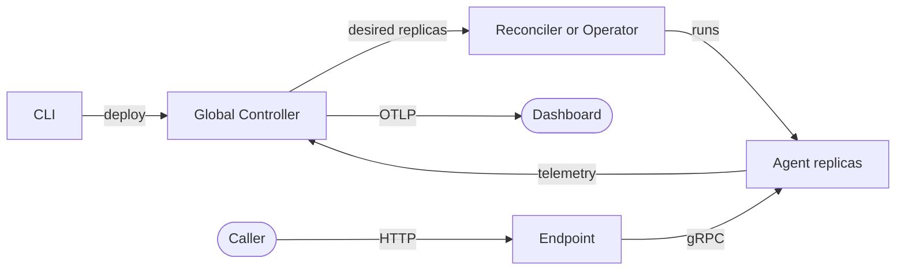

# Architecture

CanyonOS turns workflows, each a project of Python agents, into containers that call each other, with one HTTP front door and telemetry on every call.

Inside, four jobs keep that running:

1. Builds an image per agent of every project in a deployment, from each project's workflow config.
2. Keeps the desired number of replicas of each agent running.
3. Carries calls between agents, and model calls, through every replica.
4. Records each request and sends its telemetry to the dashboard or any OpenTelemetry receiver.

This page is for contributors. For the user's view, see [How it works](../HOW_IT_WORKS.md).

## How it fits

One deployment runs one Global Controller for all its projects. Every part shares state through the deployment's Redis: the config, the replica records, the routing table and each call's result.

| Component | What it does | Code |
| --- | --- | --- |
| [CLI](CLI.md) | The `canyonos` command, a thin client of the Global Controller | `packages/cli/` |
| [Global Controller](CONTROLLER.md#global-controller) | Publishes the config, polls the replicas, cleans up requests | `packages/core/canyonos_core/controller/`, `canyonos_api_interface/`, `cli.py` |
| [Local Controller](CONTROLLER.md#local-controller) | Serves one replica over gRPC and routes its calls | `packages/core/canyonos_core/controller/` |
| [Endpoint](ENDPOINT.md) | The workflow's HTTP API: queues a call, reports its result | `packages/core/canyonos_core/endpoint/` |
| [LLM Gateway](LLM_GATEWAY.md) | Carries each replica's model calls: prompts, limits, tokens | `packages/core/canyonos_core/llm_gateway/` |
| [Reconciler](RECONCILER.md) | Docker and EC2: keeps each agent at its desired count | `packages/core/canyonos_core/reconciler/` |
| [Operator](OPERATOR.md) | Kubernetes: runs a project's Redis, Global Controller, endpoint and agents | `packages/operator/` (Go), `packages/core/canyonos_core/kubernetes/` |
| [OTLP exporter](OTLP_EXPORTER.md) | Sends traces, metrics and logs from a SQLite queue to OTel receivers | `packages/core/canyonos_core/otlp_exporter/` |
| [Machine metrics poller](MACHINE_METRICS_POLLER.md) | Samples one machine's CPU, memory, GPU, disk and network | `packages/core/canyonos_core/machine_metrics_poller/` |
| [Dashboard](../guides/DASHBOARD.md) | Shows requests, traces, prompts and spend | `packages/api/`, `packages/web/` |
| Redis | Shared state: config, replica records, routing, futures. On Docker and EC2, each deployment has one per machine (`canyonos-<deployment>-redis-<host>`). On Kubernetes, one per project. See [Redis keys](CONTROLLER.md#redis-keys) | `controller/utils/redis_client.py` |

## How a deploy flows

On Docker and EC2:

1. `canyonos deploy` starts the Global Controller's container, and uploads `deployment.yaml` and each project to it, which starts the deploy.
2. In the container, the build generates the stubs and Docker contexts and starts building the agent images, while the Global Controller starts.
3. The Global Controller starts Redis and a metrics poller on its machine, publishes the config, and starts the Reconciler and the OTLP exporter as supervised processes.
4. When the images are built, the Reconciler starts any EC2 machines (each with its own Redis and metrics poller), launches the replicas and the endpoint, and publishes the routing table.
5. The Global Controller waits for every replica to report healthy, then polls them until the deploy stops.

On Kubernetes, `canyonos deploy --target kubernetes` uploads the project to a build pod. The pod builds and pushes the images, and the operator runs Redis, the Global Controller, the endpoint and one StatefulSet per agent. See [Operator](OPERATOR.md). Kubernetes deploys don't support multi-folder deployments yet.

## How a request flows

1. A client sends `POST /<project>/<agent>/<method>` to the endpoint. It creates the root `Future`, hands the call to its own Local Controller, and answers `202` with a request ID.
2. That Local Controller checks governance, picks a replica of the route's agent from the routing table, and forwards the call over gRPC.
3. The replica's Local Controller runs the method. Each call to another agent is a `Future` that takes the same path. Each model call goes through the replica's LLM Gateway.
4. Results go back over gRPC to whoever made each call. The root result lands in Redis, where `GET /status/<request_id>` reads it.
5. The Global Controller queues the request's telemetry for the OTLP exporter, then has every replica expire the request's keys.

[Request lifecycle](CONTROLLER.md#request-lifecycle) follows one call hop by hop.

## For the workflow author

[Workflow design](../guides/WORKFLOW_DESIGN.md), [Workflow layout](../guides/BUILD_ARTIFACT.md) and [What a workflow needs](../guides/WORKFLOW_REQUIREMENTS.md) cover what CanyonOS expects of a workflow.

## For contributors

- [Configuration](CONFIG.md): how the config gets from the files a user edits to the running system, and how to add a setting.
- [Development](../contributing/DEVELOPMENT.md): set up a checkout and try a change.
- [Testing](../contributing/TESTING.md): run the checks and tests.
