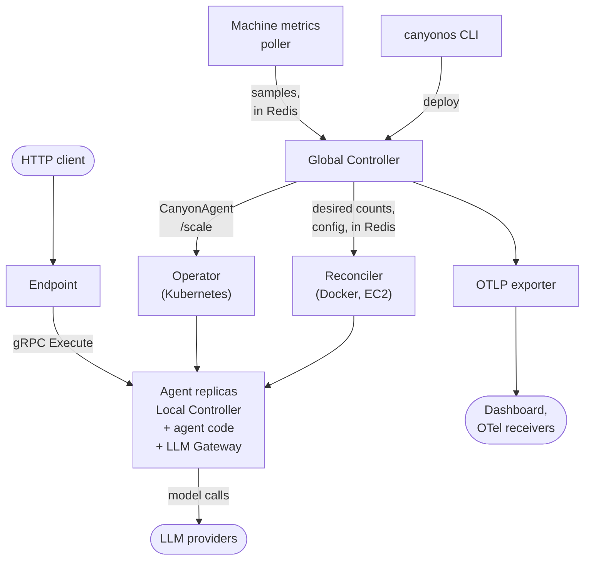

# Architecture

How CanyonOS works inside, for contributors. A workflow is a set of agents, each a
Python class, declared in the workflow config (`config/workflow_config.yaml`).
`canyonos deploy` builds an image per agent and starts a Global Controller, which
publishes the config and each agent's desired replica count to Redis. An orchestrator
keeps that many replicas running: the Reconciler on Docker and EC2, the operator and
Kubernetes on a cluster. Each replica runs a Local Controller beside the agent code,
which carries calls between agents over gRPC, and an LLM Gateway, which carries the
agent's model calls. Requests come in through the endpoint, an HTTP server that queues
a call to one agent method and reports its result. Telemetry flows from Redis through
the OTLP exporter to the dashboard and any other OpenTelemetry receiver.

For a user's view of the same parts, see [How it works](../HOW_IT_WORKS.md).

## Components

| Component              | What it does                                                               | Code                                                                 | Page                                                |
| ---------------------- | -------------------------------------------------------------------------- | -------------------------------------------------------------------- | --------------------------------------------------- |
| CLI                    | The `canyonos` command: deploy, test, stop, logs and the rest              | `packages/cli/`                                                      | [CLI](CLI.md)                                       |
| Global Controller      | Publishes the config, polls the replicas, cleans up requests               | `packages/core/canyonos_core/controller/`, `server.py`, `cli.py`     | [Controller](CONTROLLER.md)                         |
| Local Controller       | Serves an agent over gRPC and routes its calls; one per replica            | `packages/core/canyonos_core/controller/`                            | [Controller](CONTROLLER.md#local-controller)        |
| Endpoint               | The workflow's HTTP API: queues a call, reports its result                 | `packages/core/canyonos_core/endpoint/`                              | [Endpoint](ENDPOINT.md)                             |
| LLM Gateway            | Carries each replica's model calls: prompts, limits, tokens                | `packages/core/canyonos_core/llm_gateway/`                           | [LLM Gateway](LLM_GATEWAY.md)                       |
| Reconciler             | Docker and EC2: keeps each agent at its desired count, publishes routing   | `packages/core/canyonos_core/reconciler/`                            | [Reconciler](RECONCILER.md)                         |
| Operator               | Kubernetes: runs a project's Redis, Global Controller, endpoint and agents | `packages/operator/` (Go), `packages/core/canyonos_core/kubernetes/` | [Operator](OPERATOR.md)                             |
| OTLP exporter          | Sends traces, metrics and logs from a SQLite queue to OTel receivers       | `packages/core/canyonos_core/otlp_exporter/`                         | [OTLP exporter](OTLP_EXPORTER.md)                   |
| Machine metrics poller | Samples one machine's CPU, memory, GPU, disk and network                   | `packages/core/canyonos_core/machine_metrics_poller/`                | [Machine metrics poller](MACHINE_METRICS_POLLER.md) |
| Dashboard              | Shows requests, traces, prompts and spend; edits prompts and governance    | `packages/api/`, `packages/web/`                                     | [Dashboard](../guides/DASHBOARD.md)                 |
| Redis                  | Shared state: config, replica records, routing, futures                    | one per machine; one per project on Kubernetes                       | [Redis keys](CONTROLLER.md#redis-keys)              |

## How a deploy flows

On Docker and EC2:

1. `canyonos deploy` starts the Global Controller's container, copies the project into
   its `/workspace`, and calls `POST /deploy` on the container's server.
2. In the container, `python -m canyonos_core.cli deploy` generates the stubs, protos
   and Docker contexts and starts building the images, then creates the Global
   Controller.
3. The Global Controller starts Redis and a metrics poller on its own machine, publishes
   the config, and starts the Reconciler and the OTLP exporter as supervised processes.
4. When the images are built, it tells the Reconciler, which starts any EC2 machines
   (each with its own Redis and metrics poller), launches each agent's replicas and the
   endpoint, and publishes the routing table.
5. The Global Controller waits for every replica to report healthy, then polls them
   until the deploy stops.

On Kubernetes, `canyonos deploy --target kubernetes` uploads the project to a build pod
the operator runs. The pod builds and pushes the images and applies the project, and the
operator runs Redis, the Global Controller (`run-gc`), the endpoint and one StatefulSet
per agent. [Controller](CONTROLLER.md#global-controller) and [Operator](OPERATOR.md)
have the details.

## How a request flows

1. A client sends `POST /<method>` to the endpoint, which creates the root `Future`,
   hands the call to its own Local Controller, and answers `202` with a request ID.
2. The Local Controller checks governance, picks a replica of the served agent from the
   routing table, and forwards the call over gRPC.
3. That replica's Local Controller runs the method. Each call the agent makes to another
   agent is a `Future` that takes the same path, and each model call goes through the
   replica's LLM Gateway, which records its tokens on the call's future.
4. Results go back over gRPC to whoever made each call. The root result lands in Redis,
   where `GET /status/<request_id>` reads it.
5. The Global Controller queues the request's telemetry for the OTLP exporter, then has
   every replica expire the request's keys.

[Request lifecycle](CONTROLLER.md#request-lifecycle) follows one call hop by hop, and
[Endpoint](ENDPOINT.md) covers the HTTP side.

## The workflow itself

These pages cover what CanyonOS builds from a workflow and what it expects of one:

- [Workflow design](../guides/WORKFLOW_DESIGN.md): the ideas behind a workflow, an
  outcome delivered by agents that each own one step.
- [Workflow layout](../guides/BUILD_ARTIFACT.md): where `canyonos` finds a workflow,
  what goes in its `config` folder, what reaches the agent images, and what CanyonOS
  writes into its files.
- [What a workflow needs](../guides/WORKFLOW_REQUIREMENTS.md): the requirements an app
  must meet before it is converted, and who owns what.

To set up a checkout, run the tests and try a change, see
[Development](../contributing/DEVELOPMENT.md).
