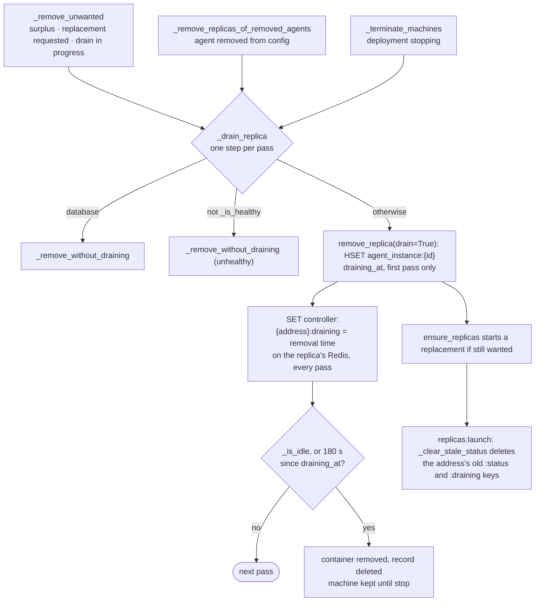
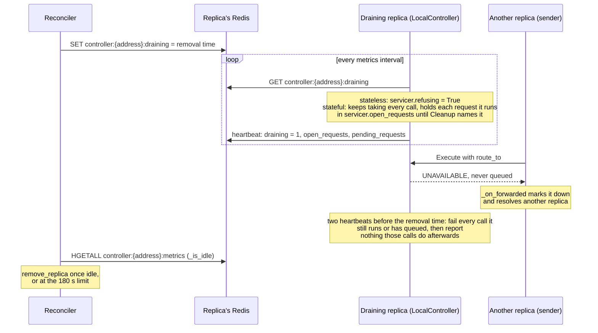
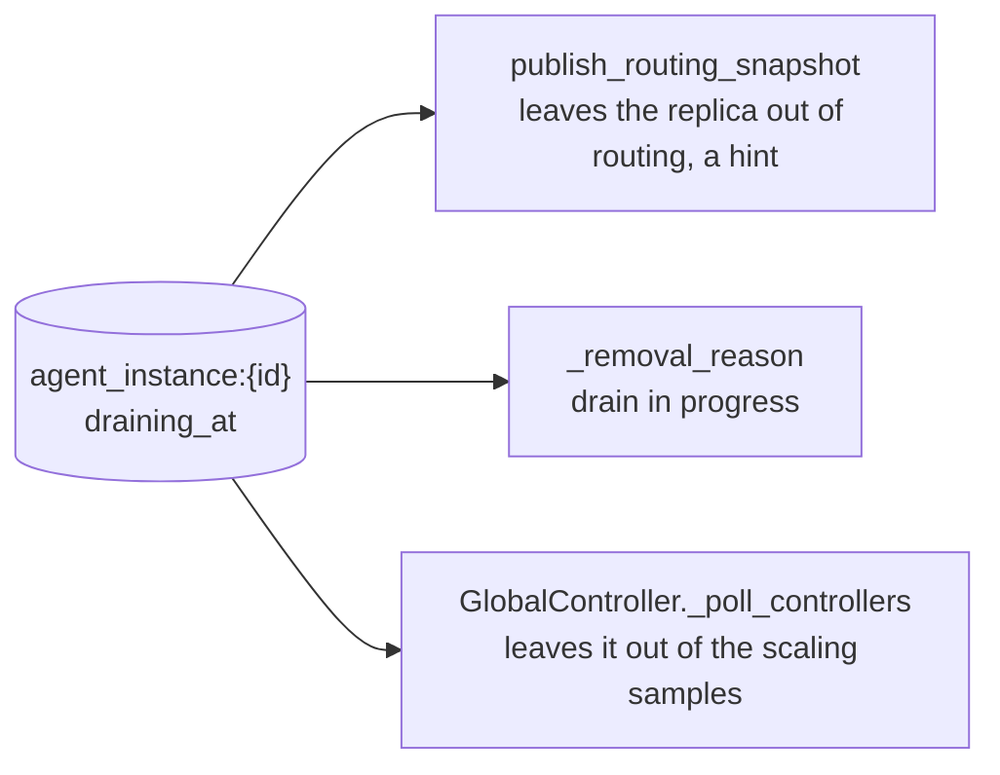

# Reconciler — Architecture

Desired replica counts live durably in Redis. A separate, GlobalController-supervised
process converges running replicas onto them and replaces replicas that stop answering.
Scaling and replacement are Redis writes plus a wake signal — no caller waits on Docker or
EC2. The code is the source of truth; this covers only what it cannot tell you.

## How it works

**Level-triggered.** Every pass recomputes what should exist (desired counts in Redis) and
what does exist (`agent_instance:*` hashes) and acts on the difference. Nothing is derived
from the event that woke the loop, so a lost signal, a Redis blip or a crash mid-pass
costs latency, never correctness. The periodic `sweep_interval` exists so the system
converges even when every signal is lost.

**The queue carries wake signals only** — an agent name or `"*"`, never "add 2". The count
is already durable; a delta would be a second source of truth that a re-delivered or
dropped message would permanently skew. The queue decouples callers from provisioning
latency and serializes reconciles into one worker, so two cannot race on one agent.

**The YAML is the source of truth.** Startup and every reload write each agent's configured
`replicas` through `_set_replicas`, overwriting whatever Redis holds, so a changed config
always takes effect. A runtime `_set_replicas` holds only until the next reload or redeploy.
Each pass removes, then fills. A replica that is no longer wanted drains gracefully
before it is removed; a database or an unhealthy one is removed at once. A stop drains
every replica the same way, then terminates every machine.

Scale-down drains the newest replicas: sorted by `created_at`, every replica that is not
already draining and is past the desired count drains, so 5→2 keeps the two oldest.
Replacement needs no code of its own — `ensure_replicas` counts the agent's records,
leaving out draining ones, and launches only the shortfall, so a replica that starts
draining gets its replacement in the same pass instead of after its drain ends.

## Redis schema

| Key | Type | Written by | Read by |
| --- | --- | --- | --- |
| `agent:{name}:desired_replicas` | int (string) | GlobalController — `_set_replicas` (also from `_apply_configured_replicas`) | Reconciler (`get_desired`, `desired_agent_specs`) |
| `reconciler:wake` | list | GlobalController — `_request_reconcile` | Reconciler (`drain`: `BRPOP` then non-blocking `RPOP`s) |
| `reconciler:replace` | set | GlobalController — `_replace_replica` | Reconciler (`replace_requests`; `clear_replace_requests` once removed) |
| `reconciler:stopping` | string (TTL) | GlobalController — `set_stopping` / `clear_stopping` | Reconciler (`is_stopping`, once per pass) |
| `agent:{name}:spec` | string (JSON) | GlobalController — `write_config_specs` | Reconciler (`read_config_specs`) |
| `agents:active` | string (JSON list) | GlobalController — `write_config_specs`, written after the specs | Reconciler (`read_config_specs`, read **first**) |
| `agent:{name}:instances` | set | `ReplicaProvisioner` | both |
| `agent_instance:{replica_id}` | hash | `ReplicaProvisioner`; `draining_at`: `ReplicaProvisioner.remove_replica` with drain | both |
| `machine_record:{launch_id}` | hash | `MachineProvisioner`, before `start_machine` | `MachineProvisioner`: the machines up for placement, `find_dead` and `find_surplus` each pass, and `terminate` |
| `routing_table:agents` / `:addresses` / `:stateful` | set / hash / hash | `publish_routing_snapshot` | routing clients |
| `routing_table:up` | set | `_publish_up_agents`, every pass, on every machine's Redis: the agents with a replica not draining that reports `healthy` with a fresh heartbeat (a database: `healthy` alone) | governance (Local Controller, LLM gateway), dashboard API |
| `controller:{host}:{port}:metrics` | hash | the agent's `LocalController` | GlobalController poll; reconciler freshness and idle checks |
| `controller:{host}:{port}:draining` | string | `ReplicaProvisioner.remove_replica` with drain | the agent's `LocalController`, each metrics interval |
| `controller:{host}:{port}:status` | string | the agent's `LocalController` | GlobalController; the reconciler only for `routing_table:up`, never to remove a replica |
| `endpoint:address` | hash | GlobalController — `_apply_config`, deleted once a stop empties the fleet | dashboard API |

The first five are owned here; the rest is pre-existing observed state this reads. Desired
state and records live on the **primary** client (`context.redis`); `controller:*` metrics
live on the machine's own Redis, via `machine_redis_for_replica`.

## Process layout

A separate OS process, not a thread: provisioning is slow, blocking and failure-prone
(Docker, SSH, EC2) and must not stall GlobalController's health polling — the loop that
decides a replica is unhealthy. `ProcessSupervisor` spawns it in `__init__`, respawns it
from the poll tick, stops it from `stop()`. The child is `sys.executable -m
canyonos_core.reconciler --config <abspath>`, absolutized at registration because it
inherits the parent's cwd. `check_and_respawn` is guarded by `if self.running:`, or a
SIGTERM landing mid-tick would resurrect the process shutdown just killed.

**The import boundary is a hard requirement.** `global_controller.py` does
`sys.path.insert(0, os.path.abspath("grpc_stubs"))` at module level, resolved against the
cwd, so it imports only from a project root with generated stubs — a child process must
never import it. The slice provisioning needs is `ControllerContext`, which
GlobalController subclasses and the reconciler constructs directly; cluster bootstrap
(cleanup, launching Redis, policies, identity) stays the controller's.

The write side (`replica_provisioner.py`, `machine_provisioner.py`, `placement.py`, `replicas.py`, `providers/`, `routing.py`) lives under `reconciler/`, and
the record readers are plain functions in `controller_context.py`. The controller calls no
provider function, and reads a failed replica's log with `replicas.log_tail`,
so **only the replica provisioner ever creates or removes a replica's container, and only the machine provisioner starts or terminates a machine**
(the Global Controller still runs its own Redis and metrics containers). The replica provisioner saves each
replica's address in its record (`address`), so the controller reads it there
instead of importing provisioning code.

## Traps

**The fill step must pass the full spec list** for every configured agent with desired counts
substituted in — never one agent's. That is what `desired_agent_specs` is for.
`publish_routing_snapshot` treats the list it is given as the complete world, `srem`/`hdel`
-ing every agent absent from it, so `ensure_replicas([one_spec])` would delete every
*other* agent from the routing table — all still running, now unreachable until the next
full pass. `remove_replica` has the same exposure and republishes from the last list it
was handed, falling back to `controller.agent_specs`.

**Resolve machine Redis clients from the replica record.** `machine_redis` is populated as a
side effect of provisioning, so a replica created by the *other* process is registered
only there. `machine_redis_for_replica(replica)` connects on demand from the record's own
`private_host`/`redis_port`. The host-keyed accessor it replaced fell back to `self.redis` on a
miss, which would have the reconciler read a local key, call a remote replica's metrics
stale, and remove every remote replica on the first pass. Each process also drops the Redis
clients of machines other than this one that no replica record points to (`remove_unused_redis_clients`):
the GC on every poll, the replica provisioner before it publishes routing. Without this, a
terminated EC2 host stays in the map and every later write to it waits on a dead address.

**`attach_local_machine_redis()` must run in the reconciler's `__init__`.** GlobalController
repoints its primary `self.redis` at the local machine's Redis after launching that container;
a process that only attaches must repoint too, or the two write to different Redises — the
reconciler sees zero replicas, provisions a duplicate fleet, never converges.

## Health and liveness

`controller:{host}:{port}:status` **cannot express "dead"**. The agent's own
`LocalController` writes `"healthy"` at init and every metrics interval, and `"stopped"`
only on a graceful shutdown that by definition does not run when a container is killed,
OOMs or hangs. No TTL, so a dead replica reads `healthy` forever — hence direct probes.
`_is_healthy` needs two independent positives, a TCP connect and a fresh metrics hash.
The connect goes to the record's `address`, the one the Global Controller calls: a local
replica by name on `canyonos-local`, since it publishes no port.
Neither suffices alone: a gRPC server can accept connections while the agent behind it is
wedged, and a stale hash cannot tell "wedged" from "never there".

**A Redis read failure is deliberately not unhealthy** — `_reports_are_fresh` returns
`True` if `hgetall` raises. An outage is evidence about the reconciler's connectivity, not
the replica; treating it as unhealthy turns one hiccup into a fleet-wide rebuild. A
*missing* hash is a real negative.

**Startup grace, but no debounce.** A replica that has never reported is starting, so
`max(30, 3 * poll_interval)` seconds from `created_at` are forgiven — and only until it is
first seen healthy, after which it is judged on live probes alone. Without this the loop
provisions a container, probes it while it is still booting, removes it, and provisions
another, forever. Going down there is no debounce: replacement is cheap, downtime is not.

## Draining a replica

### One reconcile pass

### The draining replica

### When it counts as idle

| Heartbeat field | Idle when | Covers |
| --- | --- | --- |
| `draining` | `1` | the replica has seen its drain flag |
| `queue_length` | `0` | calls waiting in its executor |
| `requests_served`, `requests_completed` | equal | calls running |
| `open_requests` | `0` | stateful requests bound to it |
| `pending_requests` | `0` | its incoming queue, the request in hand, sends not yet taken or waiting to retry |

A call waiting for a person's answer counts as running, so a drain that reaches the 180 s limit fails it and its request ends as `error`.

### Who reads draining_at

## Teardown

Teardown converges through the loop rather than tearing the fleet down underneath the
process whose job is to rebuild it. **Why a flag, not desired counts:** deleting the
keys does not empty the fleet, since `_remove_unwanted` and `desired_agent_specs` fall back to the YAML count;
setting them to 0 does, but a zero never expires, and only an expiring flag lets an
orphaned reconciler recover. **Why the TTL:** a SIGKILLed controller orphans its child, and a permanent
flag would have it hold the fleet at zero forever. `__init__` clears the flag before
starting the reconciler, so one stranded by a mid-stop kill cannot poison the next run.

`stop()` orders four load-bearing steps: `_remove_all_replicas()`, then `terminate_all()` (the reconciler is
what removes replicas), then `clear_stopping()` (or the live reconciler refills), then
`_stop_redis_containers()` last, since the reconciler needs Redis to remove replicas.

**A launch is recorded before it starts.** Each new replica gets a saved record before
anything is launched, so a launch that crashes partway through can always be found again.
The record is marked finished only at the very end, and the rest of the system ignores the
replica until then. Every pass, the reconciler removes launches that never finished: first
the container, then the record. If that removal fails, the record stays and still counts
as one of the agent's replicas, so a half-started replica is never forgotten and left running. Machines have their
own records, saved before they start, and are terminated only at stop, once every replica
record is gone.

Nothing else sweeps at startup, deliberately: the first full `_reconcile()` removes a leftover
record whose container is gone (probe fails, `created_at` is old so no grace) and starts
a replacement in the same pass, while a still-healthy leftover is reused — which an
unconditional sweep would remove.

## Config and spec handoff

`ControllerContext._load_config` resolves the config for **both** processes: load
`<project>/.env`, `yaml.safe_load`, expand `${VAR}`. Both must load through it or they
disagree about the same file — and since provisioning moved here, the unexpanded copy is
the one reaching the providers, where an `ec2-pool:` block declared with `${EC2_AMI_ID}`
would hit the AWS API verbatim. An unset ref expands to itself, so a missing variable is a
visibly wrong value, not a silent default.

The `agents:` list is handed off through Redis rather than read twice: `write_config_specs`
publishes each spec as JSON then the name list **last**, and `refresh_agent_specs_from_redis`
adopts them every pass, so a reload needs no SIGHUP handler here. List-last makes a torn
read impossible without version numbers. The list is one JSON string replaced by a single
`SET`, and stale specs are deleted only after it stops naming them. `read_config_specs` returns
`None` (not `[]`) when the key is missing and the reader keeps its specs — `[]` would read as
"no agents configured" and remove the fleet on an unseeded Redis. An intentionally empty publish
is the string `[]`, which still exists, so it reads as `[]`. A full pass also removes replicas
of any agent no longer published, and `reload_config` deletes a removed agent's
`desired_replicas` so a runtime scale does not return if the agent is re-added. Everything outside `agents:` is still
read from the YAML by both processes at construction, and again by the reconciler
(`refresh_config`) when a reload wakes every agent.

## Known gaps

- **No respawn backoff or crash-loop cap in `ProcessSupervisor`.** The reconciler owns
  initial provisioning *and* routing publication, so one that dies on startup leaves the
  controller serving nothing, respawned every tick forever.
- **A list-form `replicas` is unsupported, just not silently** — `ensure_replicas` raises
  `TypeError`, and `desired_agent_specs` passes the spec through rather than drop the agent
  from routing.
- **Smaller, known:** `replace_requests` matches by substring, so an agent name containing
  a colon mis-claims; a vanished machine is removed one replica at a time as "unhealthy".
