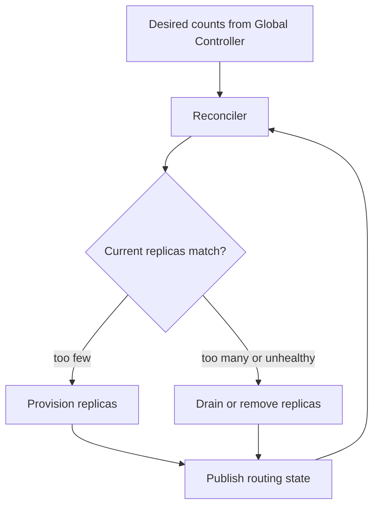
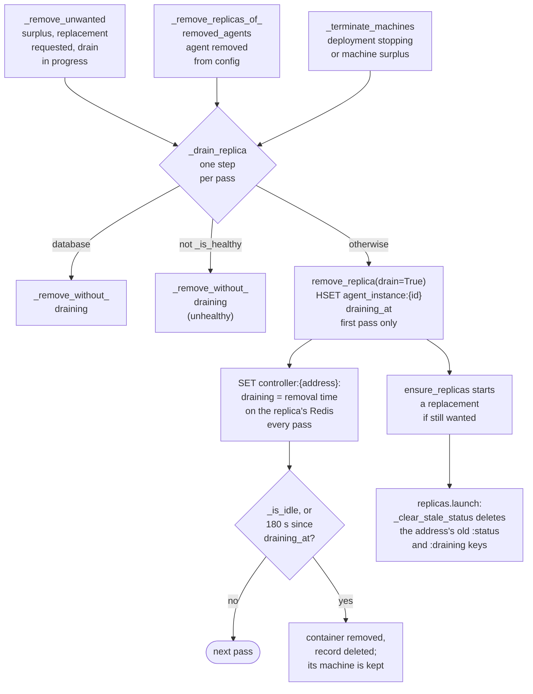
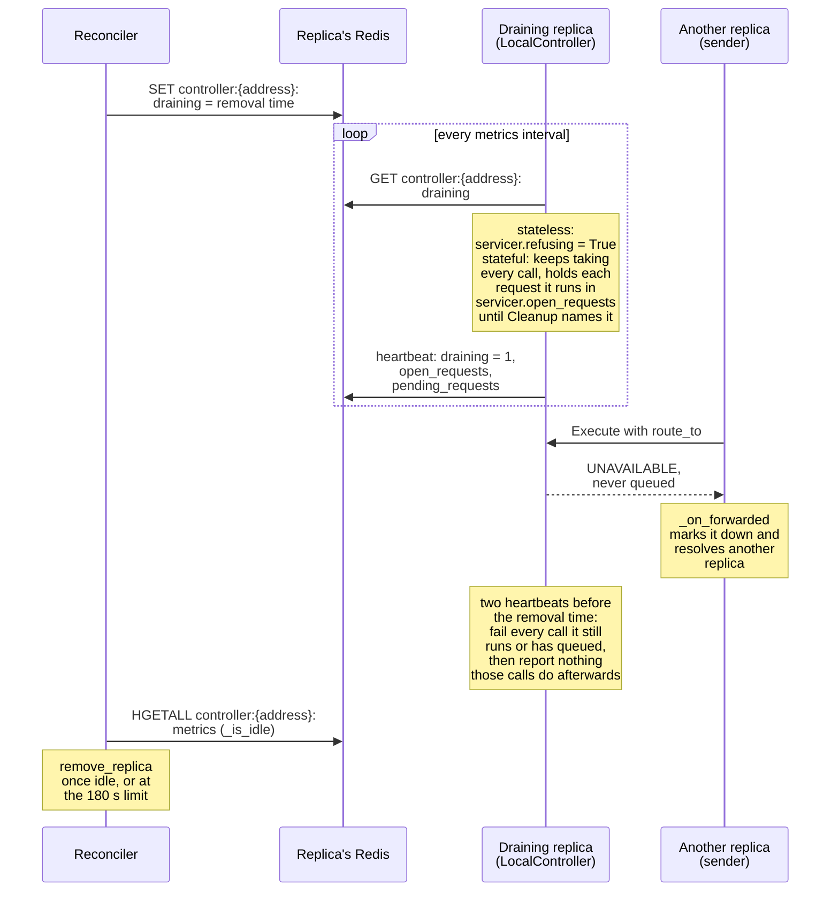
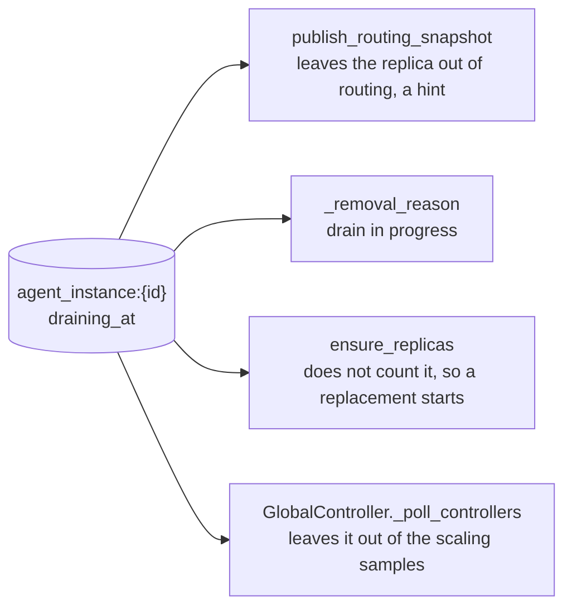

# Reconciler

On Docker and EC2, the Reconciler is a separate process, supervised by the Global
Controller, that converges running replicas on each agent's desired count in Redis. It
starts and terminates machines, provisions the shortfall, drains or removes replicas
that are no longer wanted or have stopped answering, and publishes the routing table.
Scaling and replacement are Redis writes plus a wake signal, so no caller waits on
Docker or EC2. On Kubernetes the [operator](OPERATOR.md) does this work.

| Module (under `packages/core/canyonos_core/reconciler/`) | What it holds                                                                 |
| -------------------------------------------------------- | ----------------------------------------------------------------------------- |
| `reconciler.py`                                          | `Reconciler`: the loop, one pass (`_reconcile`), removal, draining, health    |
| `state.py`                                               | Desired counts, wake queue, replace requests, stopping and images-ready flags |
| `replica_provisioner.py`                                 | `ensure_replicas`, `remove_replica` and the drain, unfinished launches        |
| `machine_provisioner.py`                                 | Machine records: start missing, find dead and surplus, terminate              |
| `placement.py`                                           | `place`: the least loaded machine of the replica's provider                   |
| `replicas.py`                                            | `docker run` of a replica, Redis and metrics collector on a machine, removal  |
| `routing.py`                                             | `publish_routing_snapshot`, `publish_up_agents`                               |
| `providers/`                                             | `local`, `ec2-pool`, `ec2-assign`: start, check and terminate machines        |

The record readers (`list_replicas`) and `ControllerContext` live in
`controller/controller_context.py`.

## How it works

- **Level-triggered.** Every pass compares the desired counts in Redis with the
  `agent_instance:*` records and acts on the difference, never on the event that woke
  it. A lost signal, a Redis blip or a crash mid-pass costs latency, never correctness,
  and the periodic sweep converges even if every signal is lost.
- **The queue carries wake signals only:** an agent name or `"*"`, never "add 2". The
  count is already durable, and a delta that is re-delivered or dropped would skew it
  for good. One worker runs every reconcile, so two cannot race on one agent.
- **The workflow config is the source of truth.** Startup and every reload write each
  agent's configured `replicas` through `_set_replicas`, overwriting Redis, so a
  runtime `_set_replicas` holds only until the next reload or redeploy.
- **Each pass removes, then fills.** A replica that is no longer wanted drains before
  it is removed; a database or an unhealthy replica is removed at once.
- **Scale-down drains the newest.** Sorted by `created_at`, every replica past the
  desired count that isn't already draining drains, so going from 5 to 2 keeps the two
  oldest. `ensure_replicas` counts records that aren't draining and launches the
  shortfall, so a replacement starts in the same pass, not after the drain ends.

### The loop

`Reconciler.run` reconciles once at startup, then:

| Trigger                                    | What runs                          |
| ------------------------------------------ | ---------------------------------- |
| `"*"` on `reconciler:wake` (config reload) | `refresh_config`, then a full pass |
| Agent names on `reconciler:wake`           | A pass over those agents only      |
| `sweep_interval` (`poll_interval`) passed  | A full pass                        |

`wait_for_wake_signals` blocks on `BRPOP` for up to 1 s, then drains the queue with
`RPOP`, so a burst of signals is one pass.

### One pass

`_reconcile` runs these steps in order; each step logs its failure and the pass goes
on:

1. `refresh_agent_specs_from_redis` adopts the agent specs the Global Controller
   published.
2. `find_dead`: machines that never came up, and those their provider says are gone.
   Their replica records are dropped at once (`forget_replicas_on`), routing is
   republished without them, and the machines are terminated.
3. While `reconciler:stopping` is set: drain every replica, terminate every machine
   with no replica left, publish `routing_table:up`, and end the pass.
4. `_remove_unwanted` for each agent; on a full pass also
   `_remove_replicas_of_removed_agents`.
5. `remove_unfinished`: launches that never finished, container first, then record.
6. `_publish_up_agents`, before provisioning, which can take minutes on EC2.
7. `desired_agent_specs`, then `start_missing` (machines the config declares and has
   no record of), `find_surplus` (machines the config no longer wants, drained, then
   terminated), and `ensure_replicas` on the machines up or starting, once
   `reconciler:images_ready` is set.

### Machines and placement

Each machine has a `machine_record:{launch_id}`, saved before the provider starts it,
so it can be terminated whatever happens next. `_start_machine` runs in a background
thread: it waits for the machine, starts its Redis and its
[metrics collector](MACHINE_METRICS_POLLER.md), then saves `private_host`, which marks
it up. Replicas placed on a machine that is still starting wait for it for up to
`START_WAIT_SECONDS` (180); a machine without `private_host` after that is replaced by
`find_dead`. A failed start is saved by machine type in `reconciler:machine_errors`.

`placement.place` puts a new replica on the least loaded machine of its provider, where
load is the larger of the CPU and memory fill. A machine started for one agent (its
record has `agent_name`, as with `ec2-assign`) takes one replica of that agent only. A
pool never refuses a replica; a full pool is shared evenly. The `local` provider has
one machine, this one; terminating it does nothing.

## Redis schema

| Key                                                 | Type               | Written by                                                                                                                                                                     | Read by                                                                                                        |
| --------------------------------------------------- | ------------------ | ------------------------------------------------------------------------------------------------------------------------------------------------------------------------------ | -------------------------------------------------------------------------------------------------------------- |
| `agent:{name}:desired_replicas`                     | int (string)       | GlobalController: `_set_replicas` (also from `_apply_configured_replicas`)                                                                                                     | Reconciler (`get_desired`, `desired_agent_specs`)                                                              |
| `reconciler:wake`                                   | list               | GlobalController: `_request_reconcile`                                                                                                                                         | Reconciler (`wait_for_wake_signals`: `BRPOP` then non-blocking `RPOP`s)                                        |
| `reconciler:replace`                                | set                | GlobalController: `_replace_replica`                                                                                                                                           | Reconciler (`replace_requests`; `clear_replace_requests` once removed)                                         |
| `reconciler:stopping`                               | string (TTL 60 s)  | GlobalController: `set_stopping`, renewed every second while stopping; `clear_stopping`                                                                                        | Reconciler (`is_stopping`, once per pass)                                                                      |
| `reconciler:images_ready`                           | string             | GlobalController: `set_images_ready` once the deploy's images are built; cleared at startup                                                                                    | Reconciler, before `ensure_replicas`                                                                           |
| `agent:{name}:spec`                                 | string (JSON)      | GlobalController: `write_config_specs`                                                                                                                                         | Reconciler (`read_config_specs`)                                                                               |
| `agents:active`                                     | string (JSON list) | GlobalController: `write_config_specs`, written after the specs                                                                                                                | Reconciler (`read_config_specs`, read first)                                                                   |
| `reconciler:launch_errors`                          | hash               | `ReplicaProvisioner`: agent name to its last launch error; cleared by a launch that succeeds                                                                                   | GlobalController, to fail a deploy with the reason                                                             |
| `reconciler:machine_errors`                         | hash               | `MachineProvisioner`: machine type to its last start error                                                                                                                     | GlobalController, to fail a deploy with the reason                                                             |
| `agent:{name}:instances`                            | set                | `ReplicaProvisioner`                                                                                                                                                           | both                                                                                                           |
| `agent_instance:{replica_id}`                       | hash               | `ReplicaProvisioner`, `address` last; `draining_at`: `remove_replica` with drain                                                                                               | both                                                                                                           |
| `agent:{replica_id}:hourly_cost`                    | string             | `ReplicaProvisioner`, on the replica's machine Redis                                                                                                                           | GlobalController (`otel_writer`)                                                                               |
| `machine_record:{launch_id}`                        | hash               | `MachineProvisioner`, before `start_machine`; `private_host` once it is up                                                                                                     | `MachineProvisioner`: the machines up for placement, `find_dead` and `find_surplus` each pass, and `terminate` |
| `routing_table:agents` / `:addresses` / `:stateful` | set / hash / hash  | `publish_routing_snapshot`, on every machine's Redis: routed replicas, oldest first, draining ones left out                                                                    | routing clients                                                                                                |
| `routing_table:replicas`                            | hash               | `publish_routing_snapshot`: every replica with a record, draining ones included                                                                                                | Local Controller, to fail a call handed to a replica that is gone                                              |
| `routing_table:up`                                  | set                | `_publish_up_agents`, every pass, on every machine's Redis: the agents with a replica not draining that reports `healthy` with a fresh heartbeat (a database: `healthy` alone) | governance (Local Controller, LLM Gateway), dashboard API                                                      |
| `controller:{host}:{port}:metrics`                  | hash               | the agent's `LocalController`                                                                                                                                                  | GlobalController poll; Reconciler freshness and idle checks                                                    |
| `controller:{host}:{port}:draining`                 | string             | `ReplicaProvisioner.remove_replica` with drain                                                                                                                                 | the agent's `LocalController`, each metrics interval                                                           |
| `controller:{host}:{port}:status`                   | string             | the agent's `LocalController`; the Reconciler for a database once it answers                                                                                                   | GlobalController; the Reconciler only for `routing_table:up`, never to remove a replica                        |
| `endpoint:address`                                  | hash               | GlobalController: `_apply_config`, deleted once a stop empties the fleet                                                                                                       | dashboard API; the Reconciler reads `api_port` to launch the endpoint                                          |

Desired state, records and the error hashes live on the primary client
(`context.redis`); `controller:*` keys live on the machine's own Redis, reached with
`machine_redis_for_replica`. The full list of keys the controllers use is in
[Controller](CONTROLLER.md#redis-keys).

## Process layout

The Reconciler is a separate OS process, not a thread: provisioning is slow, blocking
and failure-prone (Docker, SSH, EC2), and must not stall the Global Controller's health
polling, the loop that decides a replica is unhealthy. `ProcessSupervisor` spawns it in
`__init__` (`CanyonOrchestrator.register_background_processes`), respawns it from the
poll tick and stops it from `stop()`. The child runs
`sys.executable -m canyonos_core.reconciler --config <abspath>`; the path is made
absolute at registration because the child inherits the parent's cwd.
`check_and_respawn` is guarded by `if self.running:`, or a SIGTERM landing mid-tick
would resurrect the process shutdown just killed.

**The import boundary is a hard requirement.** `global_controller.py` runs
`sys.path.insert(0, os.path.abspath("grpc_stubs"))` at module level, against the cwd, so
it only imports from a project root with generated stubs, and a child process must never
import it. What provisioning needs is `ControllerContext`, which `GlobalController`
subclasses and the Reconciler constructs directly.

The Global Controller calls no provider function, and reads a failed replica's log with
`replicas.log_tail` and a replica's `address` from its record, so **only the replica
provisioner creates or removes a replica's container, and only the machine provisioner
starts or terminates a machine**. The Global Controller still starts its own machine's
Redis and metrics collector, and cleans up containers an earlier run left on it; the
machine provisioner starts them on every other machine.

## Traps

**The fill step must pass the full spec list**, every configured agent with its desired
count substituted in, never one agent's; that is what `desired_agent_specs` is for.
`publish_routing_snapshot` treats the list as the whole world and removes
(`srem`/`hdel`) every agent missing from it, so `ensure_replicas([one_spec])` would make
every other agent unreachable until the next full pass. To fill only some agents, pass
the full list with `only=`. `remove_replica` has the same exposure: it republishes from
the last list `ensure_replicas` was handed, falling back to `controller.agent_specs`.

**Resolve machine Redis clients from the replica record.** `machine_redis` is filled as
a side effect of provisioning, so a replica created by the other process isn't in it.
`machine_redis_for_replica(replica)` connects on demand from the record's
`private_host`/`redis_port`. The host-keyed accessor it replaced fell back to
`self.redis` on a miss: the Reconciler would read a local key, call a remote replica's
metrics stale, and remove every remote replica on the first pass. Each process also
drops clients for other machines no record points to (`remove_unused_redis_clients`):
the Global Controller every poll, the replica provisioner before it publishes routing.
Otherwise a terminated EC2 host stays in the map and every write to it waits on a dead
address.

**`attach_local_machine_redis()` must run in the Reconciler's `__init__`.** The Global
Controller repoints its primary `self.redis` at the local machine's Redis after
launching that container. A process that only attaches must repoint too, or the two
write to different Redis instances: the Reconciler sees zero replicas, provisions a
duplicate fleet and never converges.

## Health and liveness

`controller:{host}:{port}:status` cannot express "dead". The `LocalController` writes
`"healthy"` at init and every metrics interval, and `"stopped"` only on a graceful
shutdown, which never runs when a container is killed, runs out of memory or hangs. The
key has no TTL, so a dead replica reads `healthy` forever. `_is_healthy` therefore
needs two independent positives: a TCP connect to the record's `address` (the one the
Global Controller calls; a local replica is reached by name on its project's Docker
network, since it publishes no port) and a metrics hash whose `observed_at` is at most
`3 * poll_interval` old. Neither is enough alone: a gRPC server can accept connections
while the agent behind it is wedged, and a stale hash can't tell "wedged" from "never
there". A database has no Local Controller, so an open port is enough, and the
Reconciler writes its `healthy` status the first time it answers.

- **A Redis read failure is deliberately not unhealthy:** `_reports_are_fresh` returns
  `True` if `hgetall` raises. An outage says something about the Reconciler's
  connectivity, not the replica, and treating it as unhealthy would turn one hiccup into
  a fleet-wide rebuild. A missing hash is a real negative.
- **Startup grace, but no debounce.** A replica that has never reported is starting, so
  `max(30, 3 * poll_interval)` seconds from `created_at` are forgiven, until it is first
  seen healthy; after that only live probes count. Without the grace, the loop would
  provision, probe a booting container, remove it and provision again, forever. Going
  down there is no debounce: replacement is cheap, downtime is not.
- **A replica whose container is not running** is found by `ensure_replicas`, which
  removes it and launches a replacement in the same pass.

## Draining a replica

### One reconcile pass

Once started, a drain runs to the end even if the replica is wanted again. A replace
request stays in `reconciler:replace` until its replica is gone.

### The draining replica

### When it counts as idle

| Heartbeat field                         | Idle when | Covers                                                                           |
| --------------------------------------- | --------- | -------------------------------------------------------------------------------- |
| `draining`                              | `1`       | the replica has seen its drain flag                                              |
| `queue_length`                          | `0`       | calls waiting in its executor                                                    |
| `requests_served`, `requests_completed` | equal     | calls running                                                                    |
| `open_requests`                         | `0`       | stateful requests bound to it                                                    |
| `pending_requests`                      | `0`       | its incoming queue, the request in hand, sends not yet taken or waiting to retry |

A call waiting for a person's answer counts as running, so a drain that reaches the
180 s limit (`DRAIN_TIMEOUT_SECONDS`) fails it, and its request ends as `error`.

### On SIGTERM

SIGTERM starts the same drain without the Reconciler. Kubernetes sends it when it
scales down or rolls a pod, and Docker on `docker stop`.
`CANYONOS_SHUTDOWN_GRACE_SECONDS` tells the replica its grace period: on Docker, the
Reconciler starts the container with a `--stop-timeout` of the same 180 s its own drain
allows; on Kubernetes, the operator gives the pod's grace period (180 s by default)
minus its `preStop` pause. SIGTERM sets the removal time to now plus that period, and
the heartbeat follows it as it would the `:draining` key: refuse new calls, report
`draining = 1`, and fail leftovers two heartbeats before. Once the idle conditions hold
on its own heartbeat, or at the removal time, the controller stops and the process
exits 0. No key is written, so a pod restarted under the same name starts undrained.

The Reconciler's own removals still drain through the key, then remove the container
with `docker rm -f`, by which time the replica is idle or out of time. In the endpoint's
container, SIGTERM doesn't reach gunicorn, so the endpoint stops it first: it takes no
new connections and finishes its requests, each queuing its call through the
controller, and then the controller drains.

### Who reads draining_at

## Teardown

Teardown converges through the loop instead of tearing the fleet down under the process
whose job is to rebuild it, so a stop sets the `reconciler:stopping` flag. The Global
Controller's side, in order, is in [Controller](CONTROLLER.md#teardown): it sets the
flag and waits up to 240 s for every `agent_instance:*` and `machine_record:*` to go,
stops the Reconciler, then clears the flag, and removes Redis only when everything was
removed.

- **A flag, not desired counts:** deleting the count keys doesn't empty the fleet,
  because `_remove_unwanted` and `desired_agent_specs` fall back to the configured
  count. Setting them to 0 does, but a zero never expires.
- **With a TTL:** a SIGKILLed controller orphans its child, and a permanent flag would
  hold the fleet at zero forever. The flag lasts 60 s and the stopping controller
  renews it every second. `__init__` clears it before starting the Reconciler, so a
  flag stranded by a kill mid-stop can't poison the next run.
- **Flag before Redis:** the flag is cleared only after the Reconciler has stopped, or
  a live Reconciler would refill the fleet; Redis goes last, since the Reconciler needs
  it to remove replicas.

**A launch is recorded before it starts**, so one that crashes partway can always be
found again. The record gets `address` only at the end, which marks it finished, and
the rest of the system ignores the replica until then. Every pass, the Reconciler
removes launches that never finished, container first, then record; if that fails, the
record stays, still counts as one of the agent's replicas, and the error is saved in
`reconciler:launch_errors`, so a half-started replica is never left running and
forgotten. Machines have their own records, saved before they start. A machine is
terminated when it is dead, when the config no longer declares it, or at stop, each
time only once no replica record points to it.

Nothing else sweeps at startup, on purpose. The first full `_reconcile()` removes a
leftover record whose container is gone (the probe fails, and an old `created_at` gets
no grace) and starts its replacement in the same pass, while a still-healthy leftover
is reused, which an unconditional sweep would remove.

## Config and spec handoff

`ControllerContext._load_config` resolves the config for both processes: load
`<project>/.env`, `yaml.safe_load`, expand `${VAR}`. If either skipped it, they would
disagree about the same file, and the unexpanded copy is the one that reaches the
providers: an `ec2-pool:` block written with `${EC2_AMI_ID}` would hit the AWS API
verbatim. An unset reference expands to itself, so a missing variable is a visibly
wrong value, not a silent default.

The `agents:` list goes through Redis instead of being read twice. `write_config_specs`
publishes each spec as JSON, then the name list last, as one JSON string replaced by a
single `SET`, and deletes stale specs only after the list stops naming them, so a torn
read is impossible without version numbers. `refresh_agent_specs_from_redis` adopts them
every pass, so a reload needs no SIGHUP handler here.

- `read_config_specs` returns `None`, not `[]`, when the key is missing, and the reader
  keeps its specs: `[]` would mean "no agents configured" and remove the fleet on an
  unseeded Redis. An intentionally empty publish is the string `[]`, which exists, so it
  reads as `[]`.
- A full pass removes replicas of any agent no longer published, and `reload_config`
  deletes a removed agent's `desired_replicas`, so a runtime scale doesn't come back if
  the agent is re-added.
- Everything outside `agents:` is read from the workflow config by both processes at
  construction, and again by the Reconciler (`refresh_config`) when a reload wakes
  every agent.

## Known gaps

- **No respawn backoff or crash-loop cap in `ProcessSupervisor`.** The Reconciler owns
  initial provisioning and routing, so one that dies on startup leaves the controller
  serving nothing, respawned every tick forever.
- **A list-form `replicas` is unsupported, but not silently:** `_remove_unwanted` skips
  the agent with a warning, `desired_agent_specs` passes the spec through instead of
  dropping the agent from routing, and `ensure_replicas` raises `TypeError`, which the
  pass logs. That stops the fill for every agent in that pass.
- **A machine whose provider check fails counts as alive** until the next check, so
  its replicas are removed as unhealthy instead of being dropped with the machine.

## Changing it

A change to the Redis records must keep the operator's writer in step: the key formats
are pinned by the shared `internal/redisstate/testdata/contract.json` fixture (see
[The Redis contract](OPERATOR.md#the-redis-contract)).
