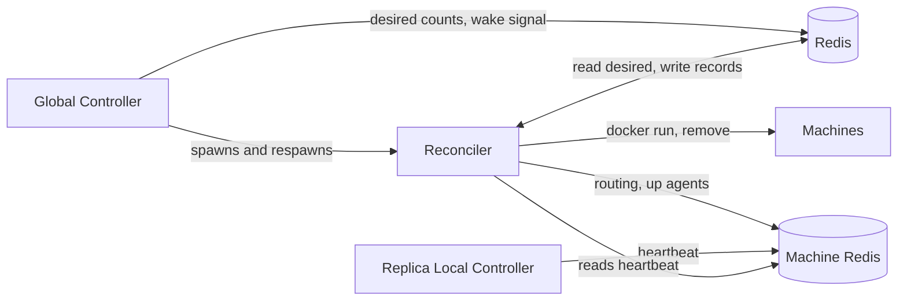
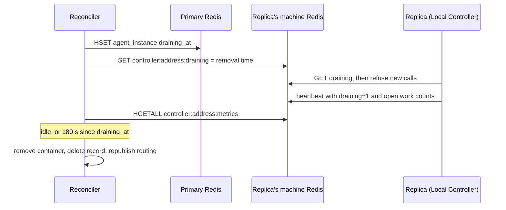

# Reconciler

On Docker and EC2, the Reconciler makes the replica counts in Redis come true. It starts
and stops machines and replicas until each agent runs what Redis says, drains the ones no
longer wanted, and publishes the routing table that calls follow.
On Kubernetes, the [operator](OPERATOR.md) does this work.

Because of it, scaling or replacing a replica is a Redis write and a wake signal. No
caller ever waits on Docker or EC2.

## How it fits

## How it works

- **Level-triggered.** Every pass compares the desired counts with the
  `agent_instance:*` records and acts on the difference, never on the event that woke
  it. A lost signal or a crash mid-pass costs latency, not correctness, and a periodic
  sweep converges even if every signal is lost.
- **The queue carries wake signals only:** an agent name or `"*"`, never "add 2". The
  count is already durable, and a re-delivered delta would skew it for good. One
  worker runs every reconcile, so two cannot race on one agent.
- **The workflow configs are the source of truth.** Startup and every reload write each
  agent's configured `replicas` over the desired count in Redis, so a runtime scale
  holds only until the next reload or redeploy.
- **Each pass removes, then fills.** A replica that is no longer wanted drains before
  it is removed. A database or an unhealthy replica is removed at once.
- **Scale-down drains the newest.** Replicas are sorted by `created_at`, so going from
  5 to 2 keeps the two oldest. A draining replica no longer counts, so its replacement
  starts in the same pass.

A pass wakes on one of three triggers: `"*"` on `reconciler:wake` (config reload, full
pass), agent names on `reconciler:wake` (a pass over those agents), or the sweep
interval (`poll_interval`, full pass). A burst of signals is one pass.

A full pass does this:

1. Adopts the agent specs the Global Controller published, and drops dead machines.
2. Removes or drains replicas that are unwanted, unhealthy or unfinished.
3. Publishes which agents are up.
4. Starts missing machines, terminates surplus ones, and launches missing replicas once
   `reconciler:images_ready` is set.

Each machine has a `machine_record:{launch_id}`, saved before the provider starts it, so
it can always be found and terminated. A new replica goes to the least loaded machine of
its provider. A launch is recorded before it starts, and `address` is written last, so a
half-started replica is removed on the next pass, never left running and forgotten.

## Redis schema

| Key                                                 | Written by                                                    | Read by                                       |
| --------------------------------------------------- | ------------------------------------------------------------- | --------------------------------------------- |
| `agent_instance:{replica_id}`                       | Reconciler, `address` last; `draining_at` when a drain starts | Reconciler, Global Controller                 |
| `machine_record:{launch_id}`                        | Reconciler, before the machine starts; `private_host` after   | Reconciler                                    |
| `routing_table:agents` / `:addresses` / `:stateful` | Reconciler, on every machine's Redis, draining ones left out  | routing clients                               |
| `routing_table:replicas`                            | Reconciler, every replica with a record, draining included    | Local Controller                              |
| `routing_table:up`                                  | Reconciler, every pass, on every machine's Redis              | governance, dashboard API                     |
| `controller:{address}:metrics`                      | the replica's Local Controller (the heartbeat)                | Global Controller, Reconciler                 |
| `controller:{address}:status`                       | the replica's Local Controller; the Reconciler for a database | Global Controller, Reconciler (`up` only)     |
| `controller:{address}:draining`                     | Reconciler, the removal time                                  | the replica's Local Controller                |

The full list of Reconciler keys is in `reconciler/state.py` and `reconciler/routing.py`.

Desired state and records live on the primary Redis. `controller:*` and `routing_table:*`
live on each machine's own Redis. The key formats are pinned by a fixture shared with the
operator, see [The Redis contract](OPERATOR.md#the-redis-contract). The controllers' own
keys are in [Controller](CONTROLLER.md#redis-keys).

## Process layout

The Reconciler is a separate OS process, not a thread. Provisioning is slow, blocking and
failure-prone (Docker, SSH, EC2), and must not stall the Global Controller's health
polling. The Global Controller's process supervisor spawns it, respawns it on every poll
tick unless the controller is stopping, and stops it last.

Only the Reconciler creates or removes a replica's container, and only it starts or
terminates a machine.

## Health and liveness

A replica is alive while it keeps writing a heartbeat.

- **What it is.** The `controller:{address}:metrics` hash. The replica's Local Controller
  rewrites it every `CANYONOS_POLL_INTERVAL` seconds (5 by default), with an
  `observed_at` timestamp.
- **Who reads it.** The Reconciler, every pass. The Global Controller reads the same hash
  to poll metrics.
- **Why not the status key.** `controller:{address}:status` reads `healthy` from startup,
  has no TTL, and is only set to `stopped` on a graceful exit. A killed container reads
  `healthy` forever.
- **When a replica is dead.** When its address does not accept a TCP connection, or its
  `observed_at` is older than 3 times `poll_interval`. Both checks must pass.
- **A database** has no Local Controller, so an open port is enough.
- **Startup grace.** A replica that has never been seen healthy is forgiven for
  `max(30, 3 * poll_interval)` seconds from `created_at`.
- **A Redis read error is not unhealthy.** An outage says nothing about the replica.

A dead replica is removed at once, with no drain, and a replacement starts in the same
pass. A replica is counted as up in `routing_table:up` when it is not draining, reports
`healthy` and has a fresh heartbeat.

## Draining a replica

A drain stops new work and waits for the work in flight: mark the replica, wait until it
is idle, then remove it.

- Marking writes `draining_at` once and the removal time every pass, so a failed write
  is retried. Routing leaves out any replica with `draining_at`.
- A replica is idle when it has seen the flag and has nothing queued, running, bound to
  it, or waiting to send.
- The limit is 180 s (`DRAIN_TIMEOUT_SECONDS`). A call still waiting then is failed.
- Once started, a drain runs to the end even if the replica is wanted again.
- A drain removes the replica, never its machine.

### On SIGTERM

A replica also starts the same drain when it receives SIGTERM, with no Reconciler
involved. Docker sends it on `docker stop`, Kubernetes when it rolls or scales down a pod.

`CANYONOS_SHUTDOWN_GRACE_SECONDS` tells the replica how long it has. The Reconciler
starts containers with a matching `--stop-timeout` of 180 s, and the operator sets it
from the pod's grace period. The replica drains until idle or until that time, then exits.

## Teardown

A stop is a drain of everything, converged through the loop, so the Reconciler is never
fighting the process tearing the fleet down. In order:

1. The Global Controller sets `reconciler:stopping` and wakes the Reconciler. It renews
   the flag every second, because it expires after 60 s.
2. While the flag is set, each pass drains every replica and terminates each machine
   once no replica is left on it. It never fills.
3. The Global Controller waits up to 240 s for every `agent_instance:*` and
   `machine_record:*` to go.
4. It stops the Reconciler, then clears the flag, then removes Redis if all of that
   succeeded.

The flag expires so that a controller killed mid-stop cannot hold the next run at zero.
Startup also clears it. The Global Controller's side is in [Controller](CONTROLLER.md).

## Config and spec handoff

Both processes resolve the config the same way: parse each file's YAML, then expand
`${VAR}` from the `.env` beside it (`load_deployment_config`). The `agents:` list does not get read twice. The Global
Controller publishes each spec as JSON, then the name list last, and the Reconciler
adopts them every pass, so a reload needs no signal handler there.

## Code

| `reconciler/reconciler.py`                  | The loop, one pass, removal, drain steps, health           |
| `reconciler/replica_provisioner.py`         | Launching replicas, the drain, unfinished launches         |
| `reconciler/machine_provisioner.py`         | Machine records: start missing, find dead and surplus      |
| `reconciler/state.py`                       | Desired counts, wake queue, replace and stopping flags     |

## Changing it

A change to the Redis records must keep the operator's writer
(`internal/redisstate/writer.go`) in step; see
[The Redis contract](OPERATOR.md#the-redis-contract).
