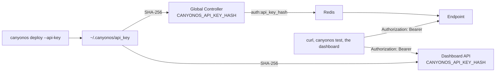

# API key

The goal is to keep anyone you didn't give the key to away from a deployed workflow and
the dashboard. CanyonOS checks one API key per machine, as vLLM does:

- The key is any string you choose. A request passes when it carries
  `Authorization: Bearer <your api key>` with that exact string.
- One key opens everything on the machine: every workflow group's endpoint and the
  dashboard API. There are no scopes and no users.
- The CLI's own `/v1/workflow-groups` routes on the dashboard API take a control key
  instead, which the CLI makes in `~/.canyonos/control_key`; see
  [Global Controller](../architecture/CONTROLLER.md#global-controller).
- With no key set, nothing is checked and everyone who reaches the endpoint or the
  dashboard can use it. `deploy` and `serve` warn about it.
- One key per workflow group is planned, not there yet.



## Set the key

Pick a key, for example with `openssl rand -hex 32`, and pass it to a deploy or to
`serve`:

```bash
canyonos deploy my-workflow --workflow-group my-group --api-key <your api key>
canyonos serve --api-key <your api key>
```

- The CLI saves it to `~/.canyonos/api_key`, readable only by you, and says
  `Your deploys now use an API key for secure connections.` It never shows the key or
  where it keeps it.
- Later deploys and serves reuse the saved key, so pass it once.
- `CANYONOS_API_KEY`, when set, is the key for that one command. It overrides the file
  and is never written to it.
- `--api-key ""` is refused: remove a key with `--no-api-key`.

## Replace or remove it

Pass a new key to `deploy` or `serve` the same way. It replaces the saved one:

- The dashboard and the workflow group you deploy use the new key at once.
- Every other running workflow group keeps the old key until you redeploy it.

`--no-api-key` on `deploy` or `serve` deletes `~/.canyonos/api_key`, and that deploy or
serve runs open. `--api-key` and `--no-api-key` don't mix.

`canyonos list` marks a workflow group deployed without a key `(unauthenticated)`.

## Send the key

To the endpoint, on port `8080` on a Docker deploy:

```bash
curl -X POST http://127.0.0.1:8080/<workflow_id> \
  -H "Authorization: Bearer <your api key>" \
  -H "Content-Type: application/json" -d '{"query": "your query"}'
curl -H "Authorization: Bearer <your api key>" http://127.0.0.1:8080/status/<request_id>
```

To the dashboard API, on port `3000`, from a script:

```bash
curl -H "Authorization: Bearer <your api key>" http://127.0.0.1:3000/workflows
```

- The `curl` lines the CLI prints show the `<your api key>` placeholder, never the key.
- `canyonos test`, `canyonos chat`, quickstart's own requests and the dashboard's
  sample data send the saved key themselves.
- The scheme matches in any case (`bearer`), and spaces around the key are dropped.

## Sign in to the dashboard

- `canyonos dashboard` signs you in: with a key set it opens
  `<dashboard url>/login#key=<your api key>`. The browser never sends the `#` fragment to
  a server, and the sign-in screen saves the key and drops the fragment.
- Elsewhere, the sign-in screen asks for the API key.
- A key the API stops accepting, after a replace, signs you out.
- With no key set, the dashboard opens with no sign-in.

## Who holds what

Only the CLI holds the key. Everything that checks it holds its SHA-256, in lowercase
hex, and compares in constant time.

| Where             | What holds the hash                                                                                                                  |
| ----------------- | ------------------------------------------------------------------------------------------------------------------------------------ |
| Global Controller | `CANYONOS_API_KEY_HASH`, set by `canyonos deploy`. It publishes it to every machine's Redis as `auth:api_key_hash`, empty for no key |
| Endpoint          | Reads `auth:api_key_hash` from its machine's Redis on each request                                                                   |
| Dashboard API     | `CANYONOS_API_KEY_HASH`, which the CLI writes into `~/.canyonos/dashboard/.env`                                                      |
| Kubernetes        | `spec.auth.apiKeyHash` on the workflow's CanyonBuild and CanyonProject; see [Kubernetes](KUBERNETES.md#dashboard)                    |

- On EC2, the key stays on the machine that runs `canyonos deploy`. Agent machines get
  only the hash, through Redis.
- A hash that is not 64 lowercase hex characters stops the Global Controller and the
  dashboard API from starting.
- `canyonos clean --all` deletes `~/.canyonos`, the key included.

## Refusals

| Status | `code`             | When                                                                                        |
| ------ | ------------------ | ------------------------------------------------------------------------------------------- |
| `401`  | `auth.missing_key` | No `Authorization: Bearer` header                                                           |
| `401`  | `auth.invalid_key` | A key that is not this machine's                                                            |
| `503`  | `auth.not_ready`   | The endpoint only: the Global Controller has not published the hash, or Redis can't be read |

- The endpoint answers `{"error": <message>, "error_name": <code>}`, and the dashboard
  API `{"error": <code>, "message": <message>}`.
- A `401` carries `WWW-Authenticate: Bearer`.
- A CORS preflight (`OPTIONS`) always passes.
