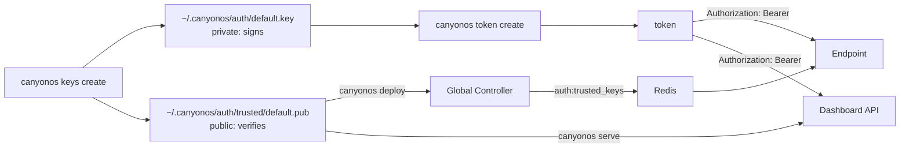

# Tokens and keys

A deployed workflow's endpoint and the dashboard API answer only requests that carry a
token. A token is a capability, not an account: whoever holds it may do what it grants,
and CanyonOS has no users or passwords. You sign tokens with the CLI, from a key pair you
make once.

- `canyonos deploy` never makes a key on its own: without one it refuses to start and
  prints the commands that make one.
- `canyonos quickstart` makes the first key as a step you see and type.
- Some commands sign a token for their own call: `canyonos test` (a new query token for
  each request it sends, valid for a minute, never shown), the sample data the
  dashboard gets after quickstart's first request (a write token valid for five
  minutes, never shown), and quickstart's first request (a query token valid for an
  hour, shown in the `curl` it asks you to type), and `canyonos dashboard` (a read and
  a write token valid for 8 hours, in the link it opens). Every other token is one you
  make with `canyonos token create`.



## The tokens

A token has one scope, which decides what it may reach:

| Scope   | For                          | It may                                                                                                                                              |
| ------- | ---------------------------- | --------------------------------------------------------------------------------------------------------------------------------------------------- |
| `query` | the endpoint of the deployment | `POST /<project>/<agent>/<method>`, `GET /status/<request_id>` and `POST /answer/<request_id>`, on the deployments it names, or on every deployment with `--all-projects` |
| `read`  | the dashboard API            | every `GET`, on every workflow the dashboard shows. It never changes anything                                                                       |
| `write` | the dashboard API            | every `POST`, `PUT` and `DELETE`, and the `GET`s of what it can change: a workflow's detail, scaling, governance and prompts                        |

- Every other `GET` (project list, stats, requests, logs, metrics, monitoring,
  resources) needs a read token. A script that reads those and also changes things
  holds both tokens and sends the one each request needs.
- An API token covers the whole dashboard, every workflow on it. Per-workflow API
  tokens are not there yet.
- A token has no expiry unless you give it one with `--ttl SECONDS`. The endpoint and
  the dashboard API still take a token for 60 seconds after it expires, in case the
  clock of the machine that signed it and theirs disagree, and neither checks when it
  was signed.
- A token is shown once and stored nowhere. Keep it as you would a password.

## Make a key, deploy, then make a token

**1. Make a key pair**, once per machine that signs tokens:

```bash
canyonos keys create
```

It writes the private key `~/.canyonos/auth/default.key`, readable only by you, and its
public half `~/.canyonos/auth/trusted/default.pub`. The private key signs and never
leaves the machine. Deploys and the dashboard trust every public key in `trusted/`.
`--name <name>` makes another pair beside it; a name uses only `[A-Za-z0-9._-]`
and does not start with a dot. `canyonos quickstart` runs this step for you on a
machine with no key, as a step you see.

**2. Deploy.** `canyonos deploy` hands every public key in `trusted/` to the workflow.
With none, it stops before it builds anything, says `No key is trusted in ...`, and
prints the `keys create` and `token create` commands. `canyonos serve` refuses the same
way.

**3. Make a token.** For the deployment, from its folder:

```bash
canyonos token create --scope query
```

It is for the deployment of that folder's `deployment.yaml`. From any other folder, it
is for the deployment `canyonos select-context <deployment>` picked; `canyonos list`
shows them with their IDs. `--project <deployment_id>` names a deployment instead,
by the ID as `deployment.yaml` writes it, a lowercase UUID, and repeats for more;
`--all-projects` makes a token for every deployment. For the dashboard API:

```bash
canyonos token create --scope read
canyonos token create --scope write
```

The token alone goes to stdout, and what it grants, when it expires, how to send it and
how to rotate it go to stderr, so `$(canyonos token create ...)` is the token. With more
than one private key, `--key <name>` picks the one to sign with. The command warns when
the private key is readable by other users, or when `trusted/` no longer holds its
public half, since nothing would accept the token then.

`canyonos test` and `canyonos quickstart` sign their own query token with your key, so
they need no token from you.

### Other commands

| Command                      | What it does                                                                                                                            |
| ---------------------------- | --------------------------------------------------------------------------------------------------------------------------------------- |
| `canyonos keys list`         | Each public key in `trusted/`: its name, its key ID and its file                                                                        |
| `canyonos keys trust <file>` | Trusts a public key made elsewhere, such as a teammate's, as `trusted/<name>.pub`, `<name>` being the file's name without its extension |
| `--auth-dir PATH`            | On every `keys`, `token`, `deploy`, `serve`, `test`, `chat` and `dashboard` command: a folder of keys other than `~/.canyonos/auth`     |

`deploy` refuses an `--auth-dir` inside any project folder it deploys, and `serve` one
inside the project folder it runs in: a project's files go into its images and, on
Kubernetes, the upload to the cluster, so the private keys would go with them.

A key ID is the start of the public key's SHA-256; every token carries the ID of the key
that signed it in its `kid` header. `keys trust` takes an Ed25519 public key in PEM, and
refuses a private key.

## Send a token

Send it as the header `Authorization: Bearer <token>`, to the endpoint:

```bash
TOKEN=$(canyonos token create --scope query)
curl -X POST http://127.0.0.1:8080/<project>/<agent>/<method> -H "Authorization: Bearer $TOKEN" \
  -H "Content-Type: application/json" -d '{"query": "your query"}'
curl -H "Authorization: Bearer $TOKEN" http://127.0.0.1:8080/status/<request_id>
```

On the **dashboard**, `canyonos dashboard` signs you in on the machine that holds the
key: it opens the dashboard with a read and a write token valid for 8 hours in the
link's `#read=…&write=…` fragment, which the browser never sends to a server, and the
sign-in screen stores them and removes the fragment from the address and its history.
Without a terminal or a browser it prints the link, which signs in whoever opens it
until the tokens expire. A link whose token the dashboard refuses, such as one signed
by a key made after `canyonos serve`, stays on the sign-in screen with the reason.

Elsewhere, the sign-in screen asks for a read token and a write token. Give one or
both:

- With a read token, every page shows, and every change is refused with the API's
  message.
- With a write token, you can change prompts, scaling and governance. What only a read
  token reads, the projects list, costs, traces, logs and metrics among it, shows the
  API's refusal instead of its data, so open a deployment at `/projects/<deployment_id>`.
- The browser keeps the tokens until you sign out from the account menu, which shows the
  tokens you hold. A token the API stops accepting, after a rotation, signs you out.

**Scripts and bots** send the same header to the dashboard API, at
`http://127.0.0.1:3000` on a Docker deploy:

```bash
READ_TOKEN=$(canyonos token create --scope read)
curl -H "Authorization: Bearer $READ_TOKEN" http://127.0.0.1:3000/projects
```

## Refusals

| Status | `code`                    | When                                                                                                                      |
| ------ | ------------------------- | ------------------------------------------------------------------------------------------------------------------------- |
| `401`  | `auth.missing_token`      | No `Authorization: Bearer` header                                                                                         |
| `401`  | `auth.invalid_token`      | Expired, signed by a key that is not trusted, or meant for something else, such as a dashboard token sent to the endpoint |
| `403`  | `auth.insufficient_scope` | A token for the right place but of another scope, such as a read token on a change                                        |
| `503`  | `auth.not_ready`          | The endpoint only: the Global Controller has not published the trusted keys yet, or Redis can't be read                   |

The endpoint answers `{"error": <message>, "error_name": <code>}`, and the dashboard API
`{"error": <code>, "message": <message>}`. The message says what is wrong, for example
`This token is for the dashboard API, not for a workflow`.

## Rotate a key

There is no way to revoke one token. Rotating its key is the only way to stop it, and it
stops every token that key signed.

1. Make a new key: `canyonos keys create --name <new_name>`.
2. Delete the old key's `.pub` from `~/.canyonos/auth/trusted/`, and its `.key` once
   you no longer sign with it. While both private keys are there, `token create` asks
   for `--key`.
3. Redeploy each deployment (`canyonos deploy <project folder>...`), so its endpoint
   trusts the new keys.
4. Restart the dashboard with `canyonos serve`: its API reads the keys only when it
   starts, and a deploy leaves a running dashboard as it is.
5. Make new tokens, and give them to whoever held the old ones.

On Kubernetes, step 4 is the operator's: it rolls the cluster dashboard's API once a
redeploy changes the keys. `canyonos keys trust` on a running deploy needs the same
redeploy and restart.

## Where keys live

The rules are the same on every target. What changes is how the public keys reach the
endpoint and the dashboard API. Private keys stay on the machine that signs.

| Target     | Where the keys are                                                                                                                                                                                                                                                                                                                            |
| ---------- | --------------------------------------------------------------------------------------------------------------------------------------------------------------------------------------------------------------------------------------------------------------------------------------------------------------------------------------------- |
| Docker     | `~/.canyonos/auth/` on this machine. The deploy hands the public keys to the Global Controller, which publishes them to the workflow's Redis for the endpoint. The dashboard's API container mounts `trusted/` read-only, so the dashboard needs the Docker engine on this machine                                                            |
| EC2        | `~/.canyonos/auth/` on the deploying machine, which runs `canyonos deploy`. Sign there, or sign on your own computer and register its `.pub` on the deploying machine with `canyonos keys trust`. Agent machines need no keys: the Global Controller publishes them to every machine's Redis                                                  |
| Kubernetes | `~/.canyonos/auth/` on the machine that runs `canyonos deploy`. The deploy puts its public keys in the workflow's CanyonProject, under `spec.auth.trustedKeys` (`kubectl -n <namespace> get canyonproject -o yaml` shows them). The cluster dashboard trusts every key any of its workflows trusts; see [Kubernetes](KUBERNETES.md#dashboard) |

- The folder `~/.canyonos/auth/` is readable only by you, and each `.key` is a `0600`
  file. `trusted/` and its `.pub` files are readable by everyone, because the dashboard
  API's container runs as another user.
- Only files ending in `.pub`, and not starting with a dot, count as keys.
- `canyonos clean --all` deletes `~/.canyonos`, keys included. Copy the keys out first
  to keep them.

## Skip it for a throwaway run

`--dangerous-skip-auth` deploys or serves without a key, and with no token checked:
anyone who reaches the endpoint or the dashboard can use it. Use it only for a run
nobody else can reach.

| Command                                             | What answers without a token                                                                              |
| --------------------------------------------------- | --------------------------------------------------------------------------------------------------------- |
| `canyonos deploy --dangerous-skip-auth`             | The endpoint, and the dashboard when this deploy starts it. A dashboard already running keeps its setting |
| `canyonos serve --dangerous-skip-auth`              | The dashboard, restarted with verification off                                                            |
| `canyonos deploy --dangerous-skip-auth`, Kubernetes | The endpoint only. The cluster dashboard follows its chart's `dashboard.dangerousSkipAuth`                |
| `canyonos serve --dangerous-skip-auth`, Kubernetes  | Nothing: it only opens the dashboard without checking this machine has a key                              |

`canyonos list` marks a deployment deployed this way `(unauthenticated)`. To turn
verification back on, run `canyonos deploy` and `canyonos serve` again without the
option.
