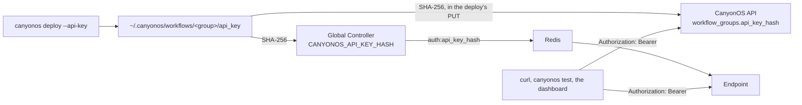

# API key

The goal is to keep anyone you didn't give the key to away from a deployed workflow and
its dashboard. Each workflow group has its own API key:

- The key is any string you choose. A request passes when it carries
  `Authorization: Bearer <your api key>` with that exact string.
- A workflow group's key opens its endpoint and its routes on the CanyonOS API, and
  never another workflow group's. There are no scopes and no users.
- A workflow group deployed with no key is open: nothing is checked, and everyone who
  reaches its endpoint or its dashboard routes can use them. `deploy` warns about it.
- Changing one workflow group's key touches only that workflow group: the CanyonOS API
  keeps running, and every other workflow group keeps its own key.

**Estimated time:** under a minute. Setting the key is one flag on a deploy; see
[Set the key](#set-the-key).



## Set the key

Pick a key, for example with `openssl rand -hex 32`, and pass it to the deploy:

```bash
canyonos deploy my-workflow --api-key <your api key>
```

- The CLI saves it in the workflow group's record,
  `~/.canyonos/workflows/<workflow group>/api_key`, readable only by you, and says
  `This workflow group now uses an API key for secure connections.` It never shows the
  key.
- Later deploys of that workflow group reuse it, so pass it once.
- `CANYONOS_API_KEY`, when set, is the key for that one command, for whichever workflow
  group it acts on. It overrides the record and is never written to it. While it is
  set, `--no-api-key` and an `--api-key` with another key are refused, since later
  commands would send it: unset it, or set it to the new key.
- `--api-key ""` is refused: remove a key with `--no-api-key`.

## Replace or remove it

Redeploy the workflow group with the new key: `canyonos deploy my-workflow --api-key
<new key>`. That is the whole rotation:

- The workflow group's endpoint and its dashboard routes take the new key from the next
  request. The old one stops working.
- Other workflow groups and the CanyonOS API are left as they are.

`--no-api-key` removes the workflow group's key, and the deploy runs it open.
`--api-key` and `--no-api-key` don't mix. `canyonos list` marks a workflow group
deployed without a key `(unauthenticated)`.

`canyonos stop` keeps the workflow group's key: the dashboard still shows its workflows'
history to that key, and to no other. Deploying it again takes that key or the deploy
key; a stopped workflow group that had no key takes the deploy key only.

A CLI from before per-workflow-group keys kept one key in `~/.canyonos/api_key`. The
first deploy copies it into every record that has none, the deployed workflow group's
included, then deletes the file. A Docker workflow group still deployed with
`--no-api-key` is skipped; a stopped one, or one on Kubernetes, takes the key, which its
next deploy then sets. Until that deploy, a command that only reads a key, such as
`canyonos curl`, sends none.

The CanyonOS API forgot a workflow group stopped before this change, and its key with it:
its workflows stay hidden, to every key, until the workflow group is deployed again,
which brings its key back.

## The deploy key

On Docker the CLI deploys, stops and reads workflow groups through the CanyonOS API's
`/v1/workflow-groups` routes. It authorizes those calls with this machine's deploy key,
not with a workflow group's key:

- The CLI makes it once, in `~/.canyonos/dashboard/deploy_key`, readable only by you,
  and hands the API its SHA-256 as `CANYONOS_DEPLOY_KEY_HASH`. You never type it.
- It is the only key that creates a workflow group, so nobody who merely reaches the
  API's port can start containers on the machine.
- A workflow group's routes also take that workflow group's own key, or no key while it
  has none. Its key never opens another workflow group's routes.
- The deploy key doesn't open the dashboard routes or `/v1/workflows`.
- A deploy registers its workflows with the dashboard. A workflow another workflow group
  holds moves over only when the caller opens that workflow group too: with its key, the
  deploy key, or no key while it has none. Otherwise the registration is refused with
  `409`, and the workflow stays where it is.

On Kubernetes these routes take your Kubernetes login instead; see
[Kubernetes](KUBERNETES.md#dashboard). There is no deploy key there.

## Send the key

To the endpoint, on port `8080` on a Docker deploy:

```bash
curl -X POST http://127.0.0.1:8080/<workflow_id> \
  -H "Authorization: Bearer <your api key>" \
  -H "Content-Type: application/json" -d '{"query": "your query"}'
curl -H "Authorization: Bearer <your api key>" http://127.0.0.1:8080/status/<request_id>
```

To the dashboard API, on port `3000`, from a script:

```bash
curl -H "Authorization: Bearer <your api key>" http://127.0.0.1:3000/v1/workflows
```

- `/v1/workflows`, `/v1/workflows/<workflow_id>` and `/v1/resources/overview` answer
  with the workflows of the workflow groups the key opens, and of the open ones. With no
  key, the open ones only.
- The routes under `/v1/workflow-groups/<workflow_group_id>/workflows/<workflow_id>/`
  take that workflow group's key. Another workflow group's key gets `404`, as for a
  workflow that is not there: it is a good key, and that workflow is not its own.
- The `curl` lines the CLI prints show the `<your api key>` placeholder, never the key.
- `canyonos test`, `canyonos curl`, `canyonos chat`, quickstart's own requests and the
  dashboard's sample data send the key of the workflow group they act on themselves.
- The scheme matches in any case (`bearer`), and spaces around the key are dropped.

## Sign in to the dashboard

- `canyonos dashboard` signs you in with the key of the workflow group it acts on: it
  opens `<dashboard url>/login#key=<your api key>`. The browser never sends the `#`
  fragment to a server, and the sign-in screen saves the key and drops the fragment.
- Elsewhere, the sign-in screen asks for a workflow group's API key. A dashboard beside a
  Global Controller you run yourself (self-host) takes the key that controller was
  deployed with: the API reads its hash from the controller's Redis as it starts.
- Signed in, the dashboard shows the workflows of the workflow groups that key opens,
  and the open ones. To see another workflow group, sign in with its key.
- A key the API stops accepting, after a redeploy with another key, signs you out.
- While no workflow group has a key, the dashboard opens with no sign-in.

## Who holds what

Only the CLI holds the keys. Everything that checks one holds its SHA-256, in lowercase
hex, and compares in constant time.

| Where             | What holds the hash                                                                                                                         |
| ----------------- | ------------------------------------------------------------------------------------------------------------------------------------------- |
| CanyonOS API      | Each workflow group's in `workflow_groups.api_key_hash`, from its deploy's PUT; read on every request, so a new key holds from the next one |
| Global Controller | `CANYONOS_API_KEY_HASH`, its own workflow group's, set by its deploy. It publishes it to every machine's Redis as `auth:api_key_hash`       |
| Endpoint          | Reads `auth:api_key_hash` from its machine's Redis on each request                                                                          |
| Deploy key        | `CANYONOS_DEPLOY_KEY_HASH` on the Docker API, which the CLI writes into `~/.canyonos/dashboard/.env`                                        |
| Kubernetes        | `spec.auth.apiKeyHash` on each workflow group's CanyonBuild and CanyonProject, which the API reads back when it starts                      |

- On EC2, the key stays on the machine that runs `canyonos deploy`. Agent machines get
  only the hash, through Redis.
- A deploy's `api_key_hash` that is not 64 lowercase hex characters (or `""` for none)
  is refused with `422`.
- `canyonos clean` deletes a workflow group's record, its key included; `clean --all`
  deletes all of `~/.canyonos`, the deploy key included.

## Refusals

| Status | `code`                    | When                                                                                                                           |
| ------ | ------------------------- | ------------------------------------------------------------------------------------------------------------------------------ |
| `401`  | `auth.missing_key`        | No `Authorization: Bearer` header, on a workflow group that has a key, or on a new one                                         |
| `401`  | `auth.invalid_key`        | A key that opens no workflow group, or, on a workflow group's `/v1/workflow-groups` routes, neither its key nor the deploy key |
| `404`  | `workflows.not_found`     | A dashboard route of a workflow the key's workflow groups don't hold, with a key that opens another workflow group             |
| `409`  | `registry.workflow_taken` | A deploy registers a workflow another workflow group holds, which only that workflow group's key, or the deploy key, moves     |
| `503`  | `database.unavailable`    | The CanyonOS API: its database is not ready, so it can't read the keys                                                         |
| `503`  | `auth.not_ready`          | The endpoint only: the Global Controller has not published the hash, or Redis can't be read                                    |

- The endpoint answers `{"error": <message>, "error_name": <code>}`, and the dashboard
  API `{"error": <code>, "message": <message>}`.
- A `401` carries `WWW-Authenticate: Bearer`.
- The dashboard API checks the key before it reads anything else the request sends, so a
  request without the key gets `401` whatever it holds.
- A workflow group the API holds no row for is nobody's: its dashboard routes refuse
  every key, `404` to a good one and `401` to any other.
- The dashboard signs you out on a `401` only: a link to a workflow your key doesn't
  open shows it as not found and keeps you signed in.
- A CORS preflight (`OPTIONS`) passes, except on the `/v1/workflow-groups` routes the CLI
  deploys and stops through, which serve no browser: there a preflight gets no CORS
  grant.
